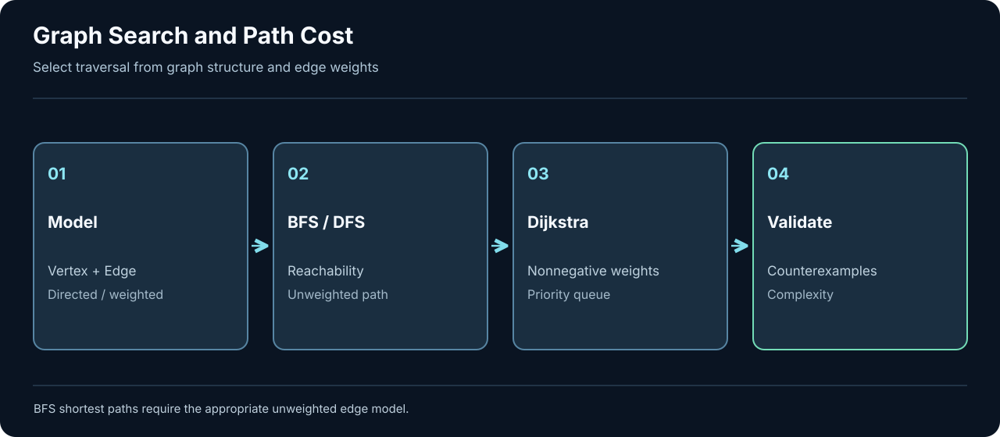

## 먼저 그래프 모델부터 확인하기

노드와 간선이 있다고 무조건 BFS로 최단경로를 찾을 수 있는 것은 아니다. **가중치가 없는가, 음수 간선이 있는가, 방향성이 있는가**가 알고리즘 선택을 결정한다.



## 그래프 표현

| 표현 | 공간 | 장점 | 주의 |
| --- | --- | --- | --- |
| Adjacency list | O(V+E) | Sparse graph에 유리 | 간선 존재 확인 비용 |
| Adjacency matrix | O(V²) | 임의 두 노드 간 확인 쉬움 | 큰 V에 비효율 |
| Edge list | O(E) | Kruskal·일괄 간선 처리 | 인접 탐색에는 추가 구조 |

무방향 그래프라면 간선을 양쪽에 저장해야 하는 경우가 많다. 입력이 1-indexed인지 0-indexed인지도 먼저 확인한다.

## BFS: Unweighted shortest path

BFS는 시작점에서 **간선 수 기준으로 가까운 노드부터 탐색**한다. 모든 간선의 비용이 동일한 무가중치 그래프에서 최단거리 계산에 적합하다.

```python
from collections import deque

def bfs(graph, start):
    dist = [-1] * len(graph)
    q = deque([start])
    dist[start] = 0
    while q:
        u = q.popleft()
        for v in graph[u]:
            if dist[v] == -1:
                dist[v] = dist[u] + 1
                q.append(v)
    return dist
```

노드를 **큐에 넣을 때 방문 처리**하지 않으면 같은 노드가 여러 번 들어갈 수 있어 시간·메모리 비용이 증가할 수 있다.

## DFS는 BFS와 언제 다른가

DFS는 깊게 탐색하며 연결 요소, cycle detection, topological sort, backtracking 등에 활용할 수 있다. 그러나 일반적으로 **무가중치 최단경로를 가장 먼저 발견한다는 보장은 없다**.

재귀 DFS는 입력이 깊으면 재귀 깊이와 stack 사용량 문제가 생길 수 있으므로 iterative stack을 검토한다.

## Dijkstra는 어떤 가중치에서?

Dijkstra는 일반적으로 **비음수 간선 가중치**의 최단경로를 구하는 데 쓴다. Python에서는 `heapq`로 우선순위 큐를 구현할 수 있다.

```python
import heapq

def dijkstra(graph, start):
    INF = float("inf")
    dist = [INF] * len(graph)
    dist[start] = 0
    pq = [(0, start)]
    while pq:
        d, u = heapq.heappop(pq)
        if d != dist[u]:
            continue
        for v, w in graph[u]:
            nd = d + w
            if nd < dist[v]:
                dist[v] = nd
                heapq.heappush(pq, (nd, v))
    return dist
```

음수 간선이 존재하면 Dijkstra의 가정이 깨질 수 있다. 그때는 Bellman–Ford 등 다른 문제 모델을 고려한다.

## Union-Find

Disjoint-set union은 **원소들이 같은 연결 요소에 속하는지**를 관리한다. Path compression과 union by size/rank를 함께 쓰면 여러 연산을 거의 상수에 가까운 amortized 비용으로 처리할 수 있다.

| 연산 | 의미 |
| --- | --- |
| `find(x)` | x가 속한 집합 대표 찾기 |
| `union(a,b)` | 두 집합 합치기 |
| Same set | 연결 관계 판단 |

Union-Find는 **최단거리 알고리즘이 아니다**. 연결성, Kruskal MST 등에서 사용하는 자료구조다.

## 문제 유형별 선택

| 상황 | 우선 고려 |
| --- | --- |
| 방문·연결 요소 | BFS / DFS |
| 모든 간선의 비용이 같음 | BFS |
| 비음수 가중치 최단경로 | Dijkstra |
| 음수 가중치 처리 | Bellman–Ford 등 |
| MST | Kruskal + Union-Find / Prim |
| DAG ordering | Topological sort |
| Dynamic connectivity | 별도 구조·오프라인 접근 검토 |

## 반례와 테스트

- 시작점과 도착점이 같은 경우.
- 연결되지 않은 노드가 있는 경우.
- Self loop와 parallel edge.
- 방향성 반대로 해석한 경우.
- 간선 비용이 0인 경우.
- 큰 정점 수와 sparse/dense graph의 차이.
- Python recursion depth 초과.

## 확인할 질문

1. BFS는 어떤 조건에서 최단거리를 보장하는가?
2. DFS의 첫 발견 경로가 최단경로가 아닌 이유는?
3. Dijkstra에서 오래된 PQ 항목을 무시하는 이유는?
4. Union-Find가 최단거리를 계산하지 않는 이유는?
5. 인접 리스트와 행렬 중 어느 것이 메모리에 유리한가?

## 참고자료

- [CP-Algorithms: Graph](https://cp-algorithms.com/graph/)
- [Python collections](https://docs.python.org/3/library/collections.html)
