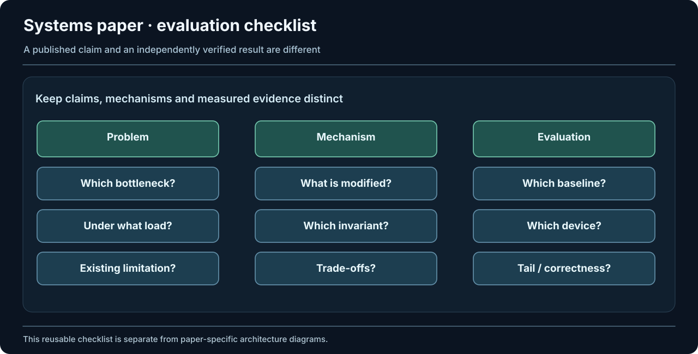

## 1. 세 논문을 같이 읽으면 보이는 공통 질문

**D2FS, OPIMQ, DJFS**는 모두 OSLab의 FAST 2025 연구지만, 다루는 병목이 다르다. 하나는 GC의 위치를 바꾸고, 하나는 다중 큐에서 쓰기 순서를 보존하며, 하나는 journaling transaction의 단위를 재설계한다.

| 논문 | 핵심 문제 | 연구할 계층 |
| --- | --- | --- |
| **D2FS** | Log-structured filesystem GC의 중복·비용 | Filesystem ↔ Device |
| **OPIMQ** | Multi-queue I/O에서 storage order 제어 | Linux I/O stack ↔ FTL |
| **DJFS** | 전역 journaling으로 인한 lock/commit 경쟁 | Filesystem metadata/journal |

## 2. D2FS의 출발점: 누가 GC를 수행하는가?

D2FS의 공개 Abstract는 **Flash 장치 내부의 GC 기능을 활용해 파일시스템의 GC 부담을 줄이려는 방향**을 설명한다.

대표 구성요소는 다음과 같이 소개된다.

- **Coupled Garbage Collection:** 장치에서 유효 Flash 페이지를 모으고 파일시스템의 논리 위치와 연결한다.
- **Migration Upcall:** 장치에서 진행된 데이터 이동·mapping 변경을 호스트에 통지하는 메커니즘.
- **Virtual Overprovisioning:** 공간 관리 및 장치 GC와 파일시스템의 관계를 설계하는 요소.

이 이름들을 암기하는 것보다 먼저 **파일시스템과 FTL이 각각 어떤 정보를 알고 있으며, 데이터가 이동하면 양쪽 metadata를 어떻게 일치시키는지**를 이해해야 한다.

## 3. OPIMQ: 여러 큐가 왜 순서를 어렵게 만드는가?

NVMe와 blk-mq는 높은 병렬성을 제공하지만, 명령이 서로 다른 queue에서 처리되면 **애플리케이션의 논리적 쓰기 순서를 그대로 저장장치가 지켜준다고 가정할 수 없다**.

OPIMQ의 공개 Abstract는 네 요소를 제시한다.

1. **Epoch Pinning**
2. **Dual-Stream Write**
3. **Order-Preserving Mapping Table Update**
4. **Sibling-aware Delayed Mapping**

각 메커니즘이 intra-stream 또는 inter-stream 순서를 어떤 방식으로 다루는지 본문에서 확인해야 한다. 특히 **Block request completion과 durable storage order가 다를 수 있음**을 이해하는 것이 출발점이다.

## 4. DJFS: Journaling transaction의 granularity

DJFS는 **per-directory transaction**을 통해 journaling의 contention과 commit 병렬성을 개선하려는 연구다. 공개 소개의 핵심 요소는 다음과 같다.

- **Path-based transaction selection**
- **Transaction coalescing**
- **Transaction conflict resolution**

왜 디렉터리 단위로 묶으면 유리할 수 있는지, cross-directory rename 등 관계가 복잡한 상황에서는 어떻게 일관성을 보존하는지를 집중해서 읽고 싶다.

## 5. 공통으로 확인할 파일시스템 개념

| 배경 개념 | D2FS | OPIMQ | DJFS |
| --- | --- | --- | --- |
| FTL와 Flash GC | 핵심 | Mapping ordering | 간접 관련 |
| Filesystem metadata | GC 시 relocation | Write ordering | Journal transaction |
| Device queue | GC I/O와 경쟁 | 핵심 | Commit path |
| Crash consistency | Mapping update의 복구 | Persistent order | Journal correctness |
| Performance | GC overhead | Ordering overhead | Lock contention |

## 6. Baseline과 workload를 검토하기

공개 Abstract의 성능 수치만 외우지 않고 다음 질문을 남긴다.

- Baseline은 vanilla Linux/F2FS인가? 수정된 다른 구현인가?
- Hardware prototype과 emulator를 구분했는가?
- Queue depth, thread 수, filesystem 상태를 공정하게 맞췄는가?
- Correctness 테스트는 어느 failure model에서 진행했는가?
- 수치를 얻은 workload 외에서도 효과가 있는가?

세 논문을 통합해서 하나의 benchmark 성능 순위를 만드는 것은 **실험 목적과 장치 조건이 다르므로 적절하지 않다**.

## 7. 논문별 읽기 과제

### D2FS

Data migration 후 호스트가 가지고 있던 mapping 정보를 어떻게 갱신할지, 동시에 foreground I/O가 들어올 때 어떤 race가 생길 수 있을지 그려 보자.

### OPIMQ

A→B가 논리적으로 순서 의존 관계인 두 쓰기를 생각해 보자. 서로 다른 SQ에서 B가 먼저 완료됐을 때 어떤 규칙이 A-before-B를 유지하게 하는지 읽어 보자.

### DJFS

같은 디렉터리와 서로 다른 디렉터리의 파일 변경을 비교해 lock contention이 언제 감소하는지 가정해 보자. Cross-directory operation이 어떻게 처리되는지 확인하자.

## 8. 내 학습 단계 표기

여기서 다룬 내용은 **공개 Abstract와 논문 메타데이터에 기반한 사전 학습 정리**다. 아직 각 논문의 full implementation과 evaluation을 모두 검증하거나 재현한 결과로 표시하지 않는다.

## 참고자료

- [D2FS — USENIX FAST 2025](https://www.usenix.org/conference/fast25/presentation/kim-juwon)
- [OPIMQ — USENIX FAST 2025](https://www.usenix.org/conference/fast25/presentation/kim-jieun)
- [DJFS — USENIX FAST 2025](https://www.usenix.org/conference/fast25/presentation/yoo)
- [OSLab Publications](https://oslab.kaist.ac.kr/publications/)
