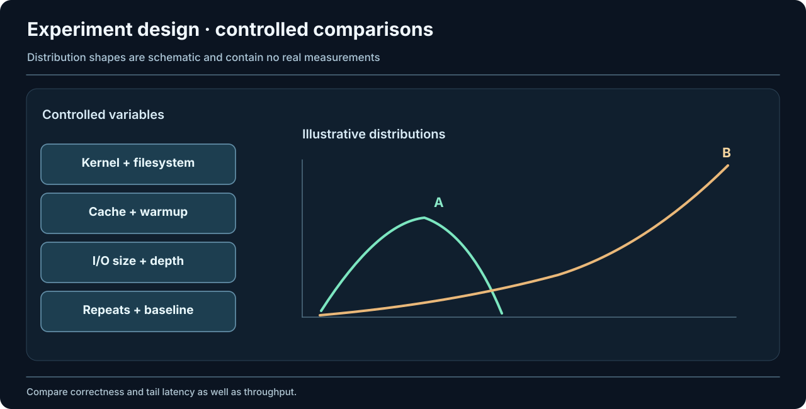

## 1. 성능이 개선됐다는 말에 필요한 증거

실험 전보다 benchmark 숫자가 높아졌다고 해서 알고리즘 덕분이라고 결론 내릴 수는 없다. **어떤 변수를 바꿨고 무엇을 일정하게 유지했는지** 확인해야 한다.



## 2. 가설을 반박 가능하게 정의하기

나쁜 예: “새로운 구조가 더 빠를 것이다.”

개선한 예: “동일 NVMe 장치와 같은 4 KiB random write workload에서, 방법 A가 CPU-side metadata 처리 시간을 줄여 p99 latency를 낮출 것이다.”

후자는 **측정 대상을 정의**하고, 그렇지 않을 경우 가설이 틀렸다고 판단할 수 있다.

## 3. Baseline의 공정성

| 변수 | 기록할 값 | 바뀌면 생길 문제 |
| --- | --- | --- |
| Kernel commit | 정확한 hash/tag | 다른 코드 경로 |
| Filesystem version | Ext4/F2FS 구현 | 다른 GC/journal 정책 |
| Mount option | journaling/sync 등 | Durability 계약 차이 |
| Device model | SSD/virtual disk | 성능·GC 특성 차이 |
| CPU/memory | 코어 수, NUMA | Scheduling 차이 |
| Workload | read/write mix, size, depth | 비교 대상 불일치 |
| Warmup | Cache/device 상태 | 초기 효과가 결과를 지배 |

메커니즘의 효과를 보려면 **관련 없는 변경은 최소화**해야 한다.

## 4. 반복 횟수와 분포

평균값 하나는 storage tail latency를 설명하기 어렵다. p50/p95/p99뿐 아니라 표본 수, 분포, 반복 실험의 변동폭을 함께 기록한다.

특히 GC나 background compaction은 실행 구간에 따라 결과가 크게 달라질 수 있어 **각 실험 시작 상태**가 중요하다.

## 5. Correctness도 성능과 같은 수준으로 확인한다

파일시스템 변경이 빠르더라도 파일의 내용이 손상되면 성공이 아니다. 검증 항목은 다음을 포함할 수 있다.

- Read/write 데이터 checksum.
- 예상된 persistence와 crash recovery 조건.
- Mount/replay 가능 여부.
- 동시성 실행에서 lost update 유무.
- 오류·timeout 시 의미 있는 반환값.
- 측정 도구의 dropped event 여부.

## 6. Negative result 기록

가설과 다른 결과가 나왔다면 다음을 남긴다.

1. 원래 예상 메커니즘.
2. 실제 workload·환경.
3. 관측한 결과와 오차.
4. 예상과 다른 지점.
5. 수정된 가설.
6. 재검증할 다음 실험.

실패한 실험을 삭제하면 같은 실수를 반복하기 쉽다. **Negative result도 새로운 지식**이 될 수 있다.

## 7. 실험 노트 템플릿

```text
Question:
Hypothesis:
Test environment:
Kernel/FS/device version:
Baseline:
Changed variable:
Workload matrix:
Measurement commands:
Raw output location:
Correctness checks:
Repeated runs:
Median/p95/p99:
Observed:
Interpreted:
Counter-evidence:
Limitations:
Next test:
```

`Observed`와 `Interpreted`를 분리하면 우연한 상관관계를 근본 원인이라고 쓰는 일을 줄일 수 있다.

## 8. 그림을 만드는 기준

Architecture diagram은 **실제 구현 경계**를 보여줘야 하고, 성능 그래프는 **축·단위·baseline·sample size**가 있어야 한다. 장식적인 SVG가 실제 측정을 대체하지 못한다.

## 9. 복습 질문

- 개선 효과가 두 번째 실행에서만 나온다면 어떤 상태를 의심할까?
- p99 차이가 있지만 sample 수가 매우 적으면 어떻게 결론 낼까?
- Baseline을 더 좋게 tuning했을 때 효과가 사라진다면 어떻게 해석할까?
- 성능과 정확성 검증을 별개 부록으로 두면 안 되는 이유는?

## 참고자료

- [fio documentation](https://fio.readthedocs.io/)
- [USENIX Artifact Evaluation](https://www.usenix.org/conferences/artifact-evaluation)
- [OSTEP](https://pages.cs.wisc.edu/~remzi/OSTEP/)
