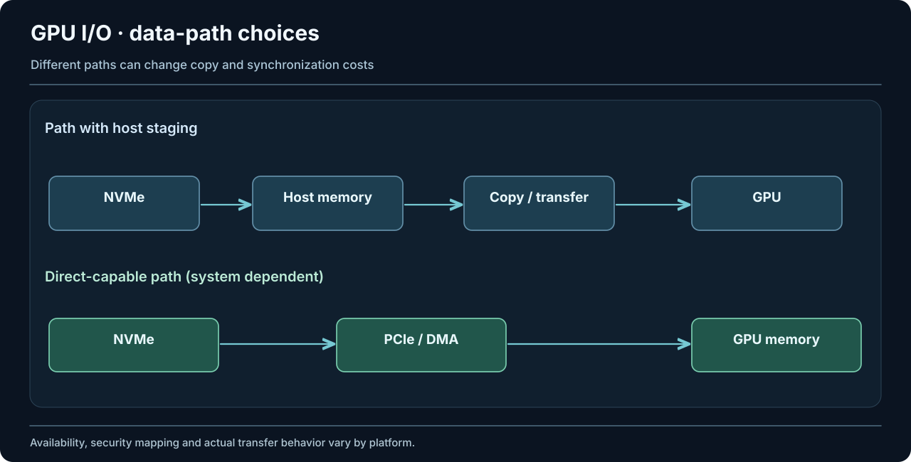

## 1. NVMe가 빨라도 I/O 경로 전체가 빠르다는 뜻은 아니다

저장장치의 완료 시간과 애플리케이션이 체감하는 지연에는 **파일시스템·block queue·CPU 처리·메모리 복사·GPU 데이터 준비** 등 여러 비용이 있다.

OSLab의 공개 연구 목록에는 **f2trace: Low-Overhead Memory-Efficient NVMe Queue-Level I/O Tracer(ICPADS 2026)**와 **Understanding the Performance Characteristics of GPUDirect Storage(NVMSA 2026 poster)**가 있다. 이 글은 두 연구를 읽기 위한 배경과 측정 질문을 정리한 것이며 공개 논문 전체를 재현한 글이 아니다.

## 2. 일반적인 I/O 경로의 비용

| 경계 | 관찰할 비용 |
| --- | --- |
| User application | 요청 준비, batching, parsing |
| File API / VFS | 경로와 객체 처리 |
| Page cache / memory | Cache hit·miss, copy, allocation |
| Block layer / blk-mq | Queueing, request merging |
| NVMe device | 명령 실행, completion |
| GPU ingestion | Buffer transfer, synchronization, memory placement |

이 경계가 분명해야 “NVMe latency를 측정한다”면서 다른 비용을 섞는 실수를 줄일 수 있다.

## 3. f2trace를 이해하기 위한 질문

제목이 강조하는 것은 **NVMe queue 수준의 추적, 낮은 오버헤드, 메모리 효율**이다. 그렇다면 일반적인 block trace보다 무엇이 더 구체적으로 필요할까?

- 어느 SQ/CQ의 사건을 관찰하는가?
- Command identifier와 completion을 어떻게 매칭하는가?
- 여러 CPU·queue 사이 이벤트를 어떤 순서로 기록하는가?
- Drop과 buffer overflow를 어떻게 처리하는가?
- Tracing overhead 자체는 어떻게 측정하는가?
- 높은 IOPS에서 event 저장 비용은 어떻게 줄이는가?

기술의 세부 구현은 발표 자료/원문을 확인해야 한다. 제목만으로 내부 자료구조를 추정해 설명하지 않는다.

## 4. GPU I/O의 문제: 계산 이전의 데이터 이동

GPU kernel 실행이 빠르더라도 모델 입력을 준비하고 GPU memory에 옮기는 과정이 느리면 전체 처리량이 낮을 수 있다.

일반적인 데이터 경로는 다음 여러 단계로 나뉜다.

1. SSD에서 파일 읽기.
2. Host memory 또는 적절한 buffer에 데이터 확보.
3. 필요한 전처리·형식 변환.
4. GPU memory로 데이터 이동.
5. GPU kernel 실행.
6. 결과 readback 또는 후처리.

GPUDirect Storage는 특정 환경에서 host-mediated copy와 data movement 경로를 바꾸는 기술이지만 **모든 시스템에서 무조건 더 빠르다는 뜻은 아니다**. 장치·드라이버·파일시스템·버퍼 정렬 등의 조건이 중요하다.

## 5. 관찰할 성능 지표

| 지표 | 질문 |
| --- | --- |
| End-to-end latency | 사용자 입력부터 결과까지 얼마나 걸리는가 |
| Device latency | SSD I/O 자체는 얼마나 걸리는가 |
| Queue wait | 명령을 제출하기 전/완료 전 어디서 대기하는가 |
| CPU utilization | Data staging에 CPU가 얼마나 관여하는가 |
| Host↔GPU bandwidth | 실제 전송 경로가 병목인가 |
| GPU idle time | 데이터를 기다리느라 계산이 멈추는가 |
| Trace overhead | 계측 때문에 결과가 변하는가 |

## 6. 학습 순서

1. NVMe SQ/CQ와 blk-mq 구조 복습.
2. Block request issue/complete 관계 이해.
3. ftrace/perf/BCC의 이벤트 모델 정리.
4. GPU memory 및 DMA 기본 개념 복습.
5. GDS를 지원하는 실제 환경 조건 확인.
6. 논문 원문의 implementation/evaluation 읽기.
7. 통제된 pipeline benchmark를 설계한다.

## 7. 새 실험이 필요할 때

GDS 지원 장치가 없다면 **일반 buffered I/O와 GPU 계산을 이어 붙인 synthetic pipeline**의 비용을 먼저 분해할 수 있다. 이것은 실제 GPUDirect Storage 성능 측정과 다르므로 결과 제목에 분명히 표시해야 한다.

## 8. 질문

- NVMe queue-level trace가 syscall trace보다 유용한 경우는?
- I/O completion과 GPU kernel의 작업 완료를 어떻게 연결하는가?
- Direct I/O와 GPUDirect Storage는 같은 개념인가?
- CPU copy 비용과 SSD latency를 구분하려면 어떤 대조군이 필요한가?
- 관측 오버헤드가 높은 IOPS에서 커질 수 있는 이유는?

## 참고자료

- [OSLab Publications](https://oslab.kaist.ac.kr/publications/)
- [Linux blk-mq](https://docs.kernel.org/block/blk-mq.html)
- [NVIDIA GPUDirect Storage Documentation](https://docs.nvidia.com/gpudirect-storage/)
