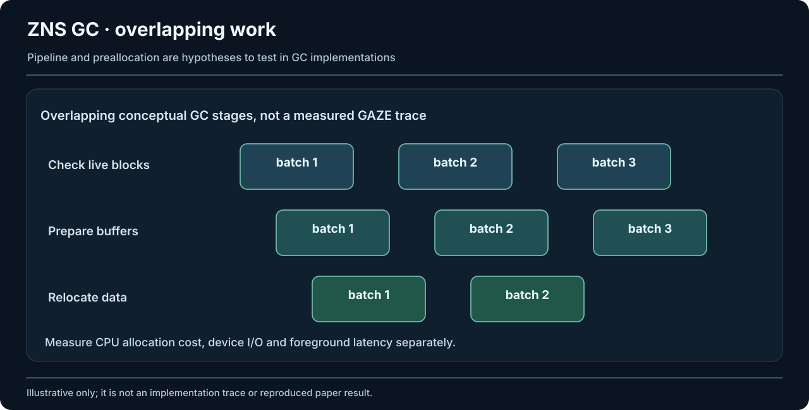

## ZNS에서 GC의 어느 부분이 느릴까?

GAZE(SOSP 2026)는 **Zoned Namespace Flash Storage에서 log-structured 파일시스템의 garbage collection을 재설계**하는 연구다. 연구실이 공개한 설명에 따르면 zone 단위 GC에서 디바이스 I/O만이 아니라 **CPU-side 파일시스템 상태 관리와 메모리 관리**가 큰 병목이 될 수 있다.

먼저 공개된 Abstract와 연구 소개를 바탕으로 GC 경로를 나눠 본다. 실제 구현의 세부 분기와 성능 평가 조건은 논문 본문에서 확인할 부분으로 남겨 둔다.

## 왜 기존 F2FS의 GC로 충분하지 않을까?

Log-structured filesystem은 새로운 데이터가 들어오면 새로운 위치에 기록하고, 오래된 블록을 무효화할 수 있다. 공간이 부족하면 유효 데이터를 이동해 공간을 회수한다.

ZNS에서는 **큰 zone 단위의 회수**가 필요할 수 있어, 기존의 상대적으로 작은 segment cleaning을 그대로 늘리면 CPU metadata 처리, memory allocation, 데이터 이동이 서로 다른 병목으로 나타날 수 있다.

| 구간 | 공부해야 할 비용 |
| --- | --- |
| 유효 블록 확인 | Metadata lookup과 상태 표현 |
| GC 대상 데이터 준비 | 임시 buffer·메모리 할당 |
| 유효 데이터 read/write | 실제 device I/O 및 queue |
| 매핑 갱신 | Metadata 일관성과 동기화 |
| Zone reset | 공간 회수와 write pointer |
| Foreground write | GC 진행 중 write admission |

## GAZE 공개 내용에서 확인할 포인트

연구실의 공개 설명은 크게 다음 방향을 소개한다.

1. **GC 작업을 여러 단계로 분리하고 겹쳐 실행**해 기다리는 시간을 줄이는 방향.
2. **필요한 메모리를 미리 확보**해 반복적인 allocation 비용을 줄이는 방향.
3. GC 중에도 적절한 buffered write를 허용할 수 있도록 **write admission policy**를 재설계하는 방향.

공개 자료에는 F2FS 대비 GC 시간과 처리량의 개선도 제시되어 있다. 다만 수치만으로 모든 workload에 같은 효과가 있다고 볼 수는 없다. 장치와 baseline, 실험 조건을 같이 읽어야 한다.

## CPU 병목과 I/O 병목을 구분하는 방법

GC 시간이 길다고 해서 무조건 SSD 속도가 느리다는 뜻은 아니다. 특정 단계에서 metadata scanning이나 memory allocation이 시간을 많이 소비한다면 더 빠른 장치로 교체해도 전체 시간이 크게 줄지 않을 수 있다.

| 관측 | 잠재적 원인 | 확인할 자료 |
| --- | --- | --- |
| 장치 utilization 낮음, CPU 높음 | Metadata/메모리 관리 병목 가능 | CPU profile, 단계별 시간 |
| 장치가 계속 busy | 실제 read/write 지배 | Block I/O trace |
| GC 동안 foreground latency 급증 | 경쟁 또는 write admission | Admission policy, queue |
| 임시 allocation 증가 | Page/heap allocation 비용 | Allocation trace, 메모리 압력 |

이 표는 실제 측정값이 아니라, 병목 위치를 판단할 때 확인해 볼 단서들이다.

## Pipeline 설계의 trade-off

Pipeline은 read, 처리, write, metadata update 같은 작업을 겹쳐 실행할 수 있게 하지만, stage 사이의 queue, buffer lifetime, back-pressure, ordering을 설계해야 한다.

어떤 stage가 가장 느리면 다른 stage를 병렬화해도 전체 처리량은 그 stage에 제한될 수 있다. **Pipeline depth를 무한히 늘리는 것이 좋은 설계는 아니다.**

## Memory preallocation의 비용

GC 중 필요한 buffer를 미리 마련하면 allocation의 반복 부담을 줄일 수 있지만, 메모리 상주량과 동시 foreground workload에 대한 압력이 커질 수 있다. 다음 질문을 확인하려 한다.

- 어떤 객체와 buffer를 언제 할당하는가?
- 사용량이 크게 변하는 workload에서는 어떻게 대응하는가?
- Preallocation이 최악의 메모리 사용량을 얼마나 늘리는가?
- Allocation 실패와 GC 중단에 대한 대응은 무엇인가?

## Write admission policy의 의미

GC 중 모든 쓰기를 막는 구조와, 특정 조건에서 buffered write를 허용하는 구조는 지연 분포가 다를 수 있다. 그러나 쓰기를 허용한다면 **사용 가능한 공간·metadata 상태·복구 규칙**을 지켜야 한다.

이 부분이 F2FS, page cache, crash consistency가 연구 주제와 연결되는 지점이다.

## 원문에서 확인할 것

1. 어떤 장치와 zone 크기를 사용했는가?
2. Baseline F2FS는 어떤 버전과 정책인가?
3. GC 단계별 CPU/I/O 비중을 어떻게 측정했는가?
4. Pipeline stage의 수와 buffer 소유권은?
5. Preallocation의 메모리 오버헤드는?
6. Foreground write를 허용하면서 correctness는 어떻게 검증했는가?
7. 성능 개선이 적은 workload는 무엇인가?

## 직접 측정한다면

GAZE를 복제하는 큰 실험보다, **일반적인 background GC 또는 파일 이동 workload에서 stage별 CPU/I/O 시간을 분리**하는 작은 실험부터 진행할 수 있다. 장치/파일시스템이 다르면 논문 주장과 같은 결과가 나올 것으로 기대하지 않는다.

## 참고자료

- [OSLab GAZE 공식 소개](https://oslab.kaist.ac.kr/gaze-rearchitecting-log-structured-filesystem-for-garbage-collection-on-zoned-namespace-flash-storage-accepted-in-sosp-26/)
- [OSLab Publications](https://oslab.kaist.ac.kr/publications/)
- [F2FS documentation](https://docs.kernel.org/filesystems/f2fs.html)
