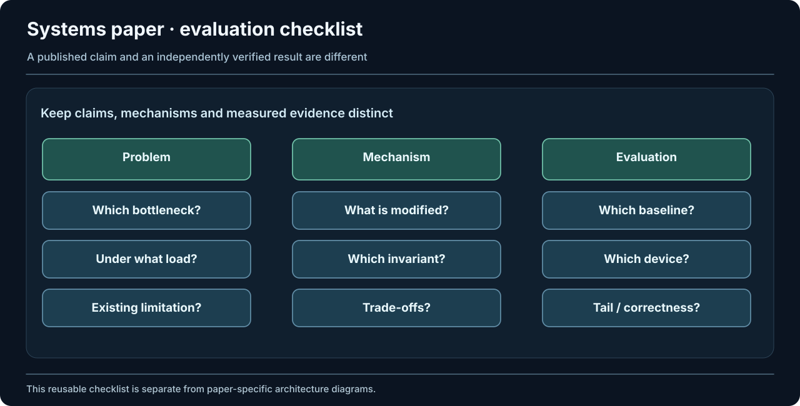

## 논문을 읽고도 설명이 안 되는 이유

Abstract에서 저자의 주장을 읽고 결론의 성능 그래프만 확인하면, **무엇을 바꿨기 때문에 그 결과가 나왔는지** 설명하기 어렵다. 시스템 논문은 일반적으로 기존 시스템의 구체적인 비용을 찾아 **어떤 계층을 변경하는지**가 중요한 논점이다.



## 한 편을 읽는 순서

| 단계 | 질문 | 남길 내용 |
| --- | --- | --- |
| Problem | 왜 지금 이 문제가 중요한가 | 기존 시스템의 구체적 결함 |
| Motivation | 어떤 측정이 문제를 뒷받침하는가 | Profiling, workload |
| Background | 필요한 OS/Storage 지식은 | 부족한 개념과 문서 |
| Mechanism | 어디를 어떻게 바꿨는가 | 자료구조, pipeline, policy |
| Implementation | 실제로 어느 코드·장치에 구현했는가 | Kernel/FS/device version |
| Evaluation | 누구와 공정하게 비교했는가 | Baseline, dataset, metrics |
| Limitation | 어떤 조건에서 효과가 없을 수 있는가 | 적용 제약과 비용 |
| My question | 무엇을 직접 확인하고 싶은가 | Reproduction 또는 작은 실험 |

## Baseline 확인이 가장 중요한 이유

저자가 “기존 시스템 대비 2배”라고 주장하면 우선 **기존 시스템이 무엇인지** 확인해야 한다.

- 동일 kernel/filesystem version인가?
- 동일 device, zone size, queue depth인가?
- 충분한 워밍업과 재현 가능한 workload인가?
- Tuned baseline인지 기본 설정인지?
- 측정하는 값이 throughput인가 latency인가?
- 정확성 또는 durability 요구사항이 같은가?

성능 개선 수치가 맞더라도 다른 조건에는 일반화되지 않을 수 있다.

## Mechanism을 읽는 방법

“CPU overhead를 줄였다”는 말만으로는 부족하다. 어떤 함수/자료구조에서 어떤 비용이 줄었는지, 원래 경로의 작업을 다른 stage로 옮긴 것인지, batching 또는 concurrency를 높인 것인지 분리한다.

| 변화 | 확인할 비용 |
| --- | --- |
| Data structure 변경 | Lookup, memory footprint, update cost |
| Pipeline | Stage imbalance, synchronization overhead |
| Batching | Per-request overhead vs waiting latency |
| Async processing | Completion/ordering, failure mode |
| Caching | Memory footprint, invalidation |
| New hardware feature | Compatibility, correctness |

## 평가 그래프를 읽는 순서

1. X/Y축이 뜻하는 값을 확인한다.
2. 로그 스케일인지 확인한다.
3. Baseline과 변형 시스템의 조건을 찾는다.
4. p50/p99와 평균값의 차이를 확인한다.
5. Error bar 또는 반복 횟수를 찾는다.
6. 결과가 안 나오는 workload를 확인한다.
7. 해당 결과가 design claim을 실제로 검증하는지 생각한다.

**한 장의 그래프가 전체 논문 주장과 동일한 것은 아니다.** 무엇을 증명했고 무엇을 증명하지 않았는지 구분한다.

## 한 페이지에 남기는 리뷰

```text
Paper:
Venue / Year:
Research question:
Prior system:
Observed bottleneck:
Key design change:
Implementation layer:
Baseline:
Hardware / workload:
Metrics:
Most convincing evidence:
Limitations:
Questions to ask:
Reproduction idea:
Reading state: skimmed / reading / completed / reproduced
```

현재 읽은 부분을 `skimmed`라고 적는 것은 불리한 것이 아니다. 확인하지 않은 논문을 완독했다고 표시하는 것이 오히려 다음 학습에 방해된다.

## 시스템 논문 읽기의 실질적 목표

좋은 리뷰는 논문의 문장을 한국어로 옮기는 것보다 **논문을 읽지 않은 사람에게 문제와 설계를 설명하고, 결과를 검증할 실험 조건까지 정의할 수 있는 것**에 가깝다.

OSLab 관련 논문을 읽을 때도 GAZE의 GC 병목과 OPIMQ의 write ordering, D2FS의 device-driven GC처럼 **핵심 제약이 무엇인지**를 먼저 찾는다.

## 실제 구현을 읽을 때

공개 소스가 있더라도 버전과 build option을 고정해야 한다. 논문에서 사용한 설정과 현재 저장소의 `main`이 다를 수 있다. 공개되지 않은 연구실 내부 코드를 추정해 설명하지 않는다.

## 참고자료

- [KAIST OSLab Publications](https://oslab.kaist.ac.kr/publications/)
- [USENIX FAST](https://www.usenix.org/conference/fast)
- [ACM SOSP](https://sigops.org/s/conferences/sosp/)
