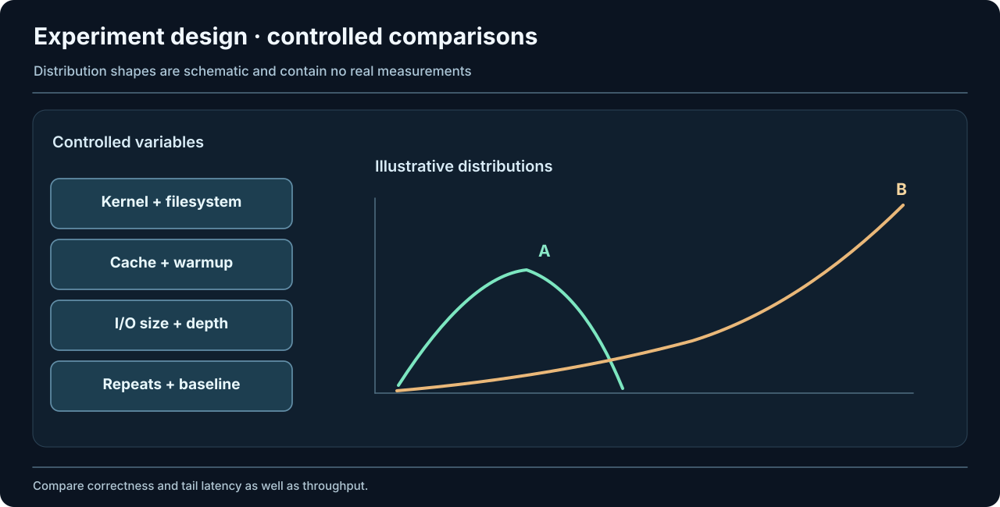

## 1. 흥미 있는 기술과 연구 질문은 다르다

“NVMe가 재미있다”는 관심이지 아직 연구 질문이 아니다. “Multi-queue I/O 환경에서 특정 ordering 요구가 p99 latency에 얼마나 영향을 주는가?”처럼 **비교할 대상, 관찰할 비용과 반박 가능한 가설**이 있어야 연구로 발전할 수 있다.

## 2. 내 관심사를 세 축으로 정리하기

| 축 | 이미 접한 경험 | 연구로 이어질 질문 |
| --- | --- | --- |
| Linux Kernel | 시스템 프로그래밍·tracing | 어떤 kernel path에서 비용이 큰가 |
| File System / Storage | Stateful service 운영·복구 | 데이터 지속성, GC, ordering 비용은 |
| Memory / AI Systems | TFLite Micro memory planning, FPGA | Memory layout와 data movement 병목은 |

현재는 **파일시스템·스토리지를 주축으로, 메모리·AI 인프라를 필요한 경우 연결**하는 것이 적절하다. 여러 분야를 동시에 독립적인 연구 테마로 선언할 필요는 없다.

## 3. 경험을 연구 질문으로 바꾸는 예

운영 중 “DB migration이 timeout됐다”는 사례가 있었다. 그 자체는 연구 주제라기보다 **복구와 상태 확인의 필요성**을 보여주는 경험이다.

연구 문제로 발전하려면 아래처럼 질문을 바꾸어야 한다.

- Storage I/O와 metadata update의 어느 부분이 tail latency를 만드는가?
- Write ordering을 보장하는 동기화 지점이 어디인가?
- 기존 방식과 비교해 CPU overhead가 얼마나 발생하는가?
- Correctness가 바뀌지 않는 조건에서 queueing을 줄일 수 있는가?

당연히 이러한 질문은 원인 입증 없이 과거 사건에 그대로 적용하면 안 된다. **운영 경험은 문제의식의 출발점일 뿐 논문 증거가 아니다.**

## 4. 좋은 연구 질문의 조건

| 조건 | 확인할 질문 |
| --- | --- |
| Specific | 어떤 subsystem과 workload인가 |
| Observable | 무엇을 측정할 수 있는가 |
| Falsifiable | 어떤 결과면 가설이 틀렸다고 인정하는가 |
| Implementable | 한 학기 안에 작은 구현이 가능한가 |
| Comparable | 공정한 baseline이 있는가 |
| Correctness | 성능 외에 지켜야 할 invariant는 |
| Reproducible | 다른 환경에서도 방법을 반복할 수 있는가 |

## 5. 작은 병목부터 찾기

File system GC 전체를 재설계하는 것은 큰 문제다. 먼저 **GC의 한 stage에서 반복되는 allocation이 실제 CPU 시간을 얼마나 쓰는가**처럼 좁히면 분석과 검증이 가능하다.

다음에는 그 비용이 의미 있는지, 캐싱·preallocation·batching이 왜 효과가 있을지 살핀다. 개선 후 다른 단계가 병목이 되면 그 역시 중요한 결과다.

## 6. 성능과 정확성은 함께 검토해야 한다

Writes를 비동기로 바꾸면 호출 지연은 줄어들 수 있지만 crash durability가 달라질 수도 있다. 그러므로 “빨라졌다”는 주장이 동일한 correctness 조건에서 성립하는지 먼저 확인해야 한다.

| 성능 변화 | 동시에 볼 위험 |
| --- | --- |
| Parallel I/O 증가 | Write ordering 붕괴 |
| GC pipeline 적용 | Buffer lifetime과 metadata race |
| Cache 사용 확대 | Memory pressure, stale state |
| Background worker 증가 | Shared DB/SSD contention |
| Device-side offload | Host/device state consistency |

## 7. 주제 선별 스코어카드

각 후보에 1~5점의 질적 점수를 붙이되, 처음에는 추정임을 명시한다.

- 문제를 보여주는 공개 근거가 있는가?
- 코드를 읽고 수정할 수 있는가?
- 도구/장치를 구할 수 있는가?
- Baseline이 공개되어 있는가?
- Correctness를 검증할 수 있는가?
- 다른 사람이 같은 실험을 수행할 수 있는가?

수치의 합계보다 **어떤 조건이 실패하면 연구를 진행할 수 없는지**를 더 중요하게 생각한다.

## 8. 첫 학기 계획

1. 두 가지 관심 있는 문제를 간단히 정의한다.
2. 관련 논문 2~3편을 비교해 baseline을 찾는다.
3. 각 문제에서 최소한의 가설 하나를 세운다.
4. 적어도 하나는 통제된 실험으로 반박·검증한다.
5. 지도교수·연구실 피드백으로 범위를 줄인다.
6. 실제 코드와 결과가 있는 주제에 집중한다.

## 9. 핵심 정리

연구의 출발점은 기술 이름이 아니라 **어떤 비용이 어디에서 발생하고, 어떤 변경으로 줄어들 수 있으며, 어떻게 증명할 것인가**이다. 실무 경험은 질문을 찾는 데 도움을 주지만 연구 결과를 대신하지 않는다.

## 참고자료

- [OSLab publications](https://oslab.kaist.ac.kr/publications/)
- [USENIX FAST](https://www.usenix.org/conference/fast)
- [Experiment reproducibility note](https://petooooo.github.io/notes/study-experiment-reproducibility/)
