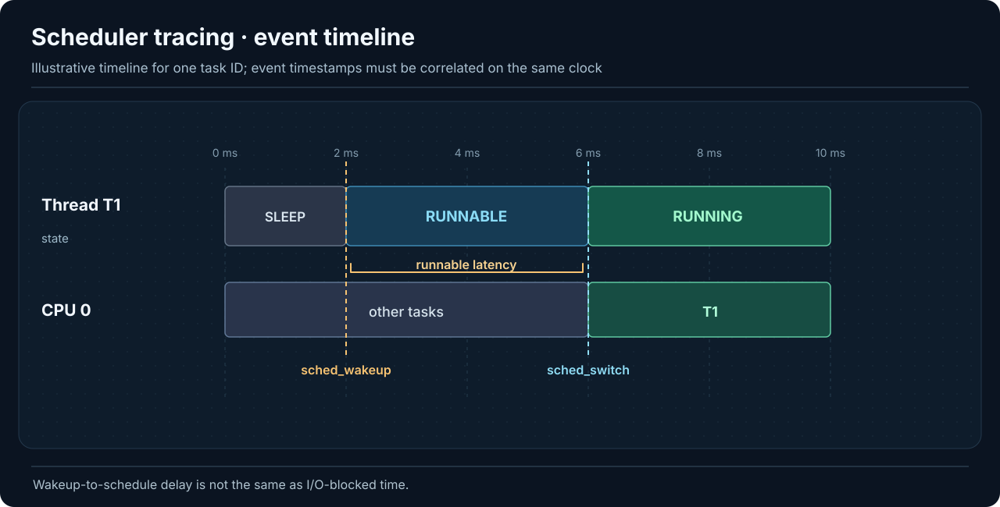

## 이벤트 타임라인이 답해 주는 질문

한 스레드가 느렸다는 사실만으로는 **CPU를 기다렸는지, I/O를 기다렸는지, lock 때문에 멈췄는지** 알 수 없다. ftrace는 Linux kernel 이벤트를 기록할 수 있는 도구이고, KernelShark는 일부 trace를 시간축에서 관찰하는 데 도움이 된다.



## 기본 tracepoint

| 이벤트 | 의미 | 어떤 값을 연결할까 |
| --- | --- | --- |
| `sched_wakeup` | Task가 runnable이 됨 | Wakeup 시각, TID, 대상 CPU |
| `sched_switch` | CPU의 실행 task 변경 | 이전/다음 TID, 시각 |
| `sched_migrate_task` | CPU 사이 이동 사건 | 이전/새 CPU |
| IRQ tracepoint | CPU에서 interrupt context의 활동 | 사건과 CPU 실행 시간 |
| Block I/O tracepoint | 저장장치 요청 발행/완료 | Blocked time과 시간 관계 |

**같은 프로세스의 다른 TID를 섞으면 잘못된 지연을 계산**할 수 있다. 멀티코어 환경에서는 CPU 번호와 시각 기준도 확인한다.

## Runnable latency와 blocked latency

Runnable 대기는 실행 가능한 상태로 깨어난 뒤 CPU를 실제로 받을 때까지의 구간이다. Blocked time은 I/O나 동기화 등에 의해 실행할 수 없는 구간이다.

서비스 요청의 긴 지연이 blocked time에서 비롯됐다면 스케줄러를 수정해도 해결되지 않을 수 있다. 반대로 runnable 대기가 길다면 CPU competition, cgroup quota, scheduling policy 등을 살펴볼 수 있다.

## Trace 수집의 범위

가능한 한 필요한 tracepoint만 켠다. 많은 이벤트를 수집하면 데이터량이 증가하고 **측정하려는 workload의 성능 자체가 달라질 수 있기 때문**이다.

예제 명령(실행 환경·권한 확인 후 사용):

```bash
uname -r
sudo trace-cmd record -e sched:sched_switch -e sched:sched_wakeup -- sleep 5
trace-cmd report
```

이 명령은 단순히 5초 동안 이벤트 수집의 예를 보여준다. **애플리케이션별 TID 지연을 계산하려면 별도의 workload와 event matching 과정**이 필요하다.

## 타임라인을 해석하는 방법

1. 특정 요청·스레드의 관측 시작점을 정한다.
2. 그 스레드가 sleeping에서 runnable로 바뀐 시점을 확인한다.
3. 이후 어느 CPU에서 실제로 schedule되었는지 확인한다.
4. CPU 실행 시간과 다음 context switch를 구분한다.
5. 같은 구간의 IRQ, CPU contention, cgroup throttling과 대조한다.
6. 대조군과 반복 실행 결과가 비슷한지 확인한다.

시계열에서 이벤트 두 개가 인접한 사실은 **인과관계의 후보**이지 그 자체로 증명이 아니다.

## 제대로 된 실험 매트릭스

| Workload | 변경 변수 | 볼 것 |
| --- | --- | --- |
| 단일 CPU-bound | Baseline | Runnable 대기와 실행 |
| CPU-bound 다수 | Task 수 | CPU competition |
| CPU affinity 제한 | Allowed CPU set | Migration / queueing |
| Cgroup quota | CPU budget | Throttling과 wakeup |
| I/O-bound | I/O 패턴 | Blocked time 비중 |

CPU 개수와 kernel version, scheduler policy, CPU governor 등은 기록한다. 새로운 결과가 생기기 전에는 **임의의 지연 수치를 채우지 않는다.**

## 실험 조건과 관찰 결과 기록

- `uname -a`, 테스트 커널의 version/commit.
- `trace-cmd`/KernelShark 버전과 설정.
- Workload 소스·인수·CPU affinity.
- Event filter와 시간 범위.
- Loss/drop 여부와 trace buffer 크기.
- 도출한 runnable latency 정의.
- Baseline, 변형 조건, 반복 횟수.
- 해석되지 않은 이상값.

이런 정보가 없다면 다음에 같은 실험을 반복할 때 관측값을 비교하기 어렵다.

## 다시 측정한다면

Raspberry Pi에서 ftrace와 KernelShark로 **함수 호출과 스케줄링 이벤트를 살펴봤을 때**, 타임라인을 보는 것과 지연 원인을 설명하는 것의 차이가 컸다. 당시의 latency 분포와 환경 설정은 남아 있지 않다. 다시 측정한다면 특정 TID의 wakeup과 CPU 배정 사이를 먼저 좁혀 보고, CPU quota와 I/O 대기를 함께 대조할 생각이다.

## 질문

1. Wakeup이 곧 CPU 실행 시작을 뜻하지 않는 이유는?
2. `sched_switch`만으로 I/O 대기 시작 시점을 확정할 수 있는가?
3. CPU quota가 지연을 만든 경우를 어떻게 구분할까?
4. Trace를 켰을 때 workload가 변하면 어떤 대조군이 필요한가?

## 참고자료

- [Linux ftrace](https://docs.kernel.org/trace/ftrace.html)
- [Linux kernel tracing](https://docs.kernel.org/trace/)
- [KernelShark](https://kernelshark.org/)
