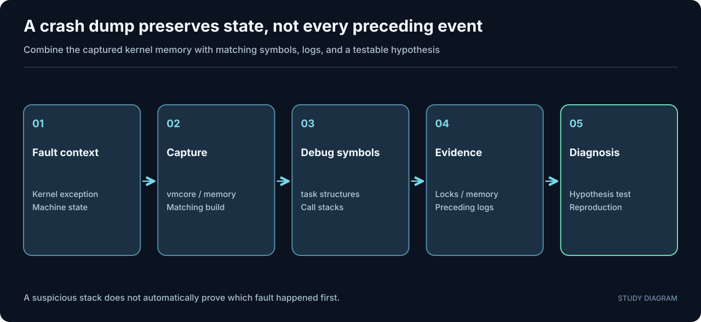

## 동작 중인 시스템과 멈춘 시스템을 분석하는 방법은 다르다

ftrace로 **실행 중인 커널 이벤트**를 살펴본 다음, 커널 덤프를 읽는 방법을 공부하면서 다른 질문이 생겼다.

> 시스템이 이미 멈췄을 때, 그 순간에 남은 메모리와 레지스터 상태로 어디까지 원인을 설명할 수 있을까?

Crash dump는 보통 특정 시점의 **메모리·프로세스·스택·커널 상태**를 제공한다. 반면 trace는 선택된 이벤트가 발생한 **시간 순서**를 제공한다. dump와 trace는 서로 대체재가 아니다.

커널 자료구조와 Trace32·crash 계열 도구, vmcore의 해석과 troubleshooting 방법을 연결해 정리했다. 이 노트는 그때 배운 분석 관점을 다시 정리하고, 향후 격리된 환경에서 재현할 순서를 기록한다.

## Kernel Crash의 대표적인 분류

커널이 비정상 상태가 되는 이유는 다양하다.

| 문제 유형 | 관찰 가능한 징후 | 분석 방향 |
|---|---|---|
| NULL pointer dereference | 잘못된 주소 접근에 의한 oops | fault address, stack |
| Use-after-free | 이미 해제된 객체에 접근 | 객체 수명·slab·참조 수 |
| Stack overflow | stack 손상 또는 예외 | 재귀, stack 사용량 |
| Deadlock | 태스크가 서로 진행하지 못함 | lock owner, waiting task |
| Hung task | 오랜 시간 특정 상태 대기 | wait chain, I/O |
| Soft/hard lockup | CPU가 오랫동안 정상 스케줄링하지 못함 | interrupt, preemption |
| OOM | 메모리 부족으로 task 종료 | memory accounting, reclaim |
| Filesystem/I/O failure | read-only remount나 I/O error | block device, mount, kernel log |

위의 증상은 **가능한 원인과 동일하지 않다**. 예를 들어 `read-only` 상태는 파일시스템 오류 대응 정책의 결과일 수 있으며, 실제 기저 원인이 무엇인지는 별도 확인이 필요하다.

## Oops와 Panic

### 3.1 Oops

Kernel oops는 커널이 오류를 발견하고 진단 정보를 출력하는 상황을 가리킨다. 어떤 문맥에서 어떤 종류의 오류가 발생했는지에 따라 해당 태스크가 종료되거나 시스템이 계속될 수도 있다.

### 3.2 Panic

Panic은 커널이 더 이상 정상적인 실행을 이어갈 수 없다고 판단했을 때 발생할 수 있다. 설정에 따라 재부팅 동작이나 dump 수집 정책이 달라진다.

### 3.3 Watchdog

watchdog이나 lockup detector가 동작하는 경우에는 실제 시작점보다 나중에 증상을 감지해 기록했을 가능성이 있다. 따라서 “마지막 로그가 watchdog”이라는 이유만으로 watchdog을 원인으로 지목하지 않는다.

## Dump 파일을 올바르게 해석하기 위한 전제

### 4.1 Kernel 버전과 Debug Symbol

덤프는 특정 커널의 자료구조를 바탕으로 해석해야 한다. 같은 이름의 구조체라도 커널 버전·설정에 따라 레이아웃이 다를 수 있다.

확인할 항목은 다음과 같다.

- 커널 버전과 정확한 빌드 식별자
- 해당 커널의 debug symbol 제공 여부
- 아키텍처 및 주소 크기
- KASLR 등의 주소 변환 정보
- dump가 정상적으로 수집됐는지
- 분석 도구가 해당 버전을 지원하는지

틀린 symbol을 이용한 backtrace는 **그럴듯하지만 잘못된 정보**가 될 수 있다.

### 4.2 `vmcore`와 `vmlinux`

| 파일/개념 | 역할 |
|---|---|
| `vmcore` | 수집된 메모리 덤프 |
| `vmlinux` | 보통 심볼을 포함할 수 있는 uncompressed kernel ELF |
| `System.map` | 커널 symbol과 주소 정보 |
| `kallsyms` | 실행 중 커널의 symbol 정보 |
| kdump | 커널 크래시 덤프를 수집하는 메커니즘 |
| crash utility | 덤프와 심볼을 이용해 상태를 검사하는 도구 |

Kernel dump를 분석할 때는 두 파일이 **서로 정확히 대응하는지** 먼저 확인해야 한다.

## Backtrace에서 볼 수 있는 것

커널 stack trace는 특정 시점에 어떤 함수들이 호출 경로에 있었는지에 대한 정보를 제공한다. 하지만 이것이 전체 원인 사슬을 자동으로 보여 주지는 않는다.

예를 들어 어떤 함수에서 NULL pointer 접근이 관찰되더라도, 문제는 그 함수에 잘못된 포인터를 넘겨준 더 이전 코드에 있을 수 있다.

따라서 다음 구분이 필요하다.

1. **Faulting instruction:** 실제 오류를 감지한 지점.
2. **Call stack:** 그 시점의 호출 경로.
3. **Object lifetime:** 접근한 객체가 유효했는지.
4. **Earlier event:** 상태가 잘못된 원인은 더 이전에 발생했는지.

“크래시가 난 함수”와 “버그가 있는 함수”는 같은 경우도 있지만, 항상 같지는 않다.

## Process와 Task 상태

Linux 커널에는 태스크별 상태를 나타내는 구조체가 있다. 덤프 분석에서는 다음 질문을 할 수 있다.

| 질문 | 관련 구조·정보 |
|---|---|
| 어느 태스크가 현재 실행 중이었나 | CPU별 current task |
| 태스크가 무엇을 기다렸나 | task state, wait channel |
| 어느 커널 스택을 사용했나 | stack trace |
| 다른 태스크와 어떤 관계인가 | process/thread group |
| 어떤 FD를 열고 있었나 | task file table |
| 어떤 주소 공간을 가졌나 | memory descriptors |

물론 덤프 하나에서 모든 잠금 관계나 과거 스케줄링 이벤트를 복원할 수 있다고 가정해서는 안 된다.

## Lock / Deadlock 조사

Deadlock은 단순히 한 스레드가 오래 멈췄다는 뜻이 아니다. **상호 의존하는 자원에 대한 순환 대기**가 존재해야 한다.

예를 들어:

- 태스크 A가 Lock 1을 가진 상태로 Lock 2를 기다린다.
- 태스크 B가 Lock 2를 가진 상태로 Lock 1을 기다린다.

이런 구조라면 진행할 방법이 없을 수 있다.

그러나 A가 I/O 완료를 기다리는 동안 멈춰 있는 경우는 deadlock과 다른 문제가 될 수 있다. 상태를 정확히 구분하려면 lock owner, call stack, wait event, I/O 진행 상태 등을 함께 봐야 한다.

## Memory Corruption과 Slab

Memory corruption을 의심할 때는 마지막 오류 메시지만으로 충분하지 않다.

- Kernel object가 언제 할당됐는가?
- 언제 해제됐는가?
- 다른 thread에서 같은 객체를 사용했는가?
- 객체 크기와 접근 범위가 올바른가?
- slab/page allocator 관련 오류가 나타났는가?

디버깅 옵션(KASAN 등)은 버그 탐지에 도움을 줄 수 있지만, 커널에 상당한 **성능·메모리 오버헤드**를 줄 수 있으므로 테스트 환경에서 목적에 맞게 사용해야 한다.

## OOM과 Disk 오류는 별도의 분석 축

### 9.1 OOM

Host OOM과 cgroup OOM은 자원 경계가 다르다. 메모리 부족 상황에서 어떤 프로세스가 종료됐다고 해서 해당 프로세스가 반드시 메모리 사용 증가의 근본 원인인 것은 아니다.

분석에는 전체 메모리 상황, 회수 가능한 page cache, kernel slab, 프로세스 사용량, cgroup 제한 등을 포함해야 한다.

### 9.2 Disk read-only

파일시스템이 read-only로 바뀌었다면 권한 오류와 다른 문제일 수 있다. `mount` 상태, `dmesg`, block I/O 오류, filesystem 상태 등을 확인해야 한다.

하지만 **read-only 자체만으로 ext4 corruption이나 실제 물리 장치 손상을 단정하지 않는다**.

## 재현 실험은 반드시 격리된 환경에서

Crash 실험은 머신과 파일시스템에 직접 영향을 줄 수 있으므로 실서비스에서 할 이유가 없다.

다음 단계는 모두 **향후 실습 계획**이다.

1. 독립된 테스트용 Linux 환경 마련.
2. 커널 버전과 debug symbol이 정확히 일치하는지 확인.
3. 의도적으로 안전하게 격리된 오류 사례를 준비.
4. dump 수집 구성이 제대로 동작하는지 확인.
5. `crash`를 이용해 task/backtrace/memory state 읽기.
6. 필요한 경우 정상 동작 trace와 비교.
7. 왜 해당 가설을 세웠고 무엇으로 반박/지지했는지 기록.

구체적인 커널 파괴 명령이나 운영 환경에 사용할 수 있는 장애 유발 절차를 공개 노트에 적는 것이 목적은 아니다. **재현 가능하고 격리된 교육용 실험**으로 검증할 것이다.

## 관찰 → 가설 → 확인 → 남은 문제

결과를 기록할 때 다음 표를 사용하는 것이 좋다.

| 항목 | 적을 내용 |
|---|---|
| Observed | 실제로 확인한 오류와 시점 |
| Environment | 커널·아키텍처·설정 |
| Evidence | dump의 task, stack, symbol, memory 정보 |
| Hypothesis | 가능한 원인과 근거 |
| Counter-evidence | 가설과 맞지 않는 관찰 |
| Reproduction | 같은 조건에서 재현 가능한가 |
| Outcome | 수정 후 결과 |
| Open questions | 여전히 설명되지 않는 부분 |

**장애 복구와 원인 입증은 별도 단계**라는 원칙은 운영 경험에서도 중요했다.

## 다음 복습 질문

- 커널이 panic에 빠지면 어떤 정보가 남는가?
- `vmcore`와 `vmlinux`를 왜 함께 사용해야 하는가?
- NULL pointer dereference는 항상 버그의 시작점인가?
- Deadlock과 I/O blocking을 어떻게 구분할 수 있는가?
- IRQ context의 stack이 일반 프로세스 stack과 다른 이유는?
- OOM victim과 실제 메모리 압력 원인이 다를 수 있는가?
- crash dump에서 시간 순서를 복원하기 어려운 이유는?

## 핵심 요약

커널 덤프는 **실행이 멈춘 시점의 구조화된 증거**다. 올바른 커널 심볼, 실행 문맥, task 정보, stack, memory 상태를 연결하면 원인에 가까워질 수 있다. 그렇지만 한 장면만으로 이전의 모든 사건을 설명할 수 있다고 생각해서는 안 된다.

## 참고자료

- Linux crash dump / debugging 학습 자료
- [Linux kdump documentation](https://docs.kernel.org/admin-guide/kdump/kdump.html)
- [Linux kernel debugging documentation](https://docs.kernel.org/dev-tools/)
- [Crash utility](https://crash-utility.github.io/)
- [Linux 시스템 전체 학습 흐름](https://petooooo.github.io/notes/study-kdt-overview/)
