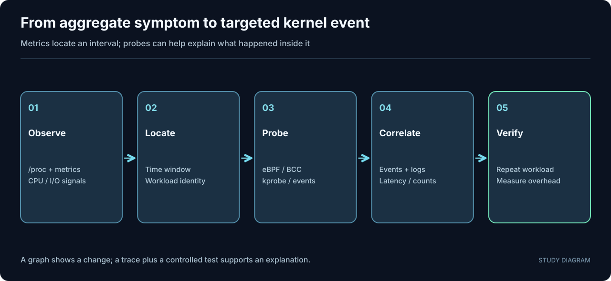

## 1. Monitoring과 Tracing을 함께 공부한 이유

Linux 시스템의 문제가 겉으로는 “CPU 사용률 증가”나 “응답 지연”처럼 나타나더라도, CPU 그래프만 봐서는 **어느 태스크에서 어떤 커널 경로가 지연됐는지** 알기 어렵다.

KDT에서 `/proc`, `ps`, `iostat`, `netstat`, `sar`, ftrace, KernelShark, `perf`, eBPF/BCC, Prometheus·Grafana 등의 개념을 공부했다. 이때 관측 도구는 모두 같은 기능을 하는 것이 아니라, **관찰 단위·시간 해상도·오버헤드·설명력**이 다르다는 점을 이해하려 했다.

이 글은 **문제를 발견하기 → 작은 가설을 만들기 → 적합한 이벤트를 수집하기 → 지표와 대조하기**의 순서로 정리한다. 아래 명령과 코드는 향후 실습을 위한 학습 예시이며, 과거 KDT에서 실행한 결과라고 주장하지 않는다.



## 2. 관측 계층을 구분하기

| 관측 수단 | 대표 정보 | 해상도·한계 |
|---|---|---|
| Application log | 비즈니스 요청, 오류, domain state | 커널 병목을 직접 설명하지 못할 수 있음 |
| `/proc`·`ps`·`top` | 프로세스, 메모리, CPU 상태 | 샘플 시점과 집계 단위 |
| `iostat`·`sar` | I/O·CPU·시스템 통계 | 요청별 원인 추적은 어려움 |
| `perf` | CPU 샘플과 하드웨어 이벤트 | 샘플링·권한·설정 영향 |
| ftrace | 커널 함수/tracepoint 이벤트 | 이벤트 선택과 buffer 제약 |
| eBPF / BCC | 프로그래머블 이벤트 수집 | 검증, overhead, hook 안정성 |
| Prometheus | 주기적 메트릭 수집 | 짧은 burst를 놓칠 수 있음 |
| Grafana | 시계열 비교와 시각화 | 원인 추론에는 추가 증거 필요 |

지표가 초당 평균값이라면 짧은 tail latency spike는 평균값에 가려질 수 있다. 로그는 문제가 언제 생겼는지 알려줄 수 있지만, 왜 그 시점에 실행 흐름이 지연됐는지는 다른 자료가 필요하다.

## 3. `/proc`를 먼저 이해하기

Linux는 `/proc`를 통해 프로세스·시스템 상태를 보여준다. 예를 들어 다음 자료를 관찰할 수 있다.

- `/proc/<pid>/status`: 프로세스 상태·메모리 관련 정보
- `/proc/<pid>/maps`: 가상 메모리 매핑
- `/proc/<pid>/fd/`: FD 링크
- `/proc/meminfo`: 시스템 메모리 통계
- `/proc/stat`: CPU 등 시스템 통계
- `/proc/pressure/`: Pressure Stall Information(지원 환경에서)

하지만 커널 버전과 옵션에 따라 노출되는 세부 항목이 달라질 수 있다.

### 3.1 RSS와 virtual size

하나의 프로세스가 큰 virtual address space를 갖는다고 해서 그만큼 RAM을 점유하는 것은 아니다. 메모리 진단에서는 VIRT/RSS/PSS, 공유 페이지와 file-backed mapping 등을 구분해야 한다.

### 3.2 값의 변화량이 중요한 경우

`/proc/stat` 같은 누적 counter는 한 번 읽은 값만으로 의미 있는 CPU 사용률을 구하기 어렵다. **서로 다른 시점의 차이**를 계산해야 한다.

간단한 관찰용 명령:

```bash
cat /proc/loadavg
cat /proc/meminfo
cat /proc/pressure/memory
```

`/proc/pressure/memory`는 커널·환경에 따라 지원 여부를 확인해야 한다. 출력 숫자를 읽을 때는 단순 점유율이 아니라 **자원 부족으로 실제 작업이 얼마나 지연됐는지**를 이해하는 데 초점을 맞춘다.

## 4. `perf`와 Sampling

CPU 프로파일링에서 `perf`는 함수/명령어 비용을 살피는 데 유용하다.

```bash
perf stat -- sleep 1
```

위 명령은 사용 가능한 권한과 하드웨어 이벤트에 따라 출력이 달라질 수 있다. 실제 분석에서는 workload와 비교 기준이 있어야 한다.

### 4.1 Sampling bias

프로파일러가 특정 순간을 샘플링하기 때문에 아주 짧은 함수, lock 대기, I/O 대기 같은 문제를 항상 정확히 표현하지는 않는다. 일부 문제는 tracing 또는 별도 통계가 더 적합할 수 있다.

| 관측 | 주의할 점 |
|---|---|
| CPU cycles | 계산 자체의 비용과 memory stall 등을 구분해야 함 |
| Instructions | 단순히 수가 적다고 성능이 좋은 것은 아님 |
| Cache miss | miss가 latency에 얼마나 기여하는지 추가 확인 |
| Context switch | 전환 수 증가가 나쁜 것인지 workload에 따라 다름 |
| Call graph | unwinding/심볼 품질에 따라 불완전할 수 있음 |

## 5. ftrace의 위치

ftrace는 커널 이벤트를 수집하는 기능으로, KernelShark는 특정 trace 데이터의 타임라인을 탐색하는 도구다. 스케줄러 이벤트는 실행 흐름을 이해하는 데 도움이 된다.

대표적으로 관찰할 수 있는 이벤트 범주는 다음과 같다.

- Scheduler: `sched_switch`, `sched_wakeup`
- Interrupt: IRQ entry/exit, softirq
- Block I/O: request issue/completion
- Filesystem: 파일시스템별 tracepoints
- Functions: 특정 커널 함수 진입·반환

하지만 이벤트를 많이 켠다고 무조건 원인을 더 잘 알 수 있는 것은 아니다. **대상 사건이 발생하는 전후의 최소 정보를 수집하는 편이 오버헤드와 해석 부담을 줄일 수 있다**.

## 6. eBPF는 무엇인가

eBPF는 커널 등에서 안전한 프로그램 실행을 지원하는 메커니즘이다. 프로그램은 verifier 검사와 권한·attach 조건을 거쳐 허용된 hook에 연결될 수 있다.

전통적인 방식으로 커널 모듈을 수정하거나 컴파일할 필요 없이 특정 관측 목적의 프로그램을 만들 수 있다는 점에서 유용하다. 하지만 verifier가 존재한다고 해서 **모든 eBPF 프로그램이 항상 안전하고 빠르며 부작용이 없는 것**은 아니다.

### 6.1 실행 흐름

1. 사용자 공간에서 eBPF 프로그램을 준비한다.
2. 커널이 프로그램 로딩·검증을 수행한다.
3. 선택된 attach point에 연결한다.
4. 이벤트 발생 시 프로그램이 실행된다.
5. eBPF map 또는 ring buffer 등의 방식으로 결과를 사용자 공간에 전달할 수 있다.
6. 사용자 공간에서 이벤트를 집계·시각화한다.

## 7. kprobe와 kretprobe

KDT 커리큘럼에서는 **BCC Python 응용 프로그램, kprobe/kretprobe를 이용한 이벤트 관찰**을 다뤘다.

- **kprobe:** 커널 함수 내부의 지정 지점에서 정보를 관찰.
- **kretprobe:** 함수 반환 시점 정보를 관찰.
- **Tracepoint:** 커널이 제공하는 비교적 구조화된 이벤트 인터페이스.
- **Kfunc / BTF 기반 방식:** 커널 지원과 버전 조건에 따라 선택할 수 있는 방법.

특정 내부 함수 이름은 커널 버전에 따라 바뀔 수 있으므로, 가능하다면 안정적인 tracepoint를 먼저 검토한다.

### 7.1 추적 설계의 질문

예를 들어 특정 시스템 콜 시간이 길어졌다면 다음 질문이 필요하다.

1. 호출한 PID/TID를 어떻게 식별하는가?
2. 시작과 종료 이벤트를 어떻게 짝짓는가?
3. 스레드가 병렬로 호출하는 경우에도 키가 충돌하지 않는가?
4. 이벤트가 누락되거나 buffer가 가득 차면 결과가 어떻게 왜곡되는가?
5. 프로그램 자체의 관측 오버헤드를 어떻게 측정하는가?

한 번의 이벤트 수집보다 **일관된 대상/키와 실패 조건**의 설계가 더 중요하다.

## 8. 히스토그램과 평균값의 함정

Latency 분석에서 산술 평균값 하나만 보면 tail latency 문제를 놓칠 수 있다.

| 통계 | 의미 |
|---|---|
| Count | 측정된 이벤트 수 |
| Mean | 전체 평균 |
| Median / p50 | 절반이 이 값 이하 |
| p95 | 대부분보다 느린 상위 5% 경계 |
| p99 | 드문 느린 요청을 보는 지표 |
| Max | 측정된 최대 지연 |
| Histogram | 분포의 형태 |

메모리 회수나 저장장치 GC처럼 드물게 큰 지연이 발생할 수 있는 영역에서는 p99와 분포 자체가 중요하다. 단, 적은 샘플 수에서 p99를 과도하게 해석하면 안 된다.

## 9. Prometheus, Node Exporter, Grafana

### 9.1 Pull 모델

Prometheus는 일반적으로 exporter가 제공하는 metrics endpoint를 주기적으로 scrape한다. 수집 간격보다 짧은 현상은 데이터 형태에 따라 그대로 보이지 않을 수 있다.

### 9.2 Counter와 Gauge

| Metric type | 용도 | 예 |
|---|---|---|
| Counter | 증가하는 누적 사건 수 | 요청 수, 오류 수 |
| Gauge | 오르내리는 현재 값 | 메모리 사용량, queue depth |
| Histogram | 이벤트 값 분포 관찰 | 요청 지연 버킷 |

Counter에서 초당 발생률을 보려면 보통 **시간 구간별 증가율**을 계산한다. Gauge에서 `rate`를 무조건 적용하는 것은 대개 의미가 맞지 않을 수 있다.

### 9.3 Dashboard 구성의 목적

Grafana 대시보드는 정보를 많이 보여주는 것보다 “어떤 현상이 시작됐는가?”를 발견하기 쉬워야 한다. 예를 들어:

1. 시스템 전체 오류/지연 추이
2. 특정 node 또는 service의 자원 사용량
3. Memory pressure / I/O 지표
4. Queue depth와 worker 처리 속도
5. 상세 로그·trace로 연결되는 관측 링크

## 10. 로그와 trace, metric을 상호 보완하기

장애 발생 시 생각해 볼 순서는 다음과 같다.

1. **로그:** 어떤 작업이 실패했고 무슨 메시지를 남겼는가?
2. **메트릭:** 문제 시작 시점에 CPU, memory, I/O, network 중 무엇이 달라졌는가?
3. **트레이스:** 어떤 kernel event나 사용자 요청 경로가 지연됐는가?
4. **가설:** 한 계층이 다른 계층의 증상을 만들어냈는가?
5. **재현:** 같은 조건에서 같은 증상이 나오는가?

이 과정을 갖추면 모든 실패를 “리소스 부족”이나 “네트워크 문제”로 뭉뚱그리지 않을 수 있다.

## 11. 다음 학습 실습: 실제 결과를 누적할 계획

이후 직접 재현할 실험을 다음과 같이 계획한다.

| 실험 | 관찰 대상 | 결과를 적을 때 필요한 정보 |
|---|---|---|
| ftrace sched trace | runnable/wakeup 지연 | kernel, CPU, workload |
| BCC syscall probe | event count / duration | hook, 키, 누락 여부 |
| `perf stat` | cycles, instructions | CPU 모델, 실행 조건 |
| Page cache workload | disk I/O와 read latency | 파일 크기, cache state |
| Prometheus dashboard | scrape/metric 변화 | scrape interval, exporter |
| Trace와 metric 비교 | 같은 장애를 다른 관점에서 보기 | 시간 동기화, 샘플 범위 |

과정에서 각 도구를 배운 것은 사실이지만, 공개 가능한 과거 실행 로그가 없는 경우 **새 실험을 했다고 가정하지 않는다**. 앞으로 실제 관측값을 남겨 이 노트를 고도화한다.

## 12. 자주 헷갈리는 것

| 개념 | 정확한 구분 |
|---|---|
| Logging / tracing | 사건 메시지 / 실행 흐름의 상세 관측 |
| Metrics / profiler | 시간에 따른 집계 / 비용이 어디에 집중되는지 |
| ftrace / BCC | 커널 제공 tracer / 프로그래머블 eBPF 관측 도구 |
| kprobe / tracepoint | 동적 함수 지점 / 커널 정의 이벤트 |
| Sampling / tracing | 일부 순간을 추출 / 선택한 이벤트를 기록 |
| High CPU / slow request | CPU 바쁨 / 사용자 지연 원인이 반드시 CPU는 아님 |
| Trace correlation / causation | 같은 시각 / 실제 원인 관계 증명 |

## 13. 핵심 정리

관측의 목표는 **더 많은 그래프를 만드는 것**이 아니라 **가설을 반박하거나 지지할 증거를 얻는 것**이다. 메트릭으로 이상 구간을 찾고, 필요한 커널 이벤트만 추적하고, 실험을 반복해 원인을 좁히는 방법을 익히는 것이 중요하다.

## 참고자료

- KDT 2기 통합 프로세스 모니터링·커널 tracing 교육 내용
- [eBPF documentation](https://docs.kernel.org/bpf/)
- [BCC project](https://github.com/iovisor/bcc)
- [Linux perf wiki](https://perf.wiki.kernel.org/)
- [Prometheus documentation](https://prometheus.io/docs/)
- [KDT 전체 학습 노트](https://petooooo.github.io/notes/study-kdt-overview/)
