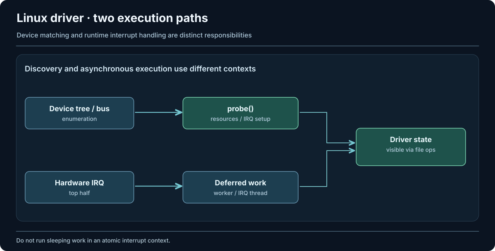

## 1. Embedded Linux를 왜 배웠나

전자공학을 복수전공하면서 디지털회로·컴퓨터구조·임베디드 시스템을 공부했다. 하지만 장치를 제어하는 코드와 **Linux 커널이 장치를 추상화하고 사용자 프로그램에 노출하는 과정**은 다른 문제였다.

Raspberry Pi Linux 환경을 구성해 보면서 ARM, bootloader, root filesystem, device tree, platform/character driver, GPIO·SPI·PWM·UART, interrupt, workqueue, kernel module이 서로 어떻게 연결되는지 생각했다. 이 글에서는 하드웨어를 단순히 “핀에 값을 쓰는 대상”으로 보지 않고, **장치의 발견부터 드라이버 등록·I/O·이벤트 처리·해제까지** 하나의 수명주기로 정리한다.



## 2. Linux가 실행되기까지의 경로

범용 PC에서는 이미 동작하는 OS를 전제로 코드를 실행하는 경우가 많다. Embedded 환경에서는 **어떻게 커널을 올리고 필요한 장치를 인식시키는가**부터 문제다.

| 단계 | 개념 | 기억할 질문 |
|---|---|---|
| Boot ROM / firmware | 최소 부팅 코드 | 초기 실행 주소와 보안 단계 |
| Bootloader | 커널 이미지·설정 전달 | 어떤 커널과 DTB를 적재하는가 |
| Linux kernel | 초기 메모리·스케줄러·driver subsystem | 어떤 단계에서 장치를 등록하는가 |
| Device tree | 장치와 자원 기술 | 레지스터·IRQ·clock을 어떻게 설명하는가 |
| Root filesystem | 사용자 공간 실행 환경 | `/init` 또는 init 시스템은 어떻게 시작하는가 |
| User process | 응용 프로그램 | 드라이버 API에 어떻게 접근하는가 |

부팅 실패를 분석할 때는 **아직 kernel이 시작되지 않았는지, kernel은 시작됐으나 rootfs를 찾지 못하는지, userspace service만 실패한 것인지** 분리해야 한다.

## 3. ARM 아키텍처와 Exception

### 3.1 CPU 실행 흐름

ARM에서는 레지스터와 exception-level, 인터럽트 및 예외 처리 메커니즘이 소프트웨어 구현과 직접 연결된다. 단순히 C 코드를 작성한다고 해서 모든 동작이 CPU의 일반 실행 흐름에서 일어나는 것은 아니다.

- **Exception:** 예외 진입을 통해 CPU 실행 흐름이 커널의 특정 처리 경로로 변경될 수 있다.
- **Interrupt:** 외부 장치나 타이머 등 비동기 사건을 알린다.
- **Synchronous exception:** 시스템 콜·주소 변환 관련 사건 등 현재 명령과 연관된 경로.
- **Context switch:** 실행할 task를 변경할 때 필요한 커널 상태 관리.

### 3.2 호출 규약과 Stack

ARM 호출 규약은 어떤 레지스터가 인수·반환값에 사용되고 어떤 레지스터를 호출자/피호출자가 보존하는지 결정한다. 커널 stack과 user stack을 구분해야 하는 이유도 여기에 연결된다.

이해를 위한 질문:

1. 예외 발생 전의 프로그램 위치는 어디에 저장되는가?
2. 커널이 다른 태스크를 실행시키면 어떤 레지스터 상태를 저장하는가?
3. 특정 아키텍처에 종속적인 코드가 시스템 콜 인터페이스와 어떻게 연결되는가?

## 4. Device Tree와 Driver의 역할 구분

Device Tree는 장치의 **하드웨어 구성과 연결 관계를 데이터로 표현하는 메커니즘**이다. Driver는 해당 장치를 실제로 사용하는 논리를 제공한다.

예시 구조는 다음과 같다. 아래 값은 설명용이며 특정 실제 장치의 배치를 표현하지 않는다.

```text
example@1000 {
    compatible = "example,device";
    reg = <0x1000 0x100>;
    status = "okay";
};
```

여기서 중요한 것은 주소 `0x1000`이라는 숫자 자체가 아니라 `compatible` 문자열을 통해 **어떤 driver와 매칭할지**, `reg`를 통해 **어떤 자원을 관리할지**를 정한다는 점이다.

실제 DT 작성에서는 `#address-cells`/`#size-cells`, interrupt controller, bus 구조, property binding 문서 등에 따라 표기와 의미가 달라진다.

### 4.1 Driver Binding

일반적인 흐름을 정리하면 다음과 같다.

1. 커널이 장치 정보를 발견한다.
2. Device bus 또는 platform subsystem이 일치하는 driver를 찾는다.
3. Driver의 probe 경로에서 필요한 자원을 얻고 초기화한다.
4. 사용할 수 있는 user/kernel interface를 제공한다.
5. 장치 제거 또는 종료 시 자원을 정리한다.

실패를 포함하는 것이 핵심이다. probe 도중 세 번째 자원을 얻다가 실패했다면, **이미 획득한 첫 번째와 두 번째 자원도 올바르게 해제**해야 한다.

## 5. Kernel Module과 Built-in Driver

| 구분 | Kernel module | Built-in driver |
|---|---|---|
| 적재 시점 | 실행 중 적재 가능 | kernel image 일부로 포함 |
| 배포 단위 | `.ko` 파일 | kernel image |
| 호환성 | 빌드 버전·설정·ABI 영향 | 해당 kernel build에 통합 |
| 제거 | 지원 상황에서 unload 가능 | 일반적으로 별도 unload 불가 |

Kernel module이 사용자 프로세스와 다른 점은 커널 주소 공간과 권한 안에서 실행된다는 것이다. 잘못된 포인터나 동기화 오류가 **전체 커널 안정성**에 영향을 줄 수 있다.

따라서 module/driver 실습은 중요한 시스템에서 직접 실행하기보다 별도의 테스트 환경으로 격리하는 것이 합리적이다.

## 6. Character Driver와 File Operations

Character device는 파일처럼 `open`, `read`, `write`, `ioctl` 등을 통해 접근할 수 있다. 이 인터페이스는 단순해 보이지만 그 아래에는 device lifetime과 동시 접근 문제가 있다.

| 함수/연산 | 질문 |
|---|---|
| `open` | 사용 중인 device와 process context를 어떻게 연결하는가 |
| `read` | 현재 읽을 데이터가 없을 때 blocking/nonblocking은? |
| `write` | 장치 상태와 버퍼 크기를 어떻게 검증하는가 |
| `ioctl` | 무엇을 제어 명령으로 노출할 것인가 |
| `poll` | 언제 읽기/쓰기가 준비됐다고 알려야 하는가 |
| `release` | 남은 참조와 리소스를 어떻게 정리할 것인가 |

이 개념이 중요한 이유는 애플리케이션 관점의 FD와 **드라이버 관점의 실제 장치 상태**가 일대일 대응이 아닐 수 있기 때문이다.

## 7. GPIO, SPI, UART, PWM

### 7.1 GPIO

GPIO는 단순한 디지털 입력/출력을 제어하지만, 입력 값을 **언제 읽었는지**, 신호 변화에 이벤트를 연결하는 방식, 핀 소유권이 중요하다.

### 7.2 SPI

SPI는 클럭과 직렬 데이터 전송을 이용하는 장치 통신 인터페이스다. 명령과 데이터 전송을 어떻게 구성하는지, chip select가 어느 구간에 유지되는지에 따라 peripheral 동작이 달라질 수 있다.

### 7.3 UART

UART는 비동기 직렬 통신을 위한 인터페이스다. 설정된 baud rate, framing, RX/TX 버퍼와 흐름 제어가 실제 통신을 좌우한다.

### 7.4 PWM

PWM은 duty cycle과 주기 같은 파라미터로 신호를 만든다. 적용 대상에 따라 LED 밝기·모터 제어 등으로 응용할 수 있다.

| 장치 인터페이스 | 데이터 단위 | 주요 설계 고려 |
|---|---|---|
| GPIO | 핀 상태 | debounce, interrupt, pinmux |
| SPI | 클럭 동기 직렬 전송 | speed, mode, CS, transfer framing |
| UART | 비동기 바이트 | baud, overrun, buffer |
| PWM | 주기적 펄스 | duty cycle, period |
| I2C | 공유 버스 메시지 | 주소, 타이밍, ACK |

## 8. Interrupt 처리와 Execution Context

### 8.1 Hard IRQ에서 무엇을 해도 되는가

하드웨어가 인터럽트를 발생시키면 커널은 해당 context로 진입해 처리한다. **Hard IRQ context에서는 일반적인 sleep을 허용하지 않으므로**, 오래 걸리는 작업을 무작정 수행하면 전체 시스템에 부정적인 영향을 줄 수 있다.

### 8.2 Top-half와 Deferred Work

개념적인 처리 흐름은 다음과 같다.

1. 하드웨어 이벤트 발생
2. CPU/IRQ subsystem 진입
3. 빠르게 상태 확인 및 필요한 최소 작업 수행
4. 필요하면 threaded IRQ나 workqueue 등의 경로에 작업 이관
5. 후속 작업에서 버퍼 처리·사용자 인터페이스 반영

인터럽트가 연속해서 들어오면 다음 질문이 생긴다.

- 새 이벤트를 처리하기 전에 이전 이벤트가 모두 끝나야 하는가?
- FIFO 버퍼가 가득 찬 경우 무엇을 버릴 것인가?
- ISR과 workqueue가 공유 상태를 동시에 변경할 수 있는가?
- 장치를 제거할 때 진행 중인 작업을 어떻게 종료하는가?

### 8.3 Threaded IRQ

Threaded IRQ는 일부 작업을 kernel thread context에서 수행하도록 도와준다. 하지만 **모든 드라이버 처리 상황을 자동으로 안전하게 만들어 주는 것은 아니다**. 적절한 동기화, 우선순위, shutdown 처리가 여전히 필요하다.

## 9. Lock과 메모리 일관성

Driver에서는 하나의 데이터가 아래 여러 문맥에서 접근될 수 있다.

- 프로세스의 `read()` 경로
- IRQ handler
- Workqueue callback
- Timer callback
- 장치 제거 경로

따라서 어떤 lock을 쓸지 결정하기 전에 **공유 상태가 어떤 문맥에서 접근되는가**를 적어야 한다.

| 문맥 조합 | 고려할 것 |
|---|---|
| Process ↔ Process | mutex 사용 가능성, blocking 처리 |
| IRQ ↔ Process | spinlock 및 IRQ disable 변형 등 검토 |
| Workqueue ↔ Process | sleep 가능 여부, 데이터 수명 |
| DMA ↔ CPU | memory ordering, cache coherency, DMA mapping |

락을 얻었다고 DMA 버퍼의 모든 cache-coherency 문제가 자동으로 사라지는 것은 아니다. 장치 DMA 인터페이스와 아키텍처의 메모리 일관성 규칙을 고려해야 한다.

## 10. Polling, Interrupt, DMA

같은 장치 작업을 구현해도 어떤 방식으로 완료를 확인하는지에 따라 CPU 비용과 지연이 달라진다.

| 방식 | 장점 | 비용/한계 |
|---|---|---|
| Polling | 단순하며 짧은 대기에 적합할 수 있음 | CPU 자원 소비 |
| Interrupt | 완료 시점에 통지 가능 | IRQ 처리 및 context 전환 |
| DMA | CPU의 대량 데이터 이동 부담 완화 | 설정, 동기화, 매핑, completion 관리 |

NVMe 같은 고성능 스토리지 장치 연구에서도 **queue, DMA, interrupt/polling**의 선택은 핵심 성능 변수다. Embedded Linux에서 배운 메커니즘이 파일시스템·스토리지 연구와 연결되는 지점이다.

## 11. 디버깅 흐름

장치가 보이지 않는 문제는 여러 단계로 분리할 수 있다.

| 증상 | 확인할 계층 |
|---|---|
| Boot 중 장치 인식 실패 | Bootloader/DTB, kernel config |
| Driver가 매칭되지 않음 | compatible/bus binding |
| Probe 실패 | 자원 요청, clock, regulator, IRQ |
| Device node는 있으나 read 실패 | driver file operations, 상태 |
| Interrupt가 오지 않음 | IRQ controller, trigger, wiring |
| 동작하다 멈춤 | lock, workqueue, teardown, timeout |
| Module unload 실패 | 참조 카운트와 실행 중 작업 |

실제 소프트웨어 개발에서는 **로그와 이벤트가 어느 단계에서 멈췄는지** 먼저 확인해야 한다.

## 12. 앞으로 재현하고 싶은 학습 실습

아래는 이해한 메커니즘을 **새 환경에서 다시 검증할 계획**이다. 과거 개인 과제 결과로 제시하는 표는 아니다.

1. QEMU/별도 테스트 환경에서 kernel module 빌드·적재 흐름 확인.
2. Character device 예제로 `open/read/write/release` 경로 관찰.
3. GPIO 이벤트를 polling과 IRQ 방식으로 각각 다루는 예제 비교.
4. Hard IRQ와 workqueue로 작업을 분리하는 예제 만들기.
5. 실패한 probe에서 리소스를 정리하는 경로 검토.
6. 실제 실행 로그와 kernel version을 함께 보관하기.

특히 위험한 드라이버 코드는 운영 중인 머신에서 실험하지 않고 **격리된 테스트 환경**을 사용한다.

## 13. 정리

Driver는 하드웨어 register를 직접 쓰는 함수 모음만을 의미하지 않는다. **커널 객체·실행 문맥·비동기 이벤트·자원 수명을 일관되게 관리하는 시스템 소프트웨어**다.

이 관점은 나중에 NVMe·스토리지 I/O queue를 공부할 때도 그대로 유용하다.

## 참고자료

- Embedded Linux, ARM 및 Linux driver 관련 학습 자료
- [Linux driver API](https://docs.kernel.org/driver-api/)
- [Linux device tree usage](https://docs.kernel.org/devicetree/usage-model.html)
- [Linux Kernel Labs](https://linux-kernel-labs.github.io/refs/heads/master/)
- [Linux 시스템 전체 학습 흐름](https://petooooo.github.io/notes/study-kdt-overview/)
