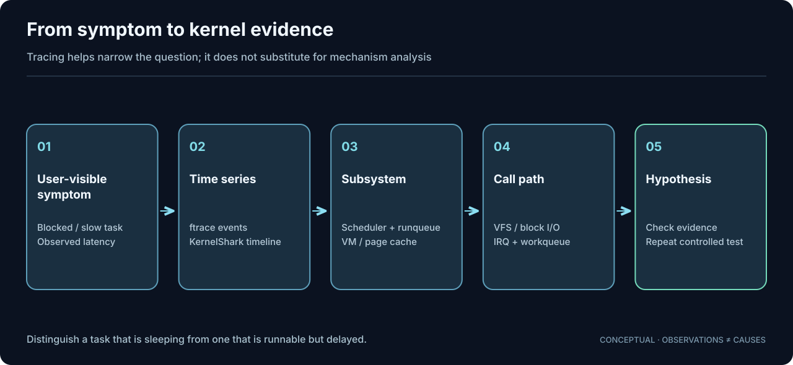

## 1. 스케줄러, 메모리, 파일시스템을 함께 공부해야 하는 이유

응용 프로그램은 CPU·메모리·파일을 별개의 API로 사용한다. 그런데 시스템이 실제로 느려지거나 멈출 때는 세 영역이 서로 연결되어 있다. 파일을 읽다가 페이지 폴트가 발생하면 스토리지 I/O를 기다릴 수 있고, 대기했던 태스크가 깨어난 뒤에도 CPU가 배정되기까지 시간이 걸릴 수 있다.

Linux의 프로세스 상태와 CFS·runqueue·context switch를 보다가, 지연을 이해하려면 page fault와 VFS·파일시스템 제어 흐름도 함께 봐야 한다는 점이 흥미로웠다. Raspberry Pi에 Linux를 설치하고 **ftrace와 KernelShark로 함수 호출과 스케줄링 이벤트를 관찰**했다. 여기서는 각 계층의 정의에서 시작해 “응답 시간이 길다”라는 한 가지 증상을 어떻게 해석할 수 있는지까지 연결한다.

## 2. Process 상태와 CPU 스케줄링

### 2.1 프로세스가 Running이 아닌 이유

태스크가 실행되지 않는 이유를 정확히 분류해야 한다.

| 상태 | 의미 | CPU를 못 얻는 이유 |
|---|---|---|
| Running | 현재 CPU에서 실제 실행 | 해당 없음 |
| Runnable | 실행 가능하지만 대기할 수 있음 | 다른 태스크가 실행 중 |
| Interruptible sleep | 사건이 발생하기를 기다림 | I/O, timer, lock 등 |
| Uninterruptible sleep | 특정 커널 대기 상황 | 완료해야 할 I/O 또는 커널 작업 등 |
| Stopped/Zombie | 실행 중지 또는 종료 상태 | 정상적인 runnable 상태가 아님 |

주의할 점은 `ps`의 한 글자 상태만으로 모든 내부 대기 원인을 알 수 없다는 것이다. 태스크가 `D` 상태라고 해서 반드시 저장장치가 고장났다는 뜻도 아니다.

### 2.2 Context switch의 비용

Context switch는 한 실행 흐름의 상태를 저장하고 다른 실행 흐름의 상태를 복원하는 과정이다. 레지스터, 스택 포인터, 메모리 관련 컨텍스트 등이 바뀔 수 있다.

비용을 구분해야 한다.

- 직접 비용: 레지스터·커널 자료구조 관리 등
- 간접 비용: cache/TLB 영향, 분기 예측·CPU locality 변화
- 경쟁 비용: lock contention, CPU 간 데이터 이동
- 관찰 비용: tracing을 활성화하면 생길 수 있는 추가 오버헤드

따라서 “context switch는 항상 몇 마이크로초”라는 고정값으로 이해하기 어렵다. CPU, 커널, 스케줄링 정책, 워크로드에 따라 달라진다.

## 3. CFS, `vruntime`, runqueue

전통적인 Linux **CFS(Completely Fair Scheduler)**의 사고방식과 runqueue부터 이해해 보았다. CFS는 태스크별로 소비한 실행 시간을 가중치와 함께 평가하는 `vruntime` 개념을 중심으로 공정성을 추구한다.

### 3.1 공정성을 어떻게 정의할까

두 태스크 A와 B가 모두 CPU를 원하지만 서로 다른 nice 값이 있다면, 같은 실제 실행 시간이라도 공정성 계산은 같지 않을 수 있다. 전통적 CFS 모델에서는 태스크별 가중치를 반영한 가상 실행 시간을 비교한다.

일반적인 설명에서는 red-black tree로 실행 대상을 관리했지만, **현대 Linux에서 EEVDF 같은 스케줄링 변화가 도입됐으므로 당시 교재의 내부 자료구조 설명을 모든 커널 버전에 그대로 적용하지 않는다.**

### 3.2 Runnable 대기와 실제 실행

관찰할 지표를 세 가지로 나누면 좋다.

1. **Runnable 대기 시간:** 실행 가능한 상태가 된 뒤 CPU를 실제로 얻기까지.
2. **Running 시간:** 실제로 CPU를 사용한 시간.
3. **Blocked 시간:** I/O·동기화·타이머 등으로 실행할 수 없었던 시간.

응답 시간이 길어도 blocked 시간이 대부분이라면 스케줄러 공정성보다 I/O 경로를 먼저 분석해야 할 수 있다.

## 4. ftrace: 이벤트를 관측하는 것과 원인을 찾는 것은 다르다

ftrace와 KernelShark로 실행 경로를 살펴볼 때 가장 흥미로웠던 부분은 **커널 이벤트를 시간축으로 확인할 수 있다는 점**이었다.

Raspberry Pi 기반 환경에서 함수 호출과 스케줄링 이벤트를 관찰하고 KernelShark로 타임라인을 확인했다. 이벤트 이름만으로는 실제 동작을 이해하기 어렵다. 그래서 다음 순서로 해석하는 것이 좋다.

| 이벤트 종류 | 알고 싶은 것 |
|---|---|
| `sched_switch` | 현재 태스크에서 다음 태스크로 전환된 시점 |
| `sched_wakeup` | 잠들었던 태스크가 실행 가능한 상태로 깨어난 시점 |
| `sched_wakeup_new` | 새 태스크가 실행 가능해진 사건 |
| IRQ/softirq tracepoints | 인터럽트 처리가 CPU 시간을 차지한 구간 |
| function tracer | 관측 가능한 커널 함수 호출의 시간 흐름 |

### 4.1 Trace를 해석할 때 주의할 것

`wakeup` 직후 실행되지 않았다고 해서 곧바로 scheduler bug라는 결론을 내릴 수는 없다. CPU 수, 태스크 우선순위, CPU affinity, 동시 runnable task 수, interrupt 처리, 커널 버전 등을 함께 봐야 한다.

마찬가지로 함수 두 개가 시간상 가까워도 **하나가 다른 하나의 원인임을 증명하지는 못한다.** 반복 실험과 대조군이 필요하다.

### 4.2 앞으로 재현할 관측 실험

다음 표는 **새로 진행할 계획**이지 과거에 측정했던 결과표가 아니다.

| 실험 | 수집 정보 | 비교 항목 |
|---|---|---|
| CPU-bound 단일 태스크 | `sched_switch`, CPU time | baseline |
| CPU 경쟁 증가 | runnable wait, context switch | 동시 runnable 수 |
| `sleep()` 포함 태스크 | wakeup → schedule latency | timer 및 부하 |
| I/O-bound 작업 | blocked time, I/O 이벤트 | page cache 상태 |
| CPU affinity 변경 | runqueue 이동, latency | 고정/비고정 |

커널 버전과 tracer 설정을 기록하지 않으면 나중에 결과를 비교하기 어렵다.

## 5. Interrupt, Softirq, Workqueue

하드웨어 인터럽트는 커널이 비동기 사건에 반응하는 경로다. 하지만 hard IRQ handler는 일반 프로세스 문맥과 다르고 **sleep 가능한 API를 임의로 호출할 수 없다**.

| Execution context | 특징 |
|---|---|
| Process context | 현재 task 문맥에서 sleep 가능한 작업이 존재 |
| Hard IRQ context | 짧고 제한된 작업, 일반적인 sleep 불가 |
| Softirq | deferred 처리 방식 중 하나, 문맥 제약 존재 |
| Threaded IRQ | 별도 kernel thread 문맥에서 처리 가능 |
| Workqueue | kernel worker에서 시간이 필요한 작업 처리 가능 |

이 구분이 중요한 이유는 커널 코드를 작성할 때 **동일한 함수라도 호출 문맥에 따라 안전성이 달라질 수 있기 때문**이다.

## 6. Virtual Memory의 기본 구조

### 6.1 가상주소와 물리주소

프로세스는 자신만의 가상주소 공간을 보는 것처럼 실행된다. 실제 메모리 접근은 MMU와 페이지 테이블을 거쳐 물리주소로 변환된다.

| 구조 | 주요 역할 |
|---|---|
| VMA | 가상 메모리 영역의 범위·권한 등 |
| Page table | 가상 페이지와 물리 프레임 매핑 |
| TLB | 주소 변환 결과를 캐싱 |
| Page fault | 매핑·접근 권한 문제 등으로 OS 개입 |
| Anonymous memory | 파일에 직접 연결되지 않은 매핑 |
| File-backed memory | 파일의 내용과 연결되는 매핑 |

`malloc()`은 일반적으로 C allocator를 통해 메모리를 요청한다. 내부적으로 `brk` 계열이나 `mmap` 등을 사용할 수 있지만, 호출했다고 **즉시 모든 물리 페이지가 확보·접근됐다는 뜻은 아니다**.

### 6.2 Page fault는 모두 오류인가

아니다. 유효한 주소에 처음 접근하면서 페이지를 할당하거나 파일에서 읽어오는 과정도 page fault를 유발할 수 있다.

- **Minor fault:** 디스크 I/O 없이 처리될 수 있는 fault
- **Major fault:** fault 처리에 저장장치 I/O가 필요했던 상황
- **Invalid access:** 권한 또는 주소 범위 문제가 있어 signal로 실패할 수 있음

실제 fault 종류와 횟수는 워크로드, OS, 메모리 상태에 따라 달라진다.

## 7. Reclaim과 OOM

메모리가 부족하다고 판단되는 과정은 단순히 “프로그램 heap 크기의 합이 RAM보다 크다”로 설명할 수 없다. page cache, anonymous memory, slab, kernel memory, cgroup 제한, 회수 가능한 페이지 등을 구분해야 한다.

### 7.1 Page cache가 커지는 이유

파일 데이터를 읽으면 page cache에 남을 수 있다. 이는 성능 향상에 유리하지만, `free`나 시스템 메모리 수치를 해석할 때는 **캐싱된 메모리와 회수 불가능한 메모리를 동일시하면 안 된다**.

### 7.2 Host OOM vs cgroup OOM

| 상황 | 의미 |
|---|---|
| Host memory pressure | 전체 노드의 물리 메모리 압박 |
| cgroup memory limit | 특정 workload에 설정된 메모리 예산 초과 |
| OOM kill | 특정 실행 주체가 메모리 부족으로 종료될 수 있음 |
| Page reclaim | 필요 없는 페이지를 회수하려는 작업 |

운영 시스템에서 host-level OOM을 봤을 때 “가장 큰 컨테이너가 원인”이라고 단정하면 위험하다. 호스트 프로세스와 cgroup 메모리 사용량을 함께 봐야 한다.

## 8. VFS: 경로에서 파일 객체로

### 8.1 VFS의 필요성

Linux는 여러 파일시스템이 공통 시스템 콜 인터페이스로 보이도록 **VFS(Virtual File System)** 계층을 둔다. 하지만 같은 `open()`·`read()`를 제공한다고 내부 구현이 같은 것은 아니다.

| VFS 개념 | 역할 |
|---|---|
| `superblock` | mount된 파일시스템의 전역 정보 |
| `inode` | 파일 메타데이터와 연산 |
| `dentry` | 이름·경로 탐색에서 사용하는 객체 |
| `file` | 열려 있는 파일에 대한 상태 |
| File descriptor | 프로세스가 `file` 등 열린 파일 상태에 접근하는 핸들 |

### 8.2 파일 경로 탐색

`/a/b/c.txt`를 열 때 커널은 경로 구성요소와 접근 권한을 검사하고, dentry/inode 등의 객체를 이용해 목표 파일에 도달한다. 경로가 같더라도 symbolic link, mount point, namespace 등의 조건에 따라 의미가 달라질 수 있다.

### 8.3 여러 FD가 하나의 파일을 참조할 때

`dup()`와 `fork()`로 공유된 open file description은 파일 오프셋이 연관된다. 반면 동일한 파일을 독립적으로 `open()`하면 일반적으로 서로 다른 open file description을 얻는다.

이 구분은 “같은 파일을 두 번 읽는데 왜 순서가 달라지는가?” 같은 질문과 연결된다.

## 9. Page Cache, Dirty Page, Writeback

### 9.1 읽기 경로

파일에서 데이터를 읽을 때 필요한 페이지가 이미 page cache에 있다면 실제 장치 I/O를 피할 수 있다. 반대로 캐시가 없다면 저장장치에서 가져와야 한다. 따라서 **두 번째 읽기가 빨랐다는 것만으로 디스크가 빨라졌다고 말할 수 없다.**

### 9.2 쓰기 경로

Buffered write는 데이터가 page cache에서 dirty 상태가 된 뒤 나중에 writeback될 수 있다. 따라서 `write()` 반환과 장치에 durable하게 기록된 시점이 다를 수 있다.

| API/사건 | 이해해야 할 점 |
|---|---|
| `write()` | 요청한 쓰기 중 실제 처리한 바이트 수 확인 |
| Dirty page | 메모리에 존재하며 아직 안정적으로 저장되지 않은 데이터 가능 |
| Writeback | 커널이 dirty 데이터를 저장장치로 반영 |
| `fsync()` | 파일의 데이터·필요 메타데이터 동기화 요청 |
| `fdatasync()` | 파일 데이터와 필요한 메타데이터 동기화 |
| Storage flush | 장치 내부 volatile cache 및 ordering 의미 확인 |

## 10. 파일시스템의 Consistency와 Journaling

파일시스템 metadata가 여러 블록에 나뉘어 있다면 중간에 전원 장애가 났을 때 **부분 갱신 상태**가 남을 수 있다. Journaling은 이러한 복구 문제를 완화하기 위한 메커니즘이다.

하지만 journaling이 있다고 해서 **사용자가 작성한 모든 애플리케이션 트랜잭션이 원자적**인 것은 아니다. 파일시스템 metadata consistency와 데이터베이스의 commit/rollback은 다른 계약이다.

### 10.1 Crash consistency를 공부할 때의 질문

1. 전원 장애 전후에 무엇이 disk에 도착했는가?
2. write ordering에 어떤 제약이 있는가?
3. metadata와 user data는 각각 어떤 durability 경로를 가지는가?
4. `rename()` 같은 작업에서 어느 상태까지 보장되는가?
5. 테스트에 사용한 filesystem, mount option, device가 무엇인가?

이 질문들은 석사 진학 후 직접 재현 실험으로 연결할 만하다.

## 11. Flash와 F2FS, 그리고 NVMe

기존 HDD를 전제로 설계한 저장 방식과 Flash SSD의 특성은 다르다.

| 구성요소 | 기억할 내용 |
|---|---|
| NAND Flash | erase-before-write, page/program 및 block/erase 단위 |
| FTL | 논리 주소와 물리 flash 위치 매핑, GC, wear leveling |
| F2FS | Flash storage의 특성을 고려한 log-structured 계열 파일시스템 |
| NVMe | 다중 queue를 이용한 storage 명령 인터페이스 |
| blk-mq | Linux block layer의 다중 queue 메커니즘 |
| ZNS | 영역 단위 write 규칙 등 새로운 device-level 제약 |

특히 궁금했던 부분은 **VFS에서 시작한 I/O 요청이 NVMe 장치까지 내려가는 동안 비용이 어디에서 발생하는가**였다. 컨테이너에서 PVC를 쓰는 상위 경험을 이 경로의 구현과 연결하고 싶다.

## 12. 세 분야를 한 번에 연결한 예제

`read()`가 느리다는 상황을 생각해 보자.

1. 프로세스가 사용자 공간에서 시스템 콜을 호출한다.
2. VFS와 파일시스템 경로를 거친다.
3. 해당 데이터가 page cache에 있는지 확인한다.
4. 캐시 miss이면 블록 I/O가 필요할 수 있다.
5. 기다리는 태스크는 sleep 상태가 될 수 있다.
6. I/O가 완료되어 wakeup되면 runnable이 된다.
7. CPU가 배정되면 `read()`가 결과를 반환한다.

측정값을 분리하면 `read()` 지연 안에서도 **스토리지 대기 시간과 runnable 대기 시간**을 구분할 실마리가 생긴다.

## 13. 다음 재현 실험 계획

| 실험 | 도구 후보 | 관측 대상 |
|---|---|---|
| Scheduler wakeup latency | ftrace / trace-cmd / KernelShark | wakeup→schedule 지연 |
| Page cache warm/cold | `fio`, `perf`, `/proc` | 캐시 상태에 따른 read latency |
| Buffered vs sync write | `fio`, `strace` | 호출 시간과 durability 관련 경로 |
| ext4 / F2FS 비교 | 독립된 테스트 볼륨 | workload-dependent latency |
| Block-layer trace | tracepoints / eBPF | block request issue/complete |
| Memory pressure | cgroup + 작은 테스트 | reclaim, page fault, OOM |

표의 도구는 선택 후보이며, 정확한 실험 환경과 실제 결과는 이후에 기록할 예정이다.

## 14. 면담 대비 복습 질문

- `malloc`, `brk`, `mmap`은 각각 어떤 책임을 가지는가?
- CFS의 `vruntime`은 무엇이며 커널 버전에 따라 어떤 설명을 조정해야 하는가?
- Runnable과 sleeping은 왜 구분해야 하는가?
- Process가 파일을 `open()`했을 때 어떤 커널 객체들이 연결되는가?
- `write()`와 `fsync()`의 차이를 정확히 설명할 수 있는가?
- page cache가 성능을 높일 수 있는 이유와 이를 측정하는 함정은 무엇인가?
- Flash SSD가 garbage collection을 하는 이유는?
- blk-mq / NVMe queue의 관계는 무엇인가?

질문에 말로 답할 수 없다면 공부가 끝난 것이 아니다. **소스 코드·실험 결과로 설명할 수 있을 때** 이해가 깊어졌다고 판단하겠다.

## 참고자료

- Linux scheduler, virtual memory, VFS 학습 자료
- [Linux kernel documentation](https://docs.kernel.org/)
- [OSTEP](https://pages.cs.wisc.edu/~remzi/OSTEP/)
- [Linux VFS documentation](https://docs.kernel.org/filesystems/vfs.html)
- [ext4 documentation](https://docs.kernel.org/filesystems/ext4/)
- [Linux block layer](https://docs.kernel.org/block/)
- [Linux 시스템 전체 학습 흐름](https://petooooo.github.io/notes/study-kdt-overview/)
