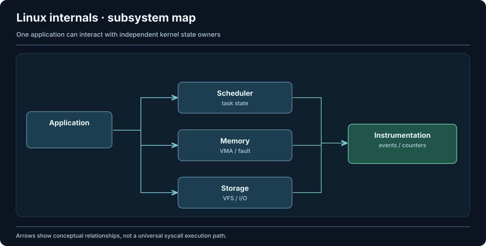

## Linux 내부 구조를 다시 정리하는 이유

Linux를 개발·운영 환경으로 쓰는 것에서 더 나아가, **프로그램이 실행되는 동안 커널이 어떤 자원을 관리하고 어디에서 지연이 생기는지** 이해하고 싶었다. 같은 오류라도 프로세스·메모리·파일시스템·네트워크 중 어떤 계층이 책임지는지 구분하는 것이 가장 중요했다.

C/C++와 시스템 프로그래밍에서 출발해 프로세스·스레드, 스케줄링, 가상 메모리, 파일시스템, 디바이스 드라이버와 커널 디버깅까지 연결해 정리했다. 특히 **Raspberry Pi에 Linux를 구성하고 ftrace와 KernelShark로 커널 함수·스케줄링 이벤트를 살펴봤던 경험**은 교재에서 보던 개념을 실제 시간축으로 이해하는 계기였다.

이 글은 나중에 OS를 다시 공부할 때 **각 개념이 어떤 경로로 연결되는지 떠올리기 위한 기술 지도**다. 개별 주제는 별도 노트에 더 자세히 정리하고, 이 글에서는 전체 계층과 학습 순서를 연결한다.



## 프로그램을 한 번 실행할 때 실제로 거치는 계층

사용자에게 보이는 프로그램의 동작과 내부에서 처리하는 계층을 나누면 다음과 같다.

| 프로그램에서 하는 일 | 시스템에서 관련되는 구조 | 복습할 질문 |
|---|---|---|
| 프로그램 실행 | ELF, loader, `execve()`, process address space | 실행 파일과 프로세스는 왜 다른가? |
| CPU에서 일 수행 | scheduler, runqueue, preemption | 실행 가능한 태스크가 바로 실행되지 않는 이유는? |
| 메모리 접근 | VMA, page table, page fault, page cache | 가상주소가 물리주소와 같은가? |
| 파일 열기 | file descriptor, VFS, dentry, inode | 파일 경로는 어떤 객체들로 해석되는가? |
| 데이터 쓰기 | buffered write, writeback, filesystem, block I/O | `write()` 성공과 영구 저장은 같은가? |
| 네트워크 연결 | socket, TCP/UDP, kernel network stack | 패킷을 보냈다고 응용 메시지가 전달되는가? |
| 장치 제어 | device tree, driver, IRQ, DMA | 장치의 이벤트가 프로세스에 전달되는 과정은? |
| 성능 확인 | ftrace, perf, eBPF, metrics | 관찰한 지연의 원인을 어떻게 증명할 수 있는가? |

여기서 배운 가장 중요한 사고방식은 **상위 계층의 증상과 하위 계층의 가설을 혼동하지 않는 것**이다. 예를 들어 프로그램이 느리다는 사실만으로 스케줄러가 문제인지, lock을 기다리는지, 저장장치 I/O가 막혔는지 단정할 수 없다.

## Linux 사용·설정: shell과 권한부터 시작

### 3.1 Shell, pipe, redirection

Shell은 명령을 해석하고 다른 프로그램의 실행 환경을 구성한다. 다음 예시는 개념 설명을 위한 명령이다.

```bash
grep 'ERROR' app.log | sort | uniq -c > error-count.txt
```

이 과정에는 다음 요소가 등장한다.

1. `grep`, `sort`, `uniq`는 각각 독립된 프로세스가 될 수 있다.
2. `|`를 통해 프로세스 사이에 바이트 스트림이 연결된다.
3. 표준 입력·출력은 file descriptor로 표현된다.
4. `>`는 출력 대상을 일반 파일로 바꾼다.
5. 파이프의 송신 측이 모두 닫혀야 읽는 측에서 정상적인 EOF를 관찰할 수 있다.

단순한 shell 명령이 나중에 배우는 **process, pipe, file descriptor, blocking I/O**의 축소판인 셈이다.

### 3.2 사용자·그룹·파일 권한

파일 모드 비트는 `read/write/execute` 권한을 구분한다. 하지만 디렉터리에서 `x` 권한이 가지는 의미나 소유자·그룹 선택 규칙은 일반 파일의 경우와 조금 다르다. 이 구조를 이해하지 못하면 접근 거부 오류를 단순히 `chmod 777`로 해결하려고 하기 쉽다.

이후 Kubernetes를 운영할 때도 **Linux 파일 권한, 컨테이너 UID, Kubernetes ServiceAccount RBAC는 서로 다른 보안 경계**임을 구분해야 했다.

### 3.3 네트워크 진단의 출발점

네트워크 경로를 이해하려면 TCP/UDP, ARP, DNS, NAT, routing, SSH, 방화벽, 소켓을 함께 봐야 한다. 연결 문제가 생겼을 때 아래 항목은 각각 별도로 확인해야 한다.

| 확인 계층 | 질문 | 관련 명령 예시 |
|---|---|---|
| DNS | 이름이 기대한 주소로 해석되는가 | `getent hosts`, `dig` |
| Routing | 어디로 패킷을 보내는가 | `ip addr`, `ip route` |
| Port | 프로세스가 실제로 수신하는가 | `ss -ltnp` |
| Transport | TCP 연결 자체가 가능한가 | `nc`, `curl -v` |
| Application | 정확한 요청을 처리하는가 | `curl`, 애플리케이션 로그 |

도구가 여러 개인 이유는 각 도구가 같은 실패를 확인하는 것이 아니라 **서로 다른 실패 지점을 분리하기 때문**이다.

## System Programming: 함수 호출 이후의 세계

C/C++에서 작성한 코드는 라이브러리와 시스템 콜을 통해 커널의 기능을 사용한다. 커널로 넘어가는 경계에서 프로세스·메모리·파일·소켓의 의미가 달라진다.

### 4.1 Process와 Thread

- **Process:** 별도 주소 공간 및 자원을 관리받는 실행 단위다.
- **Thread:** 프로세스 내부의 실행 흐름이다. 같은 프로세스 내에서 주소 공간과 일부 자원을 공유한다.
- **File descriptor:** 프로세스에서 열린 파일·파이프·소켓 등을 가리키는 정수 핸들이다.
- **Synchronization:** 공유 데이터의 불변식이 깨지지 않도록 접근 순서를 조정한다.

공유 메모리가 빠르다는 설명만으로는 충분하지 않다. 데이터의 **전달**과 데이터가 **언제 완성됐다고 판단할지**는 다른 문제다. 공유 메모리에는 별도의 동기화·수명 관리가 필요하다.

### 4.2 IPC와 socket

프로세스 사이의 통신을 이해할 때는 `pipe`, FIFO, POSIX/System V 메시지 큐, 세마포어, 공유 메모리, `mmap`, TCP/UDP 소켓과 I/O multiplexing을 구분한다.

기억할 구분은 다음과 같다.

| 메커니즘 | 제공하는 것 | 별도로 설계해야 하는 것 |
|---|---|---|
| Pipe | 순서 있는 바이트 스트림 | 메시지 경계, EOF, FD 소유권 |
| Message queue | 메시지 단위 전달 | 큐 크기, 블로킹, 장애 처리 |
| Shared memory | 같은 메모리 영역 접근 | 상호 배제, 완료 알림, 메모리 순서 |
| TCP socket | 순서 있는 신뢰성 높은 바이트 스트림 | 응용 프레이밍, timeout, 연결 종료 |
| UDP socket | 개별 datagram 전달 | 손실, 순서, 재전송 필요 여부 |

자세한 내용은 [POSIX 시스템 프로그래밍 학습 노트](https://petooooo.github.io/notes/study-kdt-posix/)에서 이어진다.

## Scheduler: 실행 중과 실행 가능은 다르다

CPU에서 동작하는 태스크를 추적하면서 **Running, Runnable, Sleeping**을 구분하는 습관이 중요했다.

- **Running:** 지금 CPU에서 실행 중이다.
- **Runnable:** 실행할 준비가 되었지만 CPU를 기다릴 수 있다.
- **Sleeping/Blocked:** I/O·lock·timer 등 사건을 기다리고 있다.

프로세스가 오랫동안 반응하지 않았다고 해서 반드시 CPU 스케줄링이 나쁜 것은 아니다. 런큐에서 대기했는지, wait queue에서 잠들었는지 구분해야 한다.

CFS, 실시간 스케줄링 정책, 선점, 멀티코어 부하 분산, context switch를 구분한다. Linux 스케줄러는 **커널 버전에 따라 구현이 변한다**. 고전적인 CFS의 `vruntime`·red-black tree 모델을 현재 Linux의 모든 실행 경로에 그대로 적용해서는 안 된다.

### 5.1 ftrace와 KernelShark

Raspberry Pi에 Linux를 구성하고 ftrace와 KernelShark로 커널 함수 및 스케줄링 이벤트를 살펴본 경험은 특히 도움이 됐다. 관찰 대상은 다음과 같은 질문이었다.

- 어느 태스크가 언제 CPU를 사용했는가?
- 언제 context switch가 발생했는가?
- 어떤 태스크가 새로 깨어났는가?
- trace 상의 시간 간격을 실제 작업 지연과 어떻게 연결할 것인가?

타임라인에 이벤트가 표시됐다는 사실만으로 **스케줄링 지연의 원인까지 입증된 것은 아니다**. 당시 정확한 context-switch 시간 수치는 따로 보관하지 않았으므로, 필요하면 새로운 실험으로 측정해야 한다.

## Virtual Memory: 가상주소와 물리 페이지를 분리하기

가상 메모리를 공부할 때 다음 개념을 연결하는 것이 핵심이었다.

1. 사용자 프로그램의 가상주소 공간
2. VMA와 접근 권한
3. 페이지 테이블과 주소 변환
4. Page fault
5. 물리 페이지 할당/매핑
6. File-backed mapping과 page cache
7. Reclaim, swap 및 OOM

`malloc()` 호출이 곧 특정 물리 페이지를 확보한다는 뜻은 아니다. 사용자가 얻는 것은 주소 범위에 대한 추상화이고, 실제 페이지 제공·매핑은 구현과 접근 시점에 따라 달라진다.

이 구분은 나중에 **컨테이너 메모리 제한, 호스트 OOM, page cache 사용량**을 해석할 때 다시 나타났다.

## VFS·파일시스템·스토리지

### 7.1 `open()`에서 블록 장치까지

파일을 읽거나 쓸 때 프로그램의 시스템 콜은 VFS를 거쳐 구체적인 파일시스템에 전달된다.

| 계층 | 중요한 역할 |
|---|---|
| File descriptor / open file description | 오픈된 파일의 상태와 오프셋 |
| VFS | 공통 파일 관련 연산 인터페이스 |
| Dentry / inode / superblock | 경로·메타데이터·파일시스템 구조 |
| Page cache / writeback | 메모리 캐싱 및 dirty 데이터 반영 |
| Block layer | 블록 I/O 요청·큐잉 |
| SSD / Flash | 물리 데이터 배치와 장치 내부 동작 |

당시 파일시스템의 기본 구조와 consistency, VFS control flow, Flash와 Flash-aware filesystem, 차세대 SSD 관련 내용을 공부했다.

### 7.2 `write()`와 durability

`write()`가 성공했다고 해서 **전원이 꺼져도 데이터가 반드시 남는다**고 결론 내릴 수 없다. 버퍼 캐시, 파일시스템 정책, writeback, 저장장치 캐시와 flush 등이 관련된다. `fsync()`도 어떤 파일과 메타데이터를 보장하는지, 실패가 어떻게 보고되는지에 따라 구체적으로 이해해야 한다.

파일시스템 journaling은 애플리케이션의 데이터베이스 트랜잭션과 동일한 의미의 원자성을 제공하지 않는다.

이 영역이 현재 가장 우선적으로 심화하려는 주제다. [스케줄러·가상 메모리·VFS 노트](https://petooooo.github.io/notes/study-kdt-kernel-vfs-memory/)에서 자세히 정리한다.

## Embedded Linux: 하드웨어의 이벤트를 커널에서 다루기

전자공학에서 익힌 회로·인터페이스 지식이 가장 직접적으로 연결된 영역이다. ARM, Raspberry Pi, device tree, kernel module, GPIO, SPI, UART, PWM, IRQ, threaded IRQ, workqueue가 하나의 장치 제어 경로를 구성한다.

드라이버에서 특히 중요한 질문은 **이 코드가 어떤 execution context에서 실행 중인가**다.

- Hard IRQ handler에서는 sleep할 수 없다.
- 오래 걸리는 작업은 적절한 deferred context로 옮긴다.
- 장치 자원은 초기화 중 오류가 나더라도 올바르게 해제해야 한다.
- 커널 버전·장치 종류에 따라 실제 드라이버 API가 달라질 수 있다.

[Embedded Linux와 Device Driver 노트](https://petooooo.github.io/notes/study-kdt-embedded-linux/)에서 상세히 정리한다.

## 성능 관측과 장애 분석: 무엇을 측정하는 도구인가

| 관측 도구 | 주로 알 수 있는 정보 | 해석할 때의 함정 |
|---|---|---|
| `ps`, `/proc` | 현재 프로세스와 자원 사용 정보 | 한 시점의 상태만 보여줄 수 있다 |
| ftrace / KernelShark | 커널 이벤트의 시간 순서 | 시간적 상관관계가 곧 인과는 아니다 |
| `perf` | CPU 샘플, 하드웨어 이벤트 | 샘플링 편향과 설정의 영향 |
| eBPF / BCC | 선택된 hook에서 수집한 이벤트 | 부하와 hook 안정성·권한 |
| Crash dump / vmcore | 시스템 정지 시점의 메모리 | 사건의 전체 시간 순서를 담지는 않는다 |
| Prometheus / Grafana | 시계열 메트릭과 대시보드 | 미세한 커널 경로가 직접 보이지 않을 수 있다 |

이 도구들을 통합해서 생각하면 **먼저 증상의 범위를 좁히고, 필요한 사건만 추적하며, 원인을 가설로 검증하는 방법**을 익힐 수 있다.

- [Crash Dump 분석 노트](https://petooooo.github.io/notes/study-kdt-crash-dump/)
- [eBPF·BCC·Observability 노트](https://petooooo.github.io/notes/study-kdt-ebpf-observability/)

## Linux 인프라 운영 경험과 연결

| 시스템 개념 | 운영하면서 떠올린 질문 | 더 공부할 부분 |
|---|---|---|
| Scheduler | CPU는 남는데 응답이 느린 이유는? | blocked/runnable time, latency |
| Virtual memory | Pod 사용량과 호스트 OOM 상황이 달라 보이는 이유는? | cgroup, reclaim, OOM |
| VFS/Storage | 재기동한 DB가 실제로 안전하게 복구된 것인가? | page cache, fsync, crash consistency |
| Networking | 서비스가 실패하면 DNS·TCP·TLS·Ingress 어디를 볼까? | kernel network path |
| Tracing | 메트릭에 보이지 않는 병목은 무엇으로 증명할까? | ftrace, perf, eBPF |
| Device driver | 하드웨어 자원이 OS에 노출되는 과정은? | IRQ, DMA, device model |

처음부터 연구 주제를 하나로 정했던 것은 아니다. 여러 시스템 계층을 이해하고 Linux 인프라를 운영하면서 **커널·파일시스템·스토리지의 내부 동작을 더 깊이 이해하고 싶다**는 방향으로 관심이 좁혀졌다.

## 다음에 이 글을 다시 읽을 때

다음 순서로 복습하면 서로 다른 노트가 연결된다.

1. **User space:** C/C++, 파일 디스크립터, 프로세스·스레드, POSIX IPC.
2. **Kernel:** Scheduler, VM, page fault, locking, interrupt.
3. **Storage:** VFS, ext4/F2FS, page cache, writeback, blk-mq, NVMe.
4. **Observability:** ftrace, perf/eBPF, crash dump, 재현 실험.
5. **Research:** 구현 읽기 → 문제 정의 → 근거 수집 → baseline → 비교 평가.

서로 연결되는 개념과 읽을거리는 [커널에서 저장장치까지](https://petooooo.github.io/notes/study-roadmap/)에 모았다.

## 참고자료

- Linux System & Kernel Expert Course (2023–2024)
- [Linux kernel documentation](https://docs.kernel.org/)
- [Linux man-pages](https://man7.org/linux/man-pages/)
- [Operating Systems: Three Easy Pieces](https://pages.cs.wisc.edu/~remzi/OSTEP/)
- [Linux Kernel Labs](https://linux-kernel-labs.github.io/refs/heads/master/)
