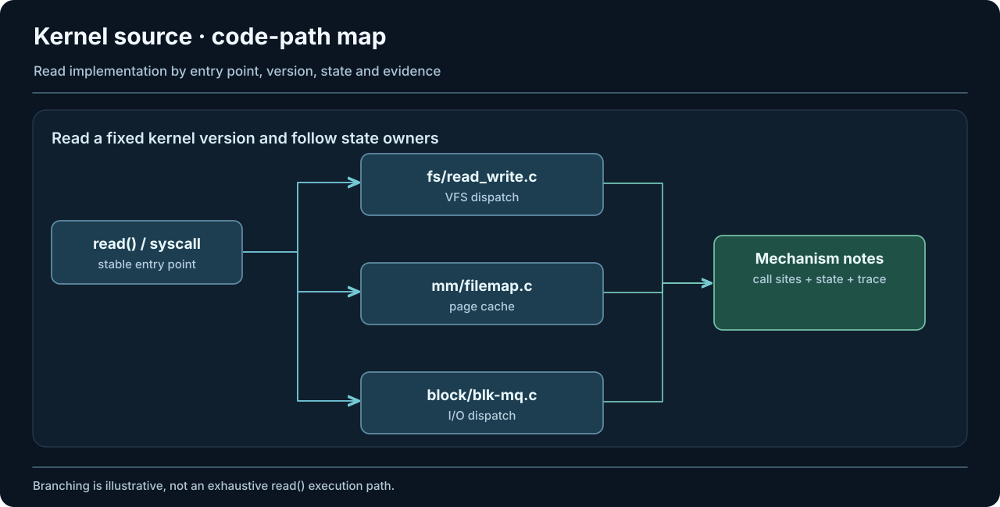

## 1. 소스 코드를 많이 읽어도 이해가 깊어지지 않는 이유

커널에서 함수 하나를 찾아 읽고 곧바로 다른 파일로 이동하면 **어떤 사용자 동작을 설명하려고 읽기 시작했는지** 잃어버리기 쉽다. 나는 시스템 콜 하나를 정하고 **공개 API → 커널 진입 → 서브시스템 → 자료구조 → 관측 가능한 사건** 순서로 경계를 따라가는 방식이 효율적이라고 생각한다.



## 2. 가장 먼저 버전을 고정한다

Linux 커널의 내부 함수명과 자료구조는 계속 달라진다. 오래된 책에서 설명한 `rb_tree` 기반 스케줄러와 최근 EEVDF 구현을 혼동하지 않으려면 **읽고 있는 소스의 tag 또는 commit을 기록**해야 한다.

| 기록할 항목 | 필요한 이유 |
| --- | --- |
| Kernel tag/commit | 함수·구조체의 의미가 버전마다 다를 수 있음 |
| Architecture | syscall 진입과 exception handling이 다름 |
| `.config` | 컴파일되는 기능과 경로가 다름 |
| Compiler/toolchain | Build 결과와 debug symbol에 영향 |
| Filesystem/mount | 같은 syscall도 구현 경로가 달라질 수 있음 |

## 3. 핵심 디렉터리 지도

| 폴더 | 읽을 때의 질문 |
| --- | --- |
| `kernel/sched/` | 어떤 태스크를 언제 실행시키는가 |
| `mm/` | 페이지 할당·매핑·reclaim은 어떻게 일어나는가 |
| `fs/` | 파일 API, 이름 탐색과 VFS 처리 |
| `block/` | I/O request가 큐와 장치로 어떻게 이동하는가 |
| `drivers/nvme/` | NVMe 명령·큐와 completion의 연결 |
| `include/linux/` | 공통 객체·함수 선언과 추상화 |

한 폴더만 읽으면 정상 동작을 놓칠 수 있다. **코드의 시작점과 실제로 비용이 발생하는 곳이 다른 디렉터리에 있을 수 있기 때문**이다.

## 4. `read()`를 예로 한 소스 탐색

1. Man-page에서 사용자 API와 오류 계약 확인.
2. `fs/read_write.c`의 관련 시스템 콜 구현 확인.
3. FD가 실제 `struct file`에 연결되는 경로 추적.
4. 해당 filesystem이 제공하는 file operation 확인.
5. Buffered I/O라면 page cache/filemap 관련 함수 추적.
6. Cache miss라면 block layer 또는 비동기 I/O 흐름 탐색.
7. 측정 가능한 tracepoint와 상태 변수를 정리.

이 순서는 개념 지도로, 특정 함수명이 모든 버전의 유일한 실행 경로라는 뜻은 아니다.

## 5. 검색 명령은 탐색 보조 도구

```bash
git status --short
git describe --tags --always
rg 'SYSCALL_DEFINE.*read' fs/
rg 'struct file_operations' include/linux fs/
rg 'trace_.*read' fs/ mm/
```

여기의 명령은 **읽을 위치를 찾는 예시**다. 일치하는 코드가 없다는 결과도 커널 버전이나 구현 방식의 차이일 수 있다. 단순 검색 결과 개수보다 코드의 **호출 관계와 자료구조 수명**을 정리하는 것이 더 중요하다.

## 6. 함수 호출 흐름을 작성하는 기준

실행 경로를 그림으로 정리할 때는 다음을 분리한다.

- **Control flow:** 어떤 함수가 다음 함수를 부르는가?
- **Data flow:** 어떤 객체가 다음 단계로 전달되는가?
- **Execution context:** 현재 프로세스인가, IRQ/workqueue인가?
- **Persistence boundary:** 어디까지 완료되면 어떤 보장이 있는가?
- **Observability:** 어떤 tracepoint로 이 지점을 확인할 수 있는가?

단지 함수 이름들을 화살표로 연결한 diagram은 실제 실행 조건과 데이터 의미가 빠져 있을 수 있다.

## 7. 변경 이력 읽기

`git log -S` 또는 특정 경로의 변경 이력을 확인하면 왜 코드가 바뀌었는지 파악할 수 있다. 성능 최적화처럼 보이는 변경도 bug fix, correctness, hardware workaround 때문일 수 있다.

**커밋 메시지와 테스트 결과를 함께 읽어야** 설계 의도를 이해할 수 있다. 코드가 짧아졌다는 사실만으로 성능이 개선됐다고 말할 수는 없다.

## 8. 작은 소스 읽기 과제

| 과제 | 산출물 |
| --- | --- |
| `open()` 경로 | Dentry/inode/file이 연결되는 한 장의 경로도 |
| `mmap()` 경로 | VMA와 page fault를 구분한 메모 |
| `sched_switch` 이벤트 | 어떤 구조체 상태를 참고하는지 |
| Buffered `write()` | Dirty page와 writeback 경계 |
| Block request issue | bio/request/queue 관계 |

각 글의 마지막에는 **소스 버전, 확인한 함수, 근거 위치, 미확인 분기**를 적는다. 읽지 않은 코드를 “전체 경로를 분석했다”고 쓰지 않는다.

## 9. 읽은 내용을 검증하는 방법

같은 사용자 프로그램을 실행하면서 실제 trace를 수집하면 추측했던 경로와 맞는지 확인할 수 있다. 단, tracepoint가 보이지 않는다고 그 코드가 반드시 실행되지 않았다고 판단할 수는 없다. **선택한 tracer의 관찰 범위**를 먼저 확인한다.

## 참고자료

- [Kernel source tree](https://git.kernel.org/pub/scm/linux/kernel/git/torvalds/linux.git/)
- [Kernel documentation](https://docs.kernel.org/)
- [Linux VFS](https://docs.kernel.org/filesystems/vfs.html)
