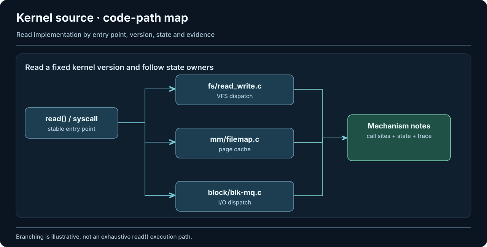

## Kernel patch의 시작은 코드 작성이 아니다

Linux 커널을 수정하기 전에 **기준 소스를 정확히 빌드하고, 원래 동작을 재현하고, 테스트할 수 있는 환경**이 있어야 한다. 기준을 만들지 않은 채 patch부터 작성하면 변경 이후의 차이가 내 코드 때문인지 환경 때문인지 구분하기 어렵다.

## Baseline을 고정하기

| 대상 | 기록 |
| --- | --- |
| Source | Repository, tag, exact commit |
| `.config` | 아키텍처 및 기능 설정 |
| Compiler | GCC/Clang version |
| Target | VM/QEMU, 테스트 머신 |
| Build output | Warning, artifact location |
| Debug symbols | Symbol/stack trace를 해석할 정보 |
| Tests | 기본 부팅 및 regression suite |

한 줄의 `uname -r`만으로 정확한 source commit과 config를 알 수 있다고 생각하지 않는다.

## 빌드 경로와 안전한 테스트 환경

커널을 운영 호스트에 직접 설치·부팅하면 실패 시 원격 연결이 끊어질 수 있다. 처음에는 전용 VM/QEMU 등 **복구 가능하고 격리된 환경**을 사용한다.

컨테이너 내부에서 kernel source를 컴파일할 수는 있지만 **컨테이너가 호스트와 별도의 Linux kernel을 자동으로 제공하는 것은 아니다**. 실제 실행 중인 커널을 테스트하려면 VM 또는 독립된 장치가 필요하다.

## Compile과 Boot는 다른 성공 기준

- Compile: 소스와 도구가 빌드 가능.
- Boot: 초기화 경로를 통과.
- Device/filesystem: 필수 드라이버와 rootfs가 동작.
- User workload: 의도한 기능을 사용할 수 있음.
- Regression: 기존 동작이 깨지지 않았음.
- Performance: 새 구현이 요구된 수치/정확성 목표에 부합함.

**빌드 성공을 구현 완료라고 보고하면 안 된다.**

## 소스 탐색·디버깅 도구

| 도구 | 역할 | 주의 |
| --- | --- | --- |
| `git grep` / `rg` | Symbol과 참조 검색 | 매크로·인라인 경로 |
| `gdb` | 정지 상태와 stack 확인 | Symbol이 빌드와 일치해야 함 |
| `ftrace` | 커널 이벤트 관찰 | 이벤트 선택과 부하 |
| `perf` | CPU hot path profiling | Sampling 편향 |
| KASAN/KCSAN | 메모리·동시성 문제의 탐지 도움 | 큰 오버헤드 가능 |
| `git bisect` | 회귀가 시작된 commit 좁히기 | 테스트 스크립트의 신뢰성 |

## 작은 Patch를 선택하는 기준

처음부터 복잡한 파일시스템의 새 기능을 만들기보다, 하나의 관측·정확성 문제가 있는 **작은 수정**을 고려한다.

1. 재현 가능한 문제를 정의한다.
2. 해당 kernel tag에서 baseline을 확인한다.
3. 메커니즘을 소스와 trace로 이해한다.
4. 영향을 받는 코드와 테스트를 최소화한다.
5. Patch 전후 정확성과 경고를 검사한다.
6. 변경의 한계와 추가 검토점을 기록한다.

## API 변경과 버전 의존성

커널 internal API는 안정된 사용자 공간 ABI와 다른 특성이 있다. 최근 커널의 예시 코드를 오래된 버전에 복사하면 빌드되지 않을 수 있다. 함수의 존재를 확인할 때는 **해당 버전의 헤더·문서·call sites**를 같이 본다.

## Commit 기록의 기준

하나의 commit이 설명할 수 있는 변경 단위가 되도록 한다.

- Why: 어떤 문제를 해결하는가.
- What: 어떤 구조/함수를 변경했는가.
- Test: 어떤 환경과 테스트를 사용했는가.
- Risk: 성능·동시성·메모리·ABI 영향은?
- Follow-up: 아직 해결하지 못한 점은?

실제 upstream 제출은 프로젝트의 coding style·review 절차를 이해한 뒤 진행한다.

## 이해 점검

- Kernel 컴파일과 운영 커널 테스트가 왜 다른가?
- Debug symbol은 어떤 build와 맞아야 하는가?
- 새 Patch에서 성능 개선을 주장하려면 무엇이 필요한가?
- QEMU에서 통과한 테스트가 실제 장치에서 반드시 통과하는가?

## 참고자료

- [Linux Kernel Build System](https://docs.kernel.org/kbuild/)
- [Linux Submitting Patches](https://docs.kernel.org/process/submitting-patches.html)
- [Linux KUnit](https://docs.kernel.org/dev-tools/kunit/)
