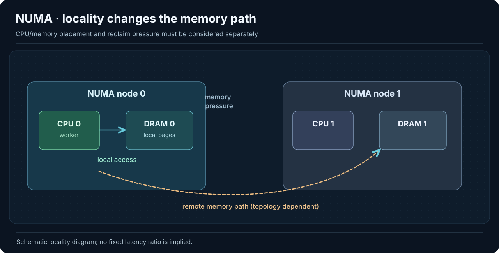

## RAM이 남아도 메모리 접근이 느릴 수 있다

메모리 문제를 “부족하다/충분하다”로만 나누면 중요한 성능 이슈를 놓친다. NUMA 시스템에서는 **데이터가 어느 메모리 노드에 있는지**가 지연과 bandwidth에 영향을 줄 수 있다. 메모리 압박에서는 Page reclaim과 swap이 CPU·I/O 비용을 만든다.



## NUMA의 기본 구조

NUMA(Non-Uniform Memory Access)는 CPU와 메모리의 물리적 위치 관계에 따라 접근 비용이 다른 구조다. 같은 총 RAM을 사용해도 local/remote memory 접근 비율이 달라지면 성능이 달라질 수 있다.

| 개념 | 의미 |
| --- | --- |
| NUMA node | CPU/메모리의 locality 단위 |
| CPU affinity | 실행할 CPU 집합 제한 |
| Memory policy | 메모리 allocation 위치 정책 |
| Local access | CPU와 가까운 메모리 접근 |
| Remote access | 상대적으로 먼 node의 메모리 접근 |
| Memory bandwidth | 단위 시간의 데이터 처리 능력 |

실제 성능 차이는 CPU 아키텍처·워크로드·페이지 배치에 따라 달라진다.

## Memory reclaim

커널은 필요에 따라 cache와 anonymous memory를 회수하려 한다. Clean file-backed cache는 버릴 수 있는 경우가 있지만 dirty data는 writeback이 필요할 수 있다. Anonymous memory는 swap과도 관련된다.

Reclaim 과정은 CPU, lock 및 디스크 I/O 부담을 일으킬 수 있다. 따라서 **OOM이 발생하지 않아도 메모리 압력 때문에 latency가 악화**될 수 있다.

## PSI: 메모리 압력을 시간으로 보기

Pressure Stall Information(PSI)은 특정 자원 때문에 task의 진행이 지연된 시간을 관찰하는 방법이다.

```bash
cat /proc/pressure/memory
cat /proc/pressure/cpu
cat /proc/pressure/io
```

지원 여부는 커널과 설정에 따라 다르다. 사용률 그래프와 PSI는 같은 값이 아니다. **메모리가 많이 할당됐다는 것**과 **그 때문에 작업이 stall됐다는 것**을 구분할 수 있다.

## Cgroup memory limit

컨테이너 기반 환경에서는 cgroup이 메모리 예산을 제한할 수 있다. Workload가 cgroup limit을 초과해 종료되는 상황과 호스트 전체의 메모리 부족은 다르다.

| 상태 | 확인할 것 |
| --- | --- |
| Host pressure | 전체 RAM, reclaim, swap |
| Cgroup pressure | `memory.current`, `memory.max`, events |
| OOM kill | 어떤 범위에서 종료가 발생했는가 |
| File cache 증가 | 회수 가능 cache와 dirty page |
| Kernel slab | 일반 프로세스 RSS에 안 보이는 사용량 |

특정 프로세스가 OOM victim으로 선택됐다고 해서 **근본 원인이 반드시 그 프로세스**인 것은 아니다.

## Memory와 Storage가 연결되는 지점

Dirty page를 회수하려면 먼저 writeback이 필요할 수 있다. 따라서 느린 SSD 또는 저장공간 압박이 memory reclaim을 어렵게 만들 수 있다.

이러한 상황에서는 Memory pressure와 I/O pressure가 동시에 높아질 수 있다. 증상 하나만으로 “메모리 문제” 또는 “디스크 문제”라고 확정하면 놓치는 계층이 생긴다.

## 실험 계획

| 실험 | 변경 변수 | 관찰 |
| --- | --- | --- |
| NUMA pinning | CPU node, memory node | Latency와 bandwidth |
| File cache 압박 | Dataset size | Reclaim/PSI |
| Anonymous memory | Allocation/touch pattern | RSS, swap, fault |
| Cgroup memory | `memory.max` | OOM events |
| Mixed workload | Dirty write와 memory pressure | Reclaim/I/O coupling |

테스트용 환경과 데이터로만 시행하고, 과도한 메모리 할당으로 공유 호스트를 불안정하게 만들지 않는다.

## 확인할 질문

- RAM 사용량이 낮은데 remote memory가 병목일 수 있는가?
- Page cache 사용량과 OOM 위험을 왜 동일시하면 안 되는가?
- PSI와 CPU 사용률이 알려주는 것은 어떻게 다른가?
- Cgroup OOM과 host OOM을 구분하는 근거는?

## 참고자료

- [Linux memory control group](https://docs.kernel.org/admin-guide/cgroup-v2.html)
- [Linux PSI](https://docs.kernel.org/accounting/psi.html)
- [Linux memory management](https://docs.kernel.org/mm/)
