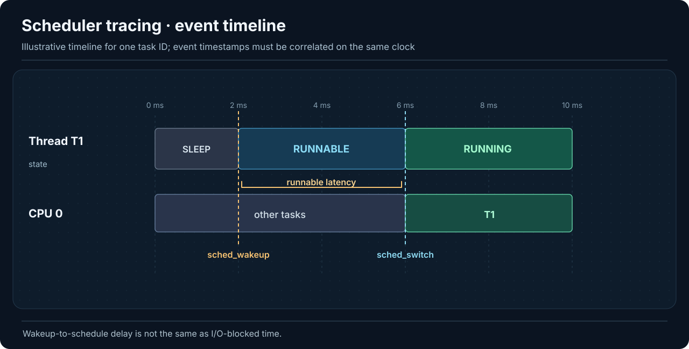

## 1. 관측의 목적은 많은 이벤트를 출력하는 것이 아니다

프로그램이 느릴 때 프로파일링 도구를 사용하면 숫자를 얻기는 쉽다. 그러나 진짜 필요한 것은 **느린 원인에 관한 가설을 지지하거나 반박하는 데이터**다. 같은 CPU latency라도 CPU instruction 실행, cache miss, lock 대기, page fault, block I/O는 서로 다른 도구 조합이 필요하다.



## 2. Sampling과 tracing

| 방식 | 관찰 단위 | 강점 | 한계 |
| --- | --- | --- | --- |
| CPU sampling | 특정 시점의 실행 위치 | CPU hotspot | 샘플링 편향 |
| Hardware counter | cycles, instructions, cache event | 큰 범위의 자원 활동 | 정확한 원인 연결에 추가 근거 필요 |
| Tracepoint | 특정 커널 사건 | 사건의 시간 관계 | 선택하지 않은 경로는 보이지 않음 |
| kprobe/kretprobe | 함수 진입·반환 부근 | 특정 함수 조사 | Kernel version과 hook 안정성 |
| BPF map/ring buffer | 이벤트 수집 결과 | 낮은 비용의 선택적 집계 가능 | Drop/overhead/검증 고려 |

## 3. `perf stat` 읽기

`perf stat`의 cycles와 instructions 값은 workload의 CPU 활동을 해석하는 단서다. 예를 들어 IPC(instructions per cycle)는 특정 CPU와 실행 조건에서 명령어 수행 효율을 나타내는 하나의 관측값일 수 있다.

```bash
perf stat -- sleep 1
perf stat -e cycles,instructions,cache-misses -- ./my-benchmark
```

두 번째 명령은 **이미 존재하는 테스트 프로그램이 필요**하다. Counter 가용성·권한·가상화·CPU 종류가 결과를 바꾸므로 출력이 안 나온다는 것만으로 “카운터가 0이다”라고 해석하면 안 된다.

## 4. eBPF 프로그램의 생명주기

eBPF 프로그램은 일반적으로 사용자 공간에서 로딩 요청 → 커널 verifier 검사 → 적절한 attach point 연결 → 이벤트 시 실행 → map/ring buffer 등으로 결과 전달의 흐름을 가진다.

- **Verifier:** 허용되지 않은 동작 등을 제한한다.
- **Map:** 커널과 사용자 공간이 특정 상태·집계 값을 교환할 수 있다.
- **Ring buffer:** 이벤트 스트림을 사용자 공간에 효율적으로 전달할 수 있다.
- **BTF:** 타입 정보를 활용해 커널 구조에 관한 접근을 도울 수 있다.

Verifier가 통과했다고 코드가 **성능 영향을 전혀 주지 않는다**는 뜻은 아니다.

## 5. Kprobe와 tracepoint 선택

가능하다면 안정적인 커널 tracepoint를 먼저 검토한다. 특정 내부 함수의 kprobe는 사용 중인 kernel version과 최적화·inlining 여부에 영향을 받을 수 있기 때문이다.

Tracepoint도 모든 버전에서 항상 동일한 필드 구조를 보장한다고 가정해서는 안 된다. `bpftrace -l` 등으로 실제 실행 환경에서 사용 가능한 항목을 확인하는 것이 좋다.

## 6. Histogram으로 tail latency 보기

평균 latency만 보면 느린 상위 요청을 놓칠 수 있다.

| Statistic | 해석 |
| --- | --- |
| Count | 표본 수 |
| Mean | 산술 평균 |
| p50 | 중간값 수준 |
| p95/p99 | 느린 요청 구간 |
| Max | 관측된 최대값 |

표본이 아주 적을 때 p99는 안정적인 비교값이 아닐 수 있다. 반복 횟수, confidence interval 또는 분포 형태를 함께 확인한다.

## 7. 관측을 방해하는 요인

1. Probe의 자체 CPU 비용.
2. 이벤트를 매번 사용자 공간으로 넘기는 비용.
3. Drop된 이벤트가 만드는 표본 편향.
4. Symbol 품질과 unwind 실패.
5. PID/TID 재사용과 event correlation 오류.
6. Sampling 주기가 workload와 충돌하는 문제.
7. Timer 및 시각 정렬의 문제.

특히 함수 시작/종료의 pair를 정확히 연결하지 못하면 **기대한 duration과 전혀 다른 시간 차이**를 계산할 수 있다.

## 8. 작은 비교 실험

한 테스트 프로그램의 CPU 사용률을 `perf`로 측정하고, 동일 workload에서 선택된 syscall tracepoint의 event count를 수집한다. 두 결과가 답하는 질문을 분리한다.

- `perf`: 어느 동작이 CPU 비용을 많이 차지했나?
- Tracepoint: 어떤 사건이 언제 얼마나 발생했나?
- Application timer: 사용자가 실제 느낀 전체 지연은 얼마였나?

실험 전후 결과가 일치하지 않더라도 **각 도구의 관측 범위를 확인한 뒤** 원인을 해석한다.

## 9. 복습 질문

- Sampling과 tracing은 무엇이 다른가?
- eBPF verifier가 있어도 성능 문제를 만들 수 있는 이유는?
- Kprobe보다 tracepoint가 적합한 경우는?
- P99 latency만 보면 안 되는 상황은?
- Event drop을 기록하지 않으면 어떤 종류의 결론이 위험한가?

## 참고자료

- [Linux BPF docs](https://docs.kernel.org/bpf/)
- [BCC](https://github.com/iovisor/bcc)
- [Linux perf](https://perf.wiki.kernel.org/)
- [Kernel tracing](https://docs.kernel.org/trace/)
