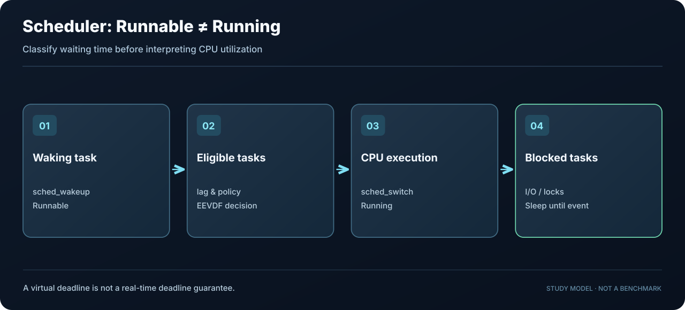

## 1. CPU 사용률이 낮은데 요청이 느릴 때

CPU가 놀고 있다면 애플리케이션이 빨라야 할까? 반드시 그렇지는 않다. 스레드가 I/O, lock, timer 등의 사건을 기다리면 실행 가능한 상태가 아니고 CPU 사용률도 낮을 수 있다. **Runnable로 기다리는 시간**과 **Sleeping/Blocked로 기다리는 시간**을 분리해야 지연의 원인에 가까워진다.

## 2. Running / Runnable / Sleeping

| 상태 | 의미 | 관찰 포인트 |
| --- | --- | --- |
| Running | 현재 CPU에서 실행 | CPU execution time |
| Runnable | 실행 가능하지만 CPU를 기다릴 수 있음 | Wakeup-to-running latency |
| Sleeping | I/O, lock, timer 등을 기다림 | Wait channel, block 원인 |
| Stopped / Zombie | 일반 실행 대상이 아님 | 중단·종료 이유 |

응답 시간은 여러 단계의 실행·대기·I/O가 중첩될 수 있으므로 한 개의 scheduler metric만으로 완전히 설명되지 않는다.

## 3. 고전적인 CFS 모델

전통적 CFS는 태스크가 사용한 CPU 시간과 정책 가중치를 활용해 공정성을 관리하는 모델이다. 핵심 개념인 **`vruntime`**은 실행 시간을 정책에 따라 가상화한다. 고전 설명에서는 red-black tree를 통해 적절한 실행 대상을 찾는다.

다만 현재 Linux의 실제 정책을 설명하면서 “언제나 최소 vruntime을 선택한다”고 쓰면 커널 버전 변화를 무시하게 된다. Linux 6.6에서 EEVDF로 전환하기 시작한 배경을 함께 읽어야 한다.

## 4. EEVDF: Lag와 Virtual deadline

EEVDF는 크게 두 질문을 나눈다.

1. **Eligible:** 공정한 CPU 할당의 관점에서 지금 실행 대상으로 선택할 자격이 있는가?
2. **Virtual deadline:** 자격 있는 태스크 중 무엇을 먼저 선택할 것인가?

Lag는 태스크가 공정한 몫 대비 얼마나 CPU 시간을 받았는지에 관한 개념이다. Positive lag는 CPU 시간을 더 받아야 하는 방향을 나타낸다. Virtual deadline 선택은 반응성에 관한 추가 구조를 제공한다.

**Virtual deadline은 실시간 스케줄러의 절대 기한 보장과 동의어가 아니다.** 둘은 정책 계약이 다르다.

## 5. 지연의 원인을 여러 구간으로 나누기

하나의 서버 요청도 다음 순서로 나뉠 수 있다.

1. 네트워크로 요청 데이터 도착.
2. 해당 스레드 wakeup.
3. CPU를 받을 때까지 runnable 대기.
4. User-space 코드 실행.
5. Mutex나 condition variable 대기.
6. 파일 읽기·쓰기 등 I/O wait.
7. 재차 wakeup과 CPU 실행.
8. 응답 생성 및 전송.

CPU 사용률이 50%라는 값만으로 3번과 6번을 구분할 수 없다.

## 6. `sched_switch`, `sched_wakeup` 읽기

| 이벤트 | 알려 주는 내용 | 주의할 점 |
| --- | --- | --- |
| `sched_wakeup` | 태스크가 runnable이 된 시점 | 모든 latency의 시작은 아님 |
| `sched_switch` | 실행 태스크의 전환 | CPU별 타임라인과 TID 필요 |
| `sched_migrate_task` | CPU 간 task migration | 모든 cache 비용은 직접 나타나지 않음 |
| IRQ/softirq tracepoint | 인터럽트 처리와 시각 관계 | 시간상 동시 발생과 인과성 구분 |

Raspberry Pi 환경에서 ftrace·KernelShark로 스케줄러 이벤트를 보면서 흥미로웠던 부분은 **추상적인 스케줄링 개념이 시간축의 실제 사건으로 드러난다**는 점이었다. 이제 같은 방식으로 실행 지연을 정량화하려면 workload와 관찰 범위를 함께 설계해야 한다.

## 7. 실험 시 통제할 조건

| 변수 | 중요성 |
| --- | --- |
| Kernel version | CFS·EEVDF 구현 차이 |
| CPU count, affinity | Core contention과 migration |
| Nice, scheduler policy | CPU 몫과 선점 |
| Cgroup CPU quota | Throttling과 대기 지연 |
| IRQ load | CPU 경쟁 요인 |
| Tracing overhead | 관측으로 인한 부하 변화 |

**Cgroup throttling이 발생한 것을 단순히 스케줄러 버그라고 규정하면 안 된다.** 타임라인과 해당 cgroup 제약을 같이 봐야 한다.

## 8. 복습용 비교 실험

CPU-bound 태스크를 한 개, 코어 수와 비슷한 수, 코어 수를 넘는 수로 실행하고 동일 작업의 wakeup-to-running 지연을 비교한다. 다른 변수를 일정하게 유지하고 모든 측정의 kernel version과 정책을 기록한다.

실제 수치가 없다면 표에 “0ms” 같은 임의의 값을 적지 않는다. **실험 결과가 생긴 뒤에 p50/p95/p99를 작성**한다.

## 9. 이해 확인

- CFS의 `vruntime`이 실제 경과 시간과 같지 않은 이유는?
- EEVDF의 lag와 virtual deadline이 각각 필요한 이유는?
- Runnable 상태가 곧 CPU 실행을 뜻하지 않는 이유는?
- `sched_wakeup`과 `sched_switch`를 묶어 지연을 구할 때 TID·CPU가 중요한 이유는?
- scheduler policy와 cgroup throttling을 어떻게 구분할 수 있는가?

## 10. Wakeup-to-running 지연을 어떻게 측정할까?

Scheduler가 느리다는 주장은 너무 넓다. 정확히 **어느 태스크의 어떤 상태 전이 사이에 시간이 발생했는가**를 정의해야 한다.

예를 들어 `sched_wakeup` 이벤트의 대상 TID가 `sched_switch`의 다음 실행 태스크로 등장할 때까지의 시간을 생각할 수 있다. 그러나 실제 trace에서는 여러 번의 wakeup, CPU migration, 태스크 재수면 등이 생길 수 있으므로 단순히 가장 가까운 두 이벤트를 뺄 수는 없다.

### 10.1 Event matching 조건

| 필드 | 왜 필요한가 |
| --- | --- |
| TID | 한 프로세스의 서로 다른 스레드 구분 |
| CPU | Wakeup 대상 CPU와 실제 실행 CPU의 관계 |
| Timestamp | 실행 상태 전이의 시간 간격 |
| Prev/next state | Switch 이전 상태 해석 |
| Priority/policy | 스케줄링 선택 기준 |
| Cgroup | CPU quota, throttling |
| Trace lost count | 누락된 사건 때문에 지연이 왜곡될 수 있음 |

실제로 어떤 값이 필요하고 어떤 필드가 보이는지는 커널과 tracer 설정에 따라 달라진다.

## 11. EEVDF의 fairness와 latency를 혼동하지 않기

EEVDF의 virtual deadline은 단순히 사용자가 설정한 실시간 deadline이 아니다. 특정 태스크가 **공정한 몫을 받아야 하는 상태인지**와 **그 태스크의 virtual deadline이 무엇인지**를 함께 고려한다.

고전적인 CFS와 비교할 때는 다음 두 기준으로 구조를 구분한다.

- 공정성을 어떤 가상 시간으로 표현하는가?
- 실행 가능한 태스크 중 어떤 기준으로 선택하는가?

커널의 실제 구현은 개발 단계와 버전에 따라 바뀔 수 있다. 따라서 **Linux 6.6 시점의 문서와 최신 mainline의 세부 함수를 동일시하지 않는 것**이 중요하다.

## 12. CPU throttling과 scheduler 지연의 분리

Cgroup에 CPU 사용량 한도가 설정되어 있다면 태스크가 CPU를 원해도 quota 때문에 실행이 제한될 수 있다. 이런 조건은 runqueue contention만으로 설명되지 않는다.

| 증상 | 확인할 가설 |
| --- | --- |
| 높은 CPU utilization | CPU-bound 작업, IRQ 활동 |
| CPU 사용률 낮고 latency 높음 | Sleeping/blocked time |
| Cgroup CPU 제한 도달 | CPU quota throttling |
| Context switch 증가 | 정상적인 workload 전환 또는 contention |
| Migration 증가 | CPU affinity / load balancing |
| 특정 CPU에만 load 집중 | Affinity 및 IRQ 배치 |

새로운 실험에서는 모든 CPU core를 동일한 조건으로 사용했는지, 스케줄러 정책과 cgroup 예산이 같은지 기록한 뒤에야 결론을 내린다.

## 참고자료

- [Linux EEVDF scheduler](https://docs.kernel.org/scheduler/sched-eevdf.html)
- [CFS scheduler](https://docs.kernel.org/scheduler/sched-design-CFS.html)
- [Kernel tracing](https://docs.kernel.org/trace/)
- [OSTEP: Scheduling](https://pages.cs.wisc.edu/~remzi/OSTEP/)
