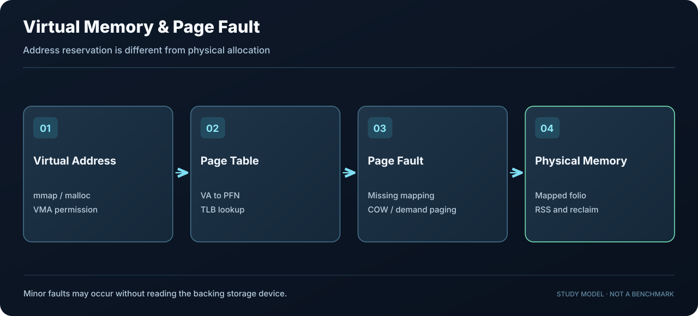

## 1. `malloc()`으로 받은 주소가 RAM을 뜻하는가?

메모리 할당 API가 돌려주는 주소는 보통 **가상주소**다. 운영체제는 프로세스가 보는 주소 공간과 실제 물리 프레임을 분리하고, 페이지를 처음 사용할 때 매핑을 완료할 수 있다. 따라서 VIRT가 큰 프로세스가 그 크기만큼 물리 RAM을 독점한다고 판단하면 안 된다.



## 2. VMA와 프로세스 주소 공간

| 영역 | 역할 | 주의할 점 |
| --- | --- | --- |
| Text | 실행 코드 | 실행 권한과 읽기 권한 |
| Data/BSS | 전역·정적 변수 | 초기화 상태의 차이 |
| Heap | 동적 할당 | allocator와 OS 요청 구분 |
| Stack | 함수 호출 및 지역 상태 | 스레드마다 별도 |
| File mapping | 파일과 연결된 주소 영역 | page cache와 연결될 수 있음 |
| Anonymous mapping | 파일 내용에 직접 연결되지 않음 | reclaim, swap 및 COW |

Linux의 VMA는 주소 영역의 속성과 범위를 나타내는 추상화다. 커널 내부에서 VMA를 찾는 자료구조는 버전에 따라 바뀔 수 있으므로 단일 구현을 영구한 사실로 보지 않는다.

## 3. MMU와 TLB

CPU가 가상주소를 참조하면 페이지 테이블이 가상주소를 물리주소에 연결한다. TLB는 주소 변환 결과를 캐싱한다. 중요한 구분은 **TLB miss는 page fault와 다르다**는 점이다. TLB에 변환이 없어도 페이지 테이블에 유효한 엔트리가 있으면 page-table walk로 처리할 수 있다.

Page fault는 매핑이 없거나 접근 조건을 처리해야 할 때 발생하는 예외다. 반드시 버그를 뜻하는 것은 아니다.

## 4. `malloc`, `brk`, `mmap`

`malloc()`은 libc allocator의 API다. 내부적으로 `brk` 또는 `mmap` 계열을 활용할 수 있지만 할당 크기와 구현에 따라 달라진다. `mmap()`은 익명 영역 또는 파일을 주소 공간에 매핑한다.

```c
#include <sys/mman.h>
#include <stdio.h>
#include <unistd.h>

int main(void) {
    size_t n = 64 * 4096;
    char *p = mmap(NULL, n, PROT_READ | PROT_WRITE,
                   MAP_PRIVATE | MAP_ANONYMOUS, -1, 0);
    if (p == MAP_FAILED) { perror("mmap"); return 1; }
    for (size_t i = 0; i < n; i += 4096) p[i] = 1;
    if (munmap(p, n) == -1) { perror("munmap"); return 1; }
}
```

이 코드는 **개념 검증용 예제**다. 매핑 직후와 페이지를 실제로 쓴 뒤 RSS 및 fault 횟수를 비교하면 demand paging과 연결해 생각할 수 있다. 커널·페이지 크기·THP 설정에 따라 결과는 달라진다.

## 5. Page fault 종류

| 종류 | 해석 | 잘못된 직관 |
| --- | --- | --- |
| Minor fault | 디스크에서 새로 읽지 않고 처리한 fault | 비용이 0이라는 뜻은 아님 |
| Major fault | 처리 과정에서 I/O가 필요했던 fault | 항상 같은 지연이 아님 |
| Permission fault | 권한을 위반한 주소 접근 | 정상 demand paging과 다름 |
| Copy-on-write fault | 공유 페이지에 쓰기 위해 복사본을 마련 | `fork` 직후 전체 복사와 다름 |

`fork()` 직후 부모와 자식의 페이지 테이블은 물리 페이지를 공유할 수 있다. 한쪽이 수정하려는 순간 분리해야 하는 상태가 나타나는데, 이것이 COW를 이해하는 핵심이다.

## 6. VIRT, RSS, PSS

- **VIRT:** 가상주소 공간에 포함된 매핑 크기와 관련된다.
- **RSS:** 실제 상주하는 물리 메모리 페이지의 크기이며 공유 페이지를 각 프로세스가 따로 계산할 수 있다.
- **PSS:** 공유된 상주 페이지를 비례 배분하는 방식으로 추정한다.
- **Page cache:** 파일의 내용을 메모리에 보존해 I/O를 줄일 수 있는 영역이다.

메모리의 합계를 구할 때 프로세스별 RSS를 단순히 더하면 공유 페이지를 여러 번 계산할 수 있다. cgroup memory 사용량과도 직접 대응하지 않는다.

## 7. Memory pressure와 OOM

메모리가 부족하면 커널은 reclaim을 시도한다. Clean file cache는 버릴 수 있는 경우가 있지만 dirty page는 writeback이 필요할 수 있다. Anonymous memory는 swap 설정 등과 관련된다.

Container limit에 의한 cgroup OOM과 host 전체 메모리 압박은 별개다. **OOM victim이 근본적인 메모리 증가의 원인이라는 보장도 없다.**

## 8. 관측 실험을 설계한다면

| 단계 | 관측 정보 | 구분하려는 현상 |
| --- | --- | --- |
| 실행 직후 | `/proc/PID/maps` | VMA 구성 |
| `mmap` 직후 | RSS, fault | 주소 예약과 실사용 |
| 페이지 터치 | minor/major faults | Demand paging |
| `fork` 직후 | RSS/PSS | 공유된 mapping |
| 자식의 쓰기 | fault, RSS/PSS | COW의 복사 |
| 회수 상황 | memory pressure | reclaim과 swap |

`perf stat`, `/usr/bin/time -v`, `/proc/PID/smaps_rollup` 등이 관측 후보이다. 실제 측정 전에는 “예상 결과”와 “관측 결과”를 구분한다.

## 9. 복습 질문

1. TLB miss와 page fault는 왜 서로 다른가?
2. 유효한 페이지에 처음 접근해도 fault가 발생할 수 있는가?
3. `mmap`과 실제 물리 메모리 소비 시점은 왜 분리되는가?
4. RSS와 PSS가 다른 이유는?
5. COW는 `fork()` 이후 언제 의미 있는 비용을 만든다고 볼 수 있는가?

## 참고자료

- [Linux memory management](https://docs.kernel.org/mm/)
- [mmap(2)](https://man7.org/linux/man-pages/man2/mmap.2.html)
- [proc_pid_smaps(5)](https://man7.org/linux/man-pages/man5/proc_pid_smaps.5.html)
- [OSTEP](https://pages.cs.wisc.edu/~remzi/OSTEP/)
