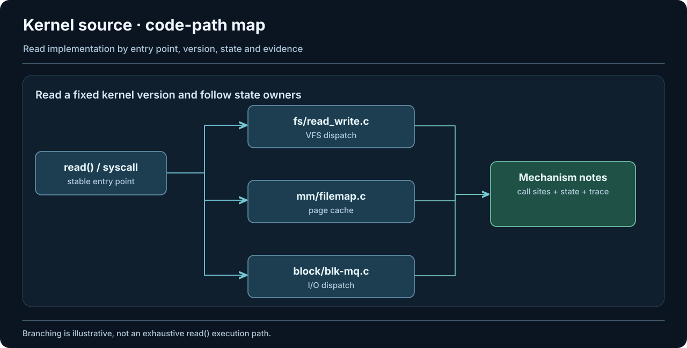

## 1. Linux 소스와 교육용 OS 실습의 차이

Linux 커널은 실용적인 코드와 하드웨어 지원이 방대해 처음부터 모든 분기를 이해하기 어렵다. xv6·Pintos는 상대적으로 작게 설계된 교육용 OS라 **system call, process, virtual memory, scheduler의 본질적인 연결**을 공부하기 좋다.

두 프로젝트를 동시에 진행하기보다는 **하나를 선택하고 작은 기능을 테스트까지 끝내는 것**이 우선이다.

## 2. xv6와 Pintos의 차이

| 구분 | xv6 | Pintos |
| --- | --- | --- |
| 설계 목적 | Unix 계열 OS 핵심 구조 학습 | OS 구성요소별 프로젝트 |
| 일반적인 학습 흐름 | Process, system call, filesystem | Threads, user programs, VM, FS |
| 소스 크기 | 비교적 작고 읽기 쉬움 | 과제와 테스트 중심 |
| 플랫폼/도구 | RISC-V/QEMU 등의 버전 | 교육 환경 및 원본 버전 확인 |
| 좋은 사용법 | 호출 경로 따라 읽기 | 테스트와 failure cases 구현 |

정확한 코드 위치와 API는 사용하는 과제 버전에 따라 달라질 수 있다. **원본 저장소/배포 버전을 고정한 뒤** 읽어야 한다.

## 3. 첫 번째 목표: 빌드·부팅 확인

1. 특정 저장소와 commit/tag를 고정한다.
2. 문서에 제시된 toolchain을 준비한다.
3. 격리된 환경에서 kernel을 빌드한다.
4. QEMU 등으로 부팅한다.
5. 기본 test 또는 간단한 사용자 프로그램을 실행한다.
6. 빌드 명령·출력을 README 또는 lab log로 기록한다.

빌드가 통과했다는 사실과 **scheduler 기능을 직접 구현했다는 사실은 다르다**. 구현 이력을 과장하지 않는다.

## 4. System Call 추가하기

새 시스템 콜을 구현한다고 생각하면 다음 계층이 모두 필요할 수 있다.

| 단계 | 확인할 것 |
| --- | --- |
| User API | 프로그램에서 어떤 인수를 전달하는가 |
| System call number | 호출을 어떻게 구분하는가 |
| Trap/syscall entry | 사용자 공간에서 kernel로 어떻게 전환되는가 |
| Argument validation | 잘못된 user pointer를 어떻게 처리하는가 |
| Kernel implementation | 실제 상태를 어떻게 읽고 수정하는가 |
| Return value/error | 실패를 어떻게 전달하는가 |
| Test | 정상 호출과 잘못된 호출이 모두 검증되는가 |

하나의 새 함수가 컴파일됐다고 해서 전체 syscall API가 안전하게 동작한다고 볼 수 없다.

## 5. Scheduler 실습

실행 순서를 바꾸려면 **어떤 task가 실행 가능한지**를 관리해야 한다. 우선 preemption과 context switch의 기본 경로를 살핀다.

실험 후보:

- 기본 scheduler의 task 선택 흐름 그리기.
- Round-robin 형태의 시간할당 관측.
- 두 CPU-bound 프로세스의 상대 실행 시간.
- Sleep/wakeup 조건의 경합.
- Lock을 잡은 상태에서 스케줄링하면 안 되는 조건.

구현 결과는 test를 실행한 뒤에만 완료로 표기한다.

## 6. Virtual Memory 실습

VM 과제에서는 PTE, page fault, user/kernel address space, demand allocation 등을 생각할 수 있다.

| 오류 | 의심할 조건 |
| --- | --- |
| User memory access crash | PTE 권한/매핑 |
| Process exit 후 메모리 누수 | Page release / reference |
| `fork()` 후 데이터 공유 오류 | COW 처리 |
| Page fault loop | Fault handler가 상태를 수정하지 못함 |
| Stack overflow | User stack 범위 관리 |

## 7. 테스트와 디버깅

GDB와 QEMU의 디버깅 기능을 이용해 register/stack/task 정보를 확인할 수 있다. 로그 출력을 많이 추가하면 concurrency timing이 달라질 수 있으므로 **추적 자체의 영향**을 고려한다.

실행 로그에는 failing test, 예상한 동작, 실제 동작, 수정한 코드, 재실행 결과를 함께 보관한다.

## 8. Linux로 넘어갈 때의 주의점

교육용 OS에서 구현한 단순한 scheduler나 page allocator를 Linux의 실제 생산 코드와 일대일 대응시키면 위험하다. 목적은 **추상화·불변식·상태 변화**를 이해하는 것이며, Linux에서는 여러 아키텍처와 성능 최적화가 추가된다.

## 9. 완료 기준

| 단계 | 증거 |
| --- | --- |
| 환경 준비 | 빌드와 부팅 로그 |
| 코드 탐색 | 함수/자료구조 관계도 |
| 구현 | 변경된 소스 diff |
| 정확성 | 정상/오류 테스트 결과 |
| 해석 | 왜 동작했는지 기술 노트 |

## 참고자료

- [xv6 RISC-V](https://github.com/mit-pdos/xv6-riscv)
- [MIT 6.S081 labs](https://pdos.csail.mit.edu/6.S081/)
- [Pintos Project](https://web.stanford.edu/class/cs140/projects/pintos/pintos.html)
