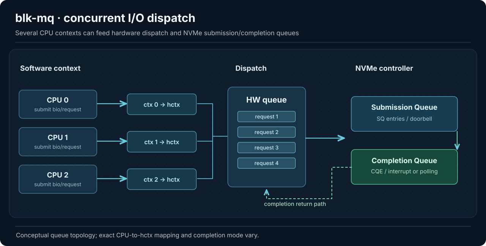

## 파일을 읽을 때 SSD에 무엇이 전달되는가

`read()`는 파일이라는 추상화에 접근한다. 반면 블록 장치는 논리 블록 주소와 I/O 요청을 처리한다. 두 경계 사이에는 VFS, 구체적 파일시스템, page cache, block layer, 드라이버가 존재한다.

## 계층별 역할

| 계층 | 주요 객체·기능 | 중요한 질문 |
| --- | --- | --- |
| Application | `read`, `write`, `fsync` | 어떤 지속성·응답 시간을 원하는가 |
| VFS/Filesystem | inode, mapping, file operations | 어떤 파일 블록에 접근하는가 |
| Page cache | Folio와 dirty/writeback | 실제 장치 I/O가 필요한가 |
| Block layer | `bio`, `request` | 여러 block range를 어떻게 제출하는가 |
| blk-mq | Software staging / hardware queue | 병렬성과 lock contention |
| NVMe driver | Submission/Completion queue | 장치가 언제 요청을 완료했는가 |

이 표는 개념적 모델이며 특정 커널 버전에서 모든 요청이 반드시 같은 경로를 거치는 것은 아니다.

## `bio`와 `request`

`bio`는 블록 주소 범위와 I/O 자료를 표현하는 객체다. Block layer는 여러 bio를 모으거나 분할하여 `request` 단위로 장치 드라이버와 상호작용할 수 있다. 실제 merge 가능 여부는 주소 연속성, 장치 한도, 정책 등에 의존한다.

**같은 파일 하나를 읽는다고 항상 request 하나가 생성되는 것은 아니다.** 파일시스템의 데이터 배치, cache 상태, readahead, 요청 크기 등에 영향을 받는다.

## blk-mq의 이유

SSD/NVMe는 HDD와 달리 다수 요청을 병렬로 처리할 수 있다. 하나의 글로벌 큐에 모든 CPU의 I/O가 몰리면 lock contention과 software overhead가 문제가 될 수 있다. blk-mq는 **software staging queue와 hardware dispatch queue**를 활용해 높은 병렬성을 지원한다.

### Software staging queue

Queueing policy, merging, scheduling 등의 처리가 필요할 때 소프트웨어 계층을 거칠 수 있다. 이를 통해 fairness와 요청 합치기 등의 정책을 적용할 수 있다.

### Hardware queue

드라이버가 장치에 제출할 수 있는 요청을 관리한다. 장치가 모든 요청을 즉시 수락할 수 없다면 추가 대기나 재시도 경로가 필요할 수 있다.

## NVMe SQ/CQ

- **Submission Queue(SQ):** 호스트가 장치에 실행을 요청한 명령을 넣는 큐.
- **Completion Queue(CQ):** 장치가 처리한 명령의 완료 결과를 전달하는 큐.
- **Queue depth:** 동시에 장치에 제출되어 있는 요청 수의 한도 또는 상태.
- **IRQ/Polling:** 완료 이벤트를 확인하는 방식의 선택.

Queue depth를 키우면 많은 outstanding request를 유지할 수 있지만 **개별 요청 지연을 자동으로 줄여 주지는 않는다**. 장치·CPU·software queue가 포화되면 tail latency가 늘어날 수 있다.

## 완료의 층위

장치 명령의 completion은 파일 API의 의미나 crash durability 전체와 동일하지 않다. 예를 들어 buffered `write()`는 블록 요청 완료 이전에 반환될 수 있고, 장치의 내부 cache와 flush semantics도 추가로 고려해야 한다.

이처럼 **Application completion / block request completion / durable media persistence**를 구분해야 한다.

## 성능 측정 관점

| 지표 | 보는 의미 | 조심할 해석 |
| --- | --- | --- |
| IOPS | 초당 완료한 I/O 수 | I/O 크기가 다르면 직접 비교 곤란 |
| Throughput | 초당 데이터 전송량 | 캐시 hit가 섞일 수 있음 |
| p99 latency | 상위 지연 요청 | 표본 수, 반복 조건 |
| Queue depth | Outstanding 요청 수 | 너무 크면 queueing 증가 |
| CPU cycles | I/O stack의 software overhead | 다른 CPU 작업 영향 |

## 추적 경로

Block tracepoint를 이용해 request issue와 completion 이벤트를 연결할 수 있다. 그러나 한 request가 여러 bio에서 만들어졌거나 일부가 병합됐다면 **file system call 하나와 request 하나를 단순 매칭하기 어렵다**. PID/TID, block device, sector, 시간 범위 등의 맥락이 필요하다.

## 복습 과제

1. Cache hit/read miss에서 block request 수가 왜 달라질까?
2. Bio와 request는 왜 다른가?
3. Software queue와 NVMe SQ는 같은가?
4. Device completion이 곧 `fsync()`의 성공을 뜻하는가?
5. Depth 1과 depth 32에서 IOPS와 latency를 함께 비교해야 하는 이유는?

## Request Merge와 Queueing의 Trade-off

Block layer가 인접한 I/O 요청을 합칠 수 있다면 장치에 제출하는 명령 수를 줄일 수 있다. 그러나 **대기 시간을 늘려 요청을 합치는 것이 모든 workload에 유리한 것은 아니다.** 지연 민감한 요청은 빨리 제출하는 편이 중요할 수 있고, sequential throughput은 큰 요청으로 병합하는 것이 유리할 수 있다.

| 최적화 | 가능한 이점 | 비용 또는 위험 |
| --- | --- | --- |
| Request merging | 제출 명령 수 감소 | 기다리면서 latency 증가 가능 |
| Queue depth 증가 | 장치 병렬성 활용 | Queueing·tail latency 상승 |
| CPU별 queue | 경합 감소 | CPU↔HW queue mapping 복잡성 |
| Polling completion | IRQ 처리 비용 회피 가능 | CPU 점유 및 전력 비용 |
| Async I/O | 호출자 블로킹 감소 | 완료·취소·오류 관리 필요 |

**I/O를 병렬화했다는 사실과 최종 애플리케이션이 빨라졌다는 사실은 다르다**는 점을 염두에 둔다.

## 파일시스템 요청과 NVMe 명령을 연결할 때의 함정

하나의 `read()` 호출이 반드시 하나의 NVMe read command에 대응하지 않는다.

- Page cache hit라면 실제 장치 명령이 전혀 없을 수 있다.
- Readahead에 의해 요청한 범위를 넘어선 I/O가 일어날 수 있다.
- 파일시스템이 하나의 파일 범위를 여러 block extent로 나눌 수 있다.
- Block layer에서 여러 bio가 request로 합쳐지거나 분할될 수 있다.
- 장치와 드라이버의 한도 때문에 제출 형태가 달라질 수 있다.

이 때문에 syscall trace와 block trace를 직접 비교할 때는 **시각·TID·파일 오프셋·장치 LBA 사이의 매핑**에 관한 증거가 필요하다.

## Perf와 Block Trace의 역할

CPU profiling은 CPU-side 처리 비용이 어느 함수에 집중되는지를 알려줄 수 있다. Block trace는 request가 발행되고 완료되는 시점을 보여준다. 서로 다른 질문에 답하는 도구다.

1. 사용자 입장에서 측정한 syscall duration.
2. 커널의 파일시스템 processing time.
3. Block layer request issue/complete 구간.
4. NVMe driver의 completion 처리.
5. CPU 사용과 context switch.

측정을 시작하기 전에 어떤 구간을 latency라고 정의할지 정해야 한다. **요청의 완료를 의미하는 이벤트와 데이터의 지속성을 보장하는 이벤트를 혼동하면 안 된다.**

## 참고자료

- [Linux blk-mq](https://docs.kernel.org/block/blk-mq.html)
- [Linux Block layer](https://docs.kernel.org/block/)
- [NVMe specifications](https://nvmexpress.org/specifications/)
