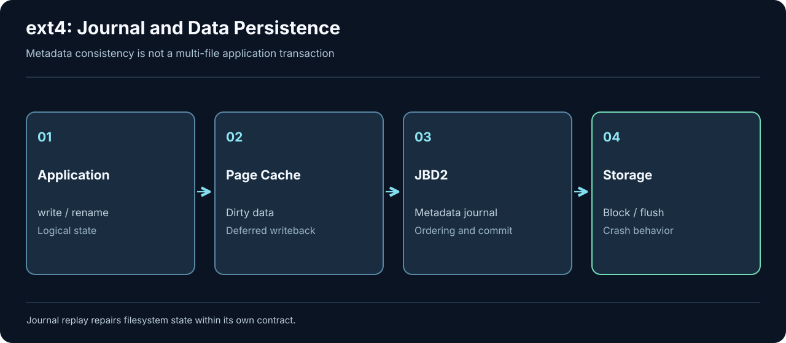

## 1. 파일시스템이 “정상적으로 마운트된다”는 것의 의미

전원 장애 이후 파일시스템이 mount된다고 해서 애플리케이션의 **모든 최신 쓰기 결과가 보존됐다**는 뜻은 아니다. File system consistency는 metadata 구조가 복구 가능한 상태인지에 관한 속성이고, application-level durability는 더 구체적이다.

## 2. ext4의 주요 구조

| 구성 | 역할 |
| --- | --- |
| Superblock | 파일시스템 전체 메타데이터 |
| Block group | 공간을 그룹 단위로 관리 |
| Inode | 파일 메타데이터 및 extent 참조 |
| Extent tree | 파일의 논리 영역과 저장 위치를 연결 |
| Directory entry | 파일 이름과 inode 번호 연결 |
| JBD2 | 파일시스템 metadata journaling 관련 기능 |

실제 파일의 내용은 여러 extent에 배치될 수 있으며, 연속 할당과 fragmentation, allocation policy가 I/O 성능에 영향을 준다.

## 3. 왜 Journal이 필요한가

파일 하나를 만들 때 inode, directory entry, allocation bitmap 등이 갱신될 수 있다. 전원이 나가면 일부 metadata만 반영돼 내부 구조가 일관되지 않을 수 있다. Journaling은 관련 metadata 변경을 묶고 장애 이후 replay할 정보를 제공한다.

그러나 journal을 이해할 때 가장 중요한 질문은 **어느 데이터를 journal에 기록하느냐**다.

## 4. ext4 journaling mode

| Mode | 주요 특징 | 주의 |
| --- | --- | --- |
| `data=ordered` | 기본적으로 metadata journal, 관련 data block write ordering | 애플리케이션 transaction 보장 아님 |
| `data=writeback` | Metadata journal, data ordering은 제한적 | Crash 이후 최근 파일 내용 해석 주의 |
| `data=journal` | 데이터와 metadata를 journal로 관리 | 추가 쓰기 비용 가능 |

구체적 mode와 성능·보장은 커널, mount 설정, 장치의 flush 지원에 영향을 받는다. Journal이 있다고 데이터베이스의 여러 파일 쓰기가 자동으로 atomic해지는 것은 아니다.

## 5. JBD2 transaction의 흐름

개념적으로 변경에 필요한 metadata를 journal transaction에 모으고 commit 기록을 통해 복구 가능한 순서를 구성한다. 이후 적절한 시점에 원래 위치에 checkpoint가 반영될 수 있다.

Crash가 발생하면 committed transaction과 그렇지 않은 변경을 구분하는 복구 정책이 필요하다. **Disk의 원시 write 순서가 항상 사용자 프로그램의 시스템 콜 순서와 같다고 가정하면 안 된다.**

## 6. `fsync`와 응용 데이터 지속성

Buffered write의 dirty data는 비동기 writeback될 수 있다. Application이 특정 파일의 변경을 지속성 보장 시점까지 기다려야 한다면 `fsync`/`fdatasync`와 오류 처리를 검토해야 한다.

파일 교체 패턴에서도 새 파일의 데이터와 `rename()`으로 바뀐 디렉터리 entry는 별개의 지속성 조건을 가질 수 있다. 이를 무시하고 단순한 `rename()`만으로 모든 crash case가 해결된다고 생각하면 위험하다.

## 7. Crash consistency를 구분하는 시나리오

| 단계 | 장애 시 질문 |
| --- | --- |
| 임시 파일 생성 | Directory entry는 생성됐는가 |
| 데이터 기록 | Dirty data가 어디까지 반영됐는가 |
| `fsync` 완료 | 해당 파일에 어떤 지속성이 기대되는가 |
| `rename` 완료 | 새 이름과 기존 이름의 상태는 |
| Directory sync | 이름 변경의 지속성을 어떻게 보장하는가 |

Crash test는 **위험한 장애 유발을 운영 장치에서 실행하지 않고** VM/격리된 전용 테스트 이미지에서만 진행한다.

## 8. 관측 지표와 실험 변수

- ext4 mount options와 journaling mode.
- 커널 버전 및 파일시스템 feature.
- 파일 크기·쓰기 패턴·동기화 빈도.
- Device volatile cache와 power-loss protection.
- 반복 횟수, 파일 내용 checksum, 복구 결과.
- Application 성공 응답과 on-disk 상태의 시각 관계.

실험에서는 “파일시스템이 mount됨”과 “최근 데이터가 살아있음”을 같은 성공으로 표기하면 안 된다.

## 9. 공부하며 연결하고 싶은 문제

Longhorn이나 database replica의 복구를 운영하다 보면 어떤 상태를 “정상”으로 볼지 고민하게 된다. 이때 **ext4가 보장하는 것, DB WAL이 보장하는 것, 분산 복제가 보장하는 것**을 별도 계층으로 나눠야 한다는 점이 선명해진다.

## 10. 복습 질문

1. `data=ordered`에서 무엇이 ordering 대상인가?
2. Metadata consistency와 application transaction의 차이는?
3. `fsync` 성공과 journal replay는 어떤 관계를 가지는가?
4. `rename` 후 전원 장애를 다룰 때 디렉터리 동기화가 왜 언급되는가?
5. Journal이 있으면 백업이 필요 없는가?

## 11. Write ordering과 장애 시점의 차이를 이해하기

같은 세 번의 `write()`가 호출됐더라도 장치가 실제로 데이터를 저장한 순서는 애플리케이션의 호출 순서와 반드시 일치하지 않을 수 있다. 파일시스템과 block layer의 buffering, queueing, cache, flush semantics가 각기 다른 책임을 갖기 때문이다.

다음 사고 실험을 해보자.

1. 파일 A의 데이터를 변경한다.
2. 파일 B에 “A 변경 완료”라는 표시를 쓴다.
3. 전원이 차단된다.
4. 복구 후 B의 표시만 존재한다.

이 상태가 가능한지 판단하려면 **A와 B의 쓰기 지속성·순서 계약이 무엇인지** 알아야 한다. 같은 filesystem 위에 있다고 해서 자동으로 하나의 application transaction이 되지 않는다.

### 11.1 Journal transaction과 application transaction

| 범위 | 보호하려는 대상 | 보장하지 않는 것 |
| --- | --- | --- |
| JBD2 transaction | 관련 filesystem metadata의 일관성·복구 | 애플리케이션의 임의 다중 파일 작업의 원자성 |
| `fsync(file)` | 해당 파일의 관련 데이터·메타데이터 지속성 | 다른 디렉터리 entry나 외부 DB 상태 |
| DB transaction | DB가 정의한 논리 작업 | 외부 object store의 상태까지 자동 commit |
| Replicated volume | 저장 블록의 중복 보존 | 사용자 실수로 삭제한 데이터의 과거 버전 |
| Backup | 이전 시점으로 복구 | 장애 순간의 무중단 서비스 |

특히 **replication과 journaling과 backup**은 서로 대체할 수 없다. 어떤 실패를 복구해야 하는지 먼저 결정해야 한다.

## 12. Rename 기반 파일 교체를 사례로 분석하기

새로운 설정 파일을 작성해 기존 파일을 교체한다고 생각하면 다음 상태를 별도로 검토해야 한다.

| 체크포인트 | 확인할 사실 |
| --- | --- |
| 임시 파일 생성 | 생성과 metadata 갱신 |
| 데이터 write | User buffer 처리와 dirty page |
| 임시 파일 `fsync` | 새 내용의 지속성 계약 |
| `rename` | Namespace에서 이름이 바뀌는 동작 |
| 디렉터리 `fsync` | 이름 연결 metadata의 지속성 |

이 절차는 예시 수준의 접근이며 실제 안전성은 OS, filesystem, hardware, 작업 순서와 오류 처리에 의존한다. **`rename`이 atomic하다는 사실과 crash 이후 반드시 특정 이름이 존재한다는 주장은 서로 다르다.**

## 13. 파일시스템 소스를 읽는 위치

- `fs/ext4/`: Inode, extent, block allocation, ext4 I/O 흐름.
- `fs/jbd2/`: Journaling transaction 처리 경로.
- `fs/namei.c`: Namespace 이름 변경.
- `mm/filemap.c`: Page cache와 파일 데이터.
- `block/`: Block I/O와 flush 관련 처리.

특정 함수 이름을 메모해 둘 때는 반드시 소스 tag를 기록하고, 실제 테스트한 mount mode 및 journal 설정과 같은지 검증한다.

## 14. 실패 실험의 해석 범위

격리된 테스트 이미지에서 파일시스템 crash test를 하더라도 **VM의 강제 종료가 물리 SSD의 전원 차단과 정확히 같은 failure model이라고 가정하지 않는다**. VM이 write cache나 flush를 시뮬레이션하는 방식에 따라 다른 결과가 나올 수 있다.

실험에서 관측한 상태는 *해당 환경에서의 관찰*로 보고하고, 다른 storage controller의 power-loss protection이나 firmware behavior까지 일반화하지 않는다.

## 참고자료

- [ext4 documentation](https://docs.kernel.org/filesystems/ext4/)
- [ext4 admin guide](https://docs.kernel.org/admin-guide/ext4.html)
- [fsync(2)](https://man7.org/linux/man-pages/man2/fsync.2.html)
