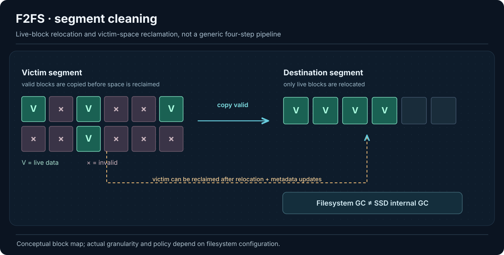

## 1. Flash SSD에서 파일시스템이 GC를 하는 이유

Flash의 물리 프로그램·삭제 특성과 파일시스템의 log-structured allocation을 함께 보면 **무효화된 공간을 어떻게 재사용하는가**가 중요한 문제가 된다. 파일시스템이 새로운 위치에 쓰기를 계속하면 오래된 블록의 데이터는 무효가 되지만, 같은 공간이 즉시 재사용 가능하다는 뜻은 아니다.

## 2. F2FS의 Log-structured 관점

F2FS는 Flash에 적합하도록 설계된 log-structured 계열 파일시스템이다. 데이터는 segment 단위로 관리되고, 사용되지 않게 된 오래된 위치를 정리하는 **cleaning** 과정이 필요하다.

| 구조/개념 | 의미 | 연결되는 질문 |
| --- | --- | --- |
| Segment | 파일시스템이 관리하는 저장 단위 | 내부의 valid block 비율은? |
| Section | 여러 segment의 그룹 | GC 단위를 어떻게 잡는가? |
| Valid block | 현재 유효한 데이터가 존재하는 블록 | Relocation 비용 |
| Invalid block | 더 이상 최신 데이터를 참조하지 않는 블록 | 회수 가능성 |
| Checkpoint | 복구 가능한 파일시스템 상태 | Crash consistency |
| Segment cleaner | 유효 데이터를 옮기며 공간 회수 | Foreground I/O와 경쟁 |

## 3. Cleaning 과정

1. 새 데이터를 새 위치에 기록한다.
2. 이전 위치는 유효하지 않은 블록이 될 수 있다.
3. 빈 공간이 부족해지면 victim segment를 선택한다.
4. Victim 내부의 valid block을 새 위치로 이동한다.
5. 적절한 메타데이터를 갱신한 뒤 공간을 회수한다.

Victim에서 **유효 블록이 많을수록 더 많은 데이터를 옮겨야** 하므로 GC 비용이 커질 수 있다. 하지만 단순히 valid block 수만 최소화하면 장기 정책과 데이터 온도 같은 문제가 남는다.

## 4. Foreground vs Background GC

- **Background GC:** 여유가 있을 때 청소 작업을 진행해 급격한 지연을 줄이려 한다.
- **Foreground GC:** 공간이 부족해 사용자 쓰기 요청의 진행을 위해 청소가 필요할 수 있다.

Foreground GC는 쓰기 요청과 직간접적으로 경쟁하므로 **tail latency**에 영향을 줄 수 있다. 평균 처리량이 괜찮아도 일부 요청이 크게 느려지는 상황이 중요하다.

## 5. Filesystem GC와 SSD FTL GC는 다르다

SSD 내부의 Flash Translation Layer도 logical block과 physical page 위치를 관리하며 자체 GC를 수행한다. 파일시스템이 하는 cleaning과 SSD가 하는 GC는 **다른 계층의 공간 관리**다.

| 비교 | Filesystem cleaning | SSD 내부 GC |
| --- | --- | --- |
| 관리 대상 | 파일시스템의 유효 파일 데이터·segment | Flash 물리 block/page |
| 알고 있는 정보 | 파일/metadata와 논리 유효성 | FTL mapping과 물리 사용 상태 |
| 주된 목표 | File system free space 회수 | NAND erase 가능한 block 확보 |
| 비용 | 데이터 이동, metadata, CPU/I/O | NAND 이동·erase·wear 관리 |

두 GC가 상호작용할 수 있으므로, 애플리케이션 레벨 latency는 한 계층으로만 설명되지 않을 수 있다.

## 6. ZNS로 이어지는 질문

Zoned Namespace에서는 호스트가 zone write pointer 등 제약을 더 명확히 다루게 된다. 이 환경에서는 **zone 단위 공간 회수**가 workload의 지연을 지배할 가능성이 있다.

GAZE 같은 연구를 이해하려면 F2FS의 기존 cleaning 구조를 먼저 파악해야 한다. 특히 GC에서 **실제 장치 I/O와 CPU-side metadata/메모리 관리 중 무엇이 병목인지**를 분리하는 것이 연구 질문이 된다.

## 7. 실험에서 비교할 변수

| 변수 | 측정 의미 |
| --- | --- |
| Free segment 수 | 공간 압박의 정도 |
| Valid block ratio | 데이터 이동 비용 |
| Foreground write load | 사용자 I/O와 GC의 경쟁 |
| Device type | SSD FTL/zone 특성 |
| Kernel/FS version | 구현 및 GC 정책 차이 |
| GC 실행 구간 | Tail latency와 시간 상관관계 |

F2FS와 ext4의 IOPS가 다르다는 단일 결과만으로 **GC 설계가 우월하다**고 말할 수 없다. 동일 환경과 workload, 시작 상태를 확인해야 한다.

## 8. 학습용 질문

1. Log-structured allocation에서 invalid block이 생기는 이유는?
2. Valid data가 많은 segment를 정리하면 왜 비싼가?
3. Foreground GC가 p99 latency에 영향을 줄 수 있는 이유는?
4. Filesystem cleaning과 SSD FTL GC가 같은 것인가?
5. ZNS의 write pointer가 파일시스템 설계에 추가하는 책임은?

## 9. Segment Cleaning을 비용 모델로 이해하기

Cleaning 비용은 단순히 “GC를 한 번 실행했다”라는 횟수만으로 비교하기 어렵다. **얼마나 많은 유효 데이터가 남아 있었고, 그 데이터를 옮길 때 메타데이터·저장장치 자원을 얼마나 썼는가**가 중요하다.

Segment 하나에 유효 블록이 10%만 남았다면 회수 가능한 공간이 크지만, 유효 블록이 90% 남았다면 실제로 옮겨야 할 데이터가 많아진다. 다만 victim 선택은 단순히 유효 블록 비율만 최적화하지 않을 수 있다. 데이터 온도, 오래된 segment 상태, free segment 부족 등 다양한 조건을 고려할 수 있다.

| 요소 | 적게 남은 경우 | 많이 남은 경우 |
| --- | --- | --- |
| Valid blocks | 복사할 데이터가 상대적으로 적음 | 많은 데이터 relocation 필요 |
| Metadata update | 일부 파일 매핑 변경 | 더 많은 파일 매핑 변경 가능 |
| Reclaimed space | 상대적으로 큼 | 상대적으로 작음 |
| Foreground impact | 낮을 수 있음 | I/O와 CPU 경쟁 커질 수 있음 |

이 표는 **GC 후보의 직관적 비용 모델**이며 실제 F2FS의 모든 victim selection 정책을 대체하는 공식이 아니다.

## 10. GC와 Crash Consistency

유효 데이터를 옮기는 과정에서 crash가 발생하면, 파일시스템이 **이전 위치와 새 위치 중 어느 것이 유효한 최신 데이터인지** 판단할 수 있어야 한다. 이 작업에는 메타데이터 갱신 순서와 checkpoint/recovery 메커니즘이 관련된다.

단순히 데이터를 복사한 뒤 이전 위치를 즉시 지워도 안전하다고 가정하면 안 된다. **Recovery 경로와 정상 수행 경로는 함께 설계**해야 한다.

## 11. GC가 Latency에 미치는 경로

Foreground write가 진행되는 동안 cleaning이 필요하면 여러 종류의 지연이 겹칠 수 있다.

1. Free segment 확인 및 공간 부족 판단.
2. Victim 선택.
3. 유효 데이터 조회.
4. 필요한 데이터 읽기/이동.
5. 파일시스템 metadata 갱신.
6. 적절한 동기화와 공간 회수.
7. 사용자 쓰기 재개.

이 중 어느 부분이 CPU 비용인지, 장치 I/O 비용인지 구분해야 개선 방향이 정해진다. 바로 이 관점이 ZNS GC 연구를 읽을 때 중요하다.

## 12. 실험에서 baseline을 제대로 만들기

F2FS GC를 비교하려면 다음 조건을 기록한다.

- 여유 segment와 파일시스템 사용률.
- 데이터 생성·수정·삭제 순서.
- Random/sequential write 비율.
- Segment 크기 및 커널·F2FS 버전.
- GC 실행 구간과 foreground latency.
- 저장장치 또는 emulator의 기능.
- 실제 파일 checksum과 복구 결과.

**평균 IOPS가 높은데 p99 latency가 나쁜 상황**을 놓치지 않도록 분포와 GC 발생 시점을 함께 비교한다.

## 참고자료

- [F2FS documentation](https://docs.kernel.org/filesystems/f2fs.html)
- [OSLab publications](https://oslab.kaist.ac.kr/publications/)
- [GAZE 연구 소개](https://oslab.kaist.ac.kr/gaze-rearchitecting-log-structured-filesystem-for-garbage-collection-on-zoned-namespace-flash-storage-accepted-in-sosp-26/)
