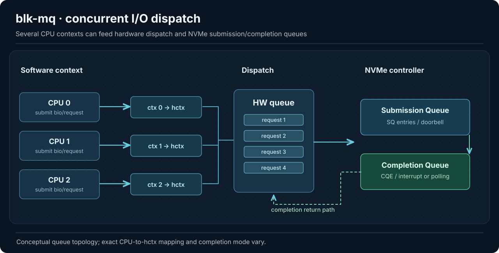

## 1. IOPS 숫자만 높으면 좋은 스토리지인가

같은 장치라도 I/O 크기와 읽기·쓰기 비율, 데이터셋 크기, queue depth에 따라 결과가 크게 달라질 수 있다. 따라서 **어떤 workload에서 얻은 IOPS인가**를 먼저 물어야 한다.

이 노트는 `fio`를 통해 필요한 변수를 하나씩 정의하는 방법을 정리한다. 아래 설정은 **실험 초안**이며 실제 측정값을 제공하지 않는다.



## 2. Workload의 핵심 파라미터

| 옵션 | 의미 | 분석할 질문 |
| --- | --- | --- |
| `rw` | sequential/random read/write 및 혼합 | workload의 접근 패턴 |
| `bs` | I/O 블록 크기 | 작은 요청 비용과 처리량 |
| `iodepth` | 비동기 I/O outstanding 수 | 병렬성·장치 큐 |
| `numjobs` | 병렬 작업 개수 | 스레드/프로세스 경쟁 |
| `ioengine` | I/O 제출 방식 | 실제 depth가 의도대로 동작하는가 |
| `direct` | Cache 경로 관련 설정 | Bufffered vs direct 비교 |
| `size` | 데이터셋 크기 | Page cache와 매체 상태 |
| `runtime` | 측정 시간 | Warmup과 열 상태 |
| `fsync`/`fdatasync` | 동기화 동작 | Durability 비용 |

`iodepth=32`라고 적었다고 실제 장치에 **항상 32개 요청이 outstanding**이라고 단정할 수 없다.

## 3. 읽기 패턴과 캐시

파일 크기가 RAM보다 작고 buffered read를 반복하면 page cache가 대부분의 요청을 처리할 수 있다. 이때 빠른 수치는 파일시스템 cache 성능일 수 있으며 SSD 자체의 random read 성능과 구분해야 한다.

Cold-cache 조건을 만들기 위한 환경 재설정은 다른 프로세스에 영향을 줄 수 있으므로 **공유 운영 호스트에서 수행하지 않는다**.

## 4. 실습용 파일 대상

다음은 **별도 테스트 디렉터리** 내 파일로 수행할 수 있는 예시다.

```bash
mkdir -p ./fio-lab
fio --name=test-seqread \
    --filename=./fio-lab/test.dat \
    --rw=read --bs=128k --size=1G \
    --ioengine=sync --direct=0 --runtime=30 --time_based=1
```

실제로 읽기 실험을 하려면 먼저 테스트 파일을 생성하고, dataset/cache 상태를 명시해야 한다. 파일이 없다는 오류를 `fio` 문제로 오인하면 안 된다.

## 5. Latency 분포 보기

평균 latency만 비교하면 드물게 늦는 요청이 가려질 수 있다. p50/p95/p99, maximum, 표준편차 또는 원시 히스토그램을 함께 살펴본다.

| 값 | 의미 | 주의 |
| --- | --- | --- |
| IOPS | 초당 완료 요청 수 | 요청 크기 명시 |
| Bandwidth | 초당 데이터 양 | 캐시, 압축, 장치 정책 |
| Clat | Completion 관련 지연 | Fio 내부 통계의 범위 확인 |
| Slat | 제출 과정의 지연 | I/O engine에 따라 다름 |
| Total latency | 전체 요청 지연 | 어떤 단계의 합인지 확인 |

## 6. 매번 동일한 장치 상태인가

Flash SSD는 내부 GC, SLC cache, thermal throttling, wear state 등에 따라 성능이 달라진다. 따라서 첫 실행과 두 번째 실행이 다르게 나올 수 있다. 파일시스템과 mount option, 데이터셋 준비 과정까지 기록해야 공정한 실험이 된다.

**실험 반복 횟수, 워밍업, 순서 효과**가 없는 단일 값 비교는 연구 자료로 쓰기 어렵다.

## 7. 파일시스템과 블록 장치 실험의 차이

Raw block device 실험은 운영 데이터와 파티션을 파괴할 수 있다. 파일시스템 위의 테스트 파일로 가능한 실험을 우선하며, raw device는 오직 완전히 격리된 전용 테스트 매체에서만 다룬다.

또한 파일시스템을 거친 I/O는 metadata, page cache, allocation과 writeback의 영향을 받는다. 장치 성능을 측정한다고 했는데 이런 영향을 통제하지 못하면 비교가 왜곡된다.

## 8. 비교표 템플릿

| 환경 | Kernel/FS | rw/bs | depth/jobs | p50/p99 | IOPS | 관찰 |
| --- | --- | --- | --- | --- | --- | --- |
| Baseline | 미측정 | 미측정 | 미측정 | 미측정 | 미측정 | 테스트 실행 뒤 기록 |
| Variant A | 미측정 | 미측정 | 미측정 | 미측정 | 미측정 | 동일 조건 유지 |

이 표는 **빈 실험 기록 템플릿**이다. 실제 측정값이 없는 상태에서는 숫자를 채우지 않는다.

## 9. 다음 조사 질문

- `iodepth`를 올렸는데 IOPS가 늘지 않는다면 어떤 병목을 의심할까?
- `direct=1`이 `fsync()`와 같지 않은 이유는?
- 4 KiB random write와 1 MiB sequential write는 공정한 IOPS 비교 대상인가?
- Page cache warm 상태를 무엇으로 확인할까?
- SSD GC가 tail latency에 미치는 영향을 어떻게 구분할까?

## 참고자료

- [fio documentation](https://fio.readthedocs.io/)
- [Linux Block layer](https://docs.kernel.org/block/)
- [Page Cache·Writeback 노트](https://petooooo.github.io/notes/study-page-cache-writeback-fsync/)
