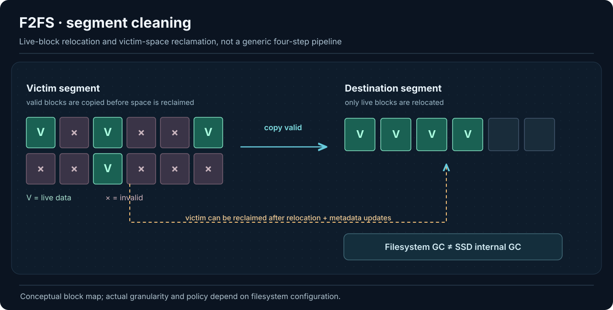

## 1. SSD가 HDD보다 빠르다는 설명만으로는 부족하다

NAND Flash는 일반적인 RAM이나 HDD와 다른 **program/erase 제약**을 가진다. 저장된 내용을 다시 쓰려면 기존 위치를 직접 덮어쓰는 대신 새로운 위치에 기록하고, 오래된 물리 블록을 추후 지워야 할 수 있다. 이 차이가 FTL과 Garbage Collection을 필요하게 만든다.

## 2. NAND의 기본 단위

| 단위 | 의미 | 중요성 |
| --- | --- | --- |
| Page | Program/read의 기본 단위 | 작은 데이터도 page 단위 접근과 관련 |
| Block | Erase 단위 | 지울 때 여러 page가 함께 영향 |
| Die/Plane/Channel | 내부 병렬성을 제공하는 구조 | SSD의 큐와 bandwidth에 영향 |
| Logical LBA | 호스트가 지정하는 주소 | 실제 NAND 위치와 직접 같지 않음 |

Flash 종류와 장치에 따라 실제 page/block 크기, 병렬성 및 동작 시간은 다르다. 특정 크기를 절대적인 표준처럼 외우지 말아야 한다.

## 3. Out-of-place update

호스트가 논리 주소 100번을 수정해도 기존 NAND 물리 페이지에 그대로 덮어쓰지 않을 수 있다. FTL은 새 물리 위치에 기록하고 매핑을 갱신한다.

1. Logical LBA를 요청받는다.
2. 새로운 물리 페이지를 할당한다.
3. 변경된 내용을 프로그램한다.
4. Logical-to-physical mapping을 갱신한다.
5. 이전 물리 페이지는 무효로 처리된다.
6. 이후 GC가 유효 데이터를 옮긴 뒤 블록을 erase할 수 있다.

따라서 **Host write 크기 = NAND program된 총 데이터 크기**라고 항상 가정할 수 없다.

## 4. FTL의 역할

FTL(Flash Translation Layer)은 논리주소와 물리 페이지 사이의 매핑을 관리한다. 주요 책임으로 mapping update, garbage collection, wear leveling, bad-block 관리, 장애 후 metadata 복구 등이 있다.

| 설계 선택 | 장점 | 부담 |
| --- | --- | --- |
| 세밀한 mapping | 랜덤 업데이트 유연성 | Mapping metadata 메모리 부담 |
| 큰 단위 mapping | Metadata 부담 감소 가능 | 랜덤 쓰기 갱신 비용 |
| GC를 미리 수행 | 급격한 공간 부족 완화 가능 | Background I/O와 자원 경쟁 |
| Over-provisioning | GC 유연성 및 headroom | 사용 가능한 사용자 용량 감소 |

실제 상용 SSD의 내부 FTL은 제조사 구현에 따라 다르므로, **하나의 모형을 특정 장치의 실제 알고리즘이라고 단정하지 않는다**.

## 5. Write amplification

Write amplification은 일반적으로 **호스트가 요청한 쓰기량보다 실제 Flash에 더 많은 데이터가 기록되는 현상**과 관련된다. GC에서 유효 페이지를 복사하거나 metadata를 갱신하면 추가 내부 쓰기가 발생한다.

예를 들어 호스트 쓰기 1 GiB에 대해 내부적으로 1.5 GiB를 기록했다고 가정하면 amplification을 1.5로 계산할 수 있지만, 이 숫자는 **설명을 위한 가상 예시**이지 실제 특정 SSD 측정 결과가 아니다.

## 6. TRIM / Discard

파일이 삭제됐을 때 파일시스템은 논리 블록이 더 이상 필요하지 않다는 사실을 알 수 있다. Discard/TRIM은 그 정보를 장치에 전달하는 수단 중 하나다.

그러나 discard를 보냈다고 장치가 즉시 해당 NAND block을 erase했다고 단정할 수 없다. FTL은 내부 자원과 정책에 따라 다르게 처리할 수 있다.

## 7. F2FS GC와 SSD GC의 차이

| 관점 | 파일시스템 GC | FTL GC |
| --- | --- | --- |
| 관리 위치 | 호스트 파일시스템 | SSD firmware |
| 유효성 판단 | 파일·metadata의 논리 참조 | FTL의 mapping |
| 공간 회수 | Segment/zone 정책 | NAND erase block 확보 |
| 성능 영향 | 메타데이터·CPU·스토리지 I/O | Internal copy·erase와 tail latency |

서로 다른 두 GC가 한 workload에서 겹칠 수 있다. 따라서 성능 문제를 분석할 때 “SSD가 GC한다” 한 문장으로 모든 비용을 설명하면 부족하다.

## 8. 연구 질문과 실험 설계

- Random write와 sequential write는 내부 mapping/GC 부담이 어떻게 다른가?
- 일정 공간을 채운 뒤 tail latency가 달라지는가?
- Over-provisioning이나 discard가 workload 반응에 영향을 주는가?
- Drive의 thermal 상태와 firmware가 결과를 바꾸는가?
- 호스트가 보는 지연과 장치의 내부 write amplification을 어떻게 연결할 수 있는가?

특정 장치의 내부 write amplification은 공개 counter가 없다면 **직접 측정하기 어려울 수 있다**. 추정과 관측을 구분해야 한다.

## 9. 핵심 정리

NAND Flash는 **out-of-place write와 erase 제약** 때문에 메모리나 HDD와 같은 비용 모델을 갖지 않는다. FTL은 이 차이를 호스트에게 추상화해 주지만, 내부 GC·mapping·wear leveling 비용은 사용자 I/O 성능에 영향을 줄 수 있다.

## 참고자료

- [F2FS documentation](https://docs.kernel.org/filesystems/f2fs.html)
- [NVMe specifications](https://nvmexpress.org/specifications/)
- [OSLab publications](https://oslab.kaist.ac.kr/publications/)
