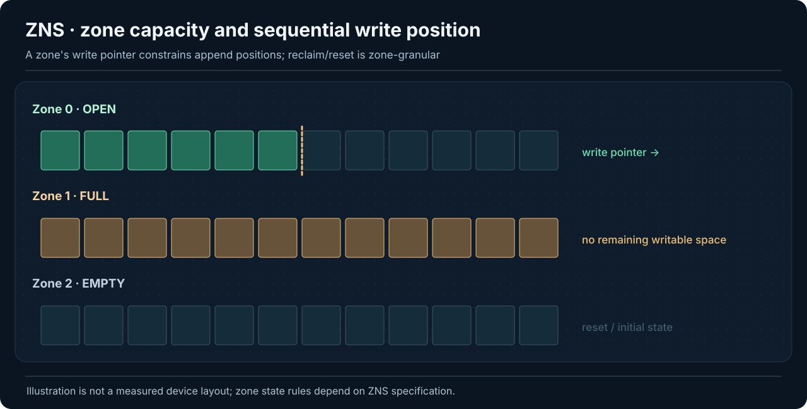

## 1. NVMe와 ZNS는 서로 다른 종류의 개념이다

NVMe는 고성능 비휘발성 저장장치와 호스트 사이의 명령/큐 인터페이스다. ZNS(Zoned Namespace)는 **데이터를 zone 단위로 관리하고 쓰기 위치에 제약을 두는 namespace 모델**이다. 둘을 하나의 기술이라고 부르면 디바이스 명령 프로토콜과 데이터 배치 제약이 섞인다.

## 2. Submission/Completion Queue

| 큐 | 역할 | 보충 설명 |
| --- | --- | --- |
| SQ | 호스트가 처리할 명령을 제출 | Queue pair와 doorbell 등의 제어 |
| CQ | 장치가 명령 완료를 통지 | 완료 순서와 제출 순서를 혼동하지 말 것 |
| Admin queue | 장치 관리 명령 | I/O queue와 목적 분리 |
| I/O queue | 실제 데이터 요청 | 많은 병렬 요청 지원 가능 |

Queue depth를 크게 하면 outstanding I/O가 늘어날 수 있지만 **latency와 CPU 비용이 동시에 낮아진다는 보장은 없다**. Workload/장치의 병렬 처리 능력과 bottleneck이 중요하다.

## 3. Conventional block SSD의 관점

일반적인 논리 블록 인터페이스에서는 호스트가 특정 LBA에 덮어쓰기 명령을 내릴 수 있다. 내부 NAND Flash의 out-of-place update는 FTL이 숨길 수 있다.

ZNS에서는 호스트가 zone 구조와 순차 쓰기 제약을 더 적극적으로 인식한다. 즉 **호스트 파일시스템이나 애플리케이션이 공간 관리 책임을 일부 맡는 방향**이다.

## 4. Zone와 Write Pointer

Zone에는 capacity와 write pointer 등 상태가 있다. 순차 쓰기 zone의 경우 쓰기 위치는 관리되는 write pointer를 따르는 제약이 있다. 장치와 spec에 따라 **open/active zone 수**에도 제한이 있을 수 있다.

| 상태/작업 | 의미 | 설계 질문 |
| --- | --- | --- |
| Empty | 아직 데이터를 쓰지 않은 zone | 새 데이터를 어디에 둘까 |
| Implicit/Explicit open | 쓰기 가능한 상태 | 동시에 열 수 있는 zone 제한은 |
| Closed | 당장 쓰지 않지만 재사용 전 준비 필요 | 재open 비용은 |
| Full | 추가 순차 쓰기 불가 | 다른 zone으로 어떻게 전환할까 |
| Reset | 공간을 재사용할 수 있도록 초기화 | 유효 데이터를 먼저 어떻게 옮길까 |

정확한 zone 상태 전이와 명령 의미는 **NVMe ZNS specification 및 장치 구현을 기준**으로 확인해야 한다.

## 5. GC와 Zone 단위 공간 회수

Zone을 재사용하기 전에 여전히 필요한 데이터를 다른 위치로 옮겨야 할 수 있다. 이때 zone 단위의 cleaning이 foreground write를 지연시킬 수 있다.

전통적 F2FS의 segment cleaning과 ZNS의 zone GC를 비교하면 **회수 단위와 metadata 관리 비용**이 다르다. Zone이 커지면 실제 데이터 I/O보다 CPU-side state 관리가 병목이 될 수도 있다.

## 6. Zone Append와 순서

Zone append는 장치가 유효한 쓰기 위치를 선택해 수행할 수 있는 명령 모델이다. 호스트가 쓰기 명령의 완료 순서와 데이터 순서를 어떻게 해석할지 주의해야 한다.

다중 queue 환경에서는 독립적인 command submission과 completion이 관측될 수 있으므로 **호스트 수준의 write ordering 계약**을 설계할 필요가 있다.

## 7. 연구에서 궁금한 점

- 큰 zone을 회수할 때 GC 시간이 증가하는 이유는 데이터량인가 CPU metadata 처리인가?
- 여러 queue로 쓰기 명령을 낼 때 순서를 보장하려면 어떤 동기화가 필요한가?
- Zone reset 직전에 마지막 유효 데이터를 어떻게 보호할까?
- 작은 random update를 append-friendly 형태로 변환할 때 비용은 무엇인가?
- Zone state가 foreground tail latency를 언제 지배하는가?

## 8. 실험을 한다면

ZNS 장치나 올바르게 구성된 전용 emulator가 없다면 실제 zone write 동작을 확인했다고 할 수 없다. 개념 모델이나 모의 결과와 실제 NVMe ZNS hardware의 결과를 구분한다.

실험 기록에는 zone 크기, open/active 제한, 장치 모델, queue depth, filesystem/version, I/O pattern, GC 측정 방법이 포함되어야 한다.

## 9. 복습 질문

1. NVMe SQ와 blk-mq hardware queue는 완전히 같은 객체인가?
2. ZNS zone의 write pointer를 host가 인식해야 하는 이유는?
3. Zone reset 전에 유효 데이터 이동이 필요한 이유는?
4. Submission order와 completion order는 왜 다를 수 있는가?
5. File system GC와 device GC를 어떤 계층으로 구분하는가?

## 10. Submission과 Completion의 순서는 왜 다를 수 있을까

여러 SQ에 요청을 제출하면 서로 다른 queue에서 명령이 독립적으로 진행될 수 있다. **호스트가 A를 먼저 제출했다고 해서 모든 상황에서 A가 B보다 먼저 durable하게 기록된다고 가정해서는 안 된다.**

이 문제를 이해하려면 다음 두 개념을 분리한다.

- **I/O command completion:** 장치가 어떤 명령의 완료를 보고하는가.
- **Persistence ordering:** 충돌 이후에도 어떤 데이터 변경의 순서를 보장해야 하는가.

Filesystem journaling, write barrier, flush/FUA와 host의 동기화는 두 번째 계약과 관련된다. 따라서 SQ/CQ를 이해하는 것과 `fsync()`의 의미를 이해하는 것은 연결돼 있지만 동일한 문제가 아니다.

## 11. Zoned Namespace의 운영 상태

ZNS는 zone을 쓰기 가능한 상태로 열고, 정해진 제약에 따라 sequential write를 진행하며, 나중에 전체 공간을 재사용해야 할 수 있다.

| 상태 | 알아야 할 것 | 다음 질문 |
| --- | --- | --- |
| Empty | Write pointer 초기 위치 | Zone을 어떻게 선택할까 |
| Open | 명령을 받을 수 있는 상태 | Open zone limit이 있는가 |
| Closed | 당장은 쓰지 않음 | 다시 열 수 있는가 |
| Full | 공간 끝까지 기록됨 | 유효 데이터는 어디에 남아 있는가 |
| Reset | Zone을 재사용할 준비 | Reset 전 GC가 완료됐는가 |

이 표는 **학습용 상태 모델**이며 정확한 zone condition의 세부 목록과 허용 전이 규칙은 사용한 NVMe ZNS 규격을 기준으로 확인해야 한다.

## 12. 왜 ZNS가 파일시스템 연구와 연결되는가

Conventional SSD는 내부 FTL이 논리 블록 업데이트와 물리 배치를 상당 부분 추상화한다. ZNS에서는 호스트에 zone write 규칙이 노출되므로, **어떤 데이터를 같은 zone에 넣을지, 수정된 데이터의 위치를 어떻게 관리할지, 언제 reset할지**를 파일시스템이 더 적극적으로 결정할 수 있다.

이는 다음의 trade-off를 만든다.

1. 호스트가 데이터 배치를 더 잘 통제할 수 있다.
2. 대신 mapping과 metadata 관리가 복잡해질 수 있다.
3. Cleaning 중 유효 데이터 이동 비용이 커질 수 있다.
4. 다중 queue 환경에서 write ordering이 더 중요해질 수 있다.
5. GC와 정상 I/O가 동일한 장치 자원을 경쟁할 수 있다.

이 흐름이 GAZE, D2FS, OPIMQ 연구에서 서로 다른 계층의 설계 선택을 이해하는 출발점이다.

## 13. 실제 장비 없이 공부할 수 있는 범위

일반 block SSD에서 fio를 실행해도 **ZNS zone pointer나 reset 동작을 실제로 시험한 것은 아니다.** 장치가 없을 때는 공개 문서·emulator와 Linux kernel code를 통해 제약을 학습하고, 실제 ZNS 명령을 실행한 것처럼 결과를 표현하지 않는다.

## 참고자료

- [NVMe specifications](https://nvmexpress.org/specifications/)
- [Linux Zoned Storage](https://zonedstorage.io/)
- [Linux blk-mq](https://docs.kernel.org/block/blk-mq.html)
