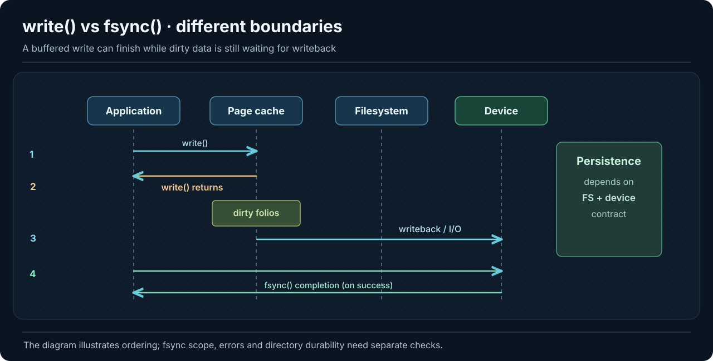

## 1. `write()`가 성공하면 영구 저장된 것일까?

파일 쓰기 시스템 콜이 성공했다고 해서 전원 장애 이후에도 데이터가 반드시 남아 있다는 뜻은 아니다. **Buffered I/O는 메모리의 page cache를 먼저 수정하고 저장장치 반영은 나중에 수행할 수 있기 때문**이다.



## 2. Read path와 Page cache

동일 파일의 데이터를 두 번 읽었을 때 두 번째가 빨랐다면, 데이터가 page cache에 남아 **실제 장치 읽기를 줄였을 가능성**을 검토한다. 저장장치가 더 빨라졌다고 결론 내리면 안 된다.

| 현상 | 가능한 메커니즘 | 확인할 정보 |
| --- | --- | --- |
| 첫 읽기 느림 | Cold cache, 실제 I/O | Block I/O 발생 여부 |
| 반복 읽기 빠름 | Cache hit | Page cache와 syscall 시간 |
| 메모리 증가 | Cached file folio | Reclaim 가능성 |
| Write 지연 증가 | Dirty throttling / writeback 경쟁 | Dirty/Writeback 통계 |

## 3. Dirty folio와 writeback

일반적인 buffered write는 파일 내용을 page cache에서 수정하고 dirty 상태로 표시할 수 있다. 파일시스템과 writeback 경로는 나중에 저장장치에 반영한다. **`write()`의 반환 시점과 블록 장치 완료 시점은 분리될 수 있다.**

여러 쓰기를 한꺼번에 처리하면 성능에 이점이 있지만, 갑작스러운 전원 장애 시 어떤 데이터가 영구적으로 남았는지는 별도로 다뤄야 한다.

## 4. `fsync`, `fdatasync`, `sync`

| API | 의도 | 주의할 계약 |
| --- | --- | --- |
| `write()` | 파일에 데이터를 쓰도록 요청 | 부분 쓰기와 캐시 반영 |
| `fsync(fd)` | 파일 데이터와 필요한 메타데이터의 동기화 요청 | Filesystem/장치 오류 가능 |
| `fdatasync(fd)` | 데이터와 읽기에 필요한 메타데이터 중심 동기화 | 일부 메타데이터와 범위 차이 |
| `sync()` | 시스템 차원의 dirty writeback 요청 | 특정 transaction 원자성 아님 |
| `O_DIRECT` | 지원 환경에서 page cache 경로를 일부 우회 | 자동 durability 아님 |

Direct I/O를 사용했다고 **장치의 휘발성 캐시까지 영구 저장됐다는 뜻은 아니다**. 또 파일시스템과 장치에 따른 정렬 조건이 다를 수 있다.

## 5. `rename()`과 디렉터리 동기화

새로운 파일을 기존 설정 파일로 교체할 때는 파일 **내용**과 디렉터리 **이름 연결**의 지속성이 별개라는 점을 생각해야 한다.

1. 새 임시 파일에 내용을 기록한다.
2. 새 파일을 `fsync()`한다.
3. 같은 파일시스템 내에서 `rename()`으로 이름을 교체한다.
4. 필요하다면 디렉터리를 열어 `fsync()`하여 이름 변경의 지속성을 확인한다.

여기서 `rename()`의 이름 교체 원자성과 **충돌 이후의 지속성**은 다르다. 파일시스템별 의미와 오류 처리를 함께 확인해야 한다.

## 6. 간단한 `fsync` 복습 예제

```c
#include <fcntl.h>
#include <stdio.h>
#include <string.h>
#include <unistd.h>

int main(void) {
    int fd = open("output.tmp", O_CREAT | O_TRUNC | O_WRONLY, 0600);
    if (fd == -1) { perror("open"); return 1; }
    const char *s = "state\n";
    ssize_t n = write(fd, s, strlen(s));
    if (n != (ssize_t)strlen(s)) { perror("write"); close(fd); return 1; }
    if (fsync(fd) == -1) { perror("fsync"); close(fd); return 1; }
    if (close(fd) == -1) { perror("close"); return 1; }
}
```

이 코드는 **파일 내용 동기화의 개념 예제**이며 완전한 crash-safe 교체 알고리즘이 아니다. 실제 사용에는 partial write 반복 처리, 예외 정리, temp 파일 충돌 방지 및 디렉터리 지속성 정책이 필요하다.

## 7. 장치까지 내려가는 보장

Application → VFS/filesystem → page cache/journal → block layer → device 내부 cache → 비휘발성 media 순서로 계약이 이어진다. 각 계층이 요청을 수락했다는 사실만으로 하위 계층의 모든 보장이 성립하지 않는다.

Journal이 파일시스템 metadata consistency를 회복하더라도 **애플리케이션의 여러 파일 작업을 하나의 DB transaction으로 만들어 주지는 않는다.**

## 8. 실험할 때 주의할 점

| 비교 | 통제할 조건 | 흔한 오류 |
| --- | --- | --- |
| Cold vs warm read | 파일 크기, cache state | 캐시 성능을 장치 성능으로 혼동 |
| Buffered vs direct | 정렬, I/O 크기 | 서로 다른 조건으로 비교 |
| Async vs sync write | `fsync` 주기, queue depth | Durability 없는 write를 durable throughput이라 표기 |
| Filesystem 비교 | Mount option, device, kernel | 변수 두 개 이상을 동시에 바꿈 |

측정 전에는 kernel과 파일시스템, 장치 종류·cache 상태를 기록한다. 성능 수치는 실험 뒤에만 적는다.

## 9. 확인 질문

1. `write()` 성공과 `fsync()` 성공은 어떤 점이 다른가?
2. `rename()`의 원자성과 crash 이후 이름 보존은 같은가?
3. Page cache가 크면 실제 메모리 부족을 뜻하는가?
4. `O_DIRECT`는 왜 데이터 지속성과 다른 개념인가?
5. 파일시스템 journaling과 database WAL의 계약은 왜 다른가?

## 참고자료

- [Linux VFS](https://docs.kernel.org/filesystems/vfs.html)
- [fsync(2)](https://man7.org/linux/man-pages/man2/fsync.2.html)
- [open(2)](https://man7.org/linux/man-pages/man2/open.2.html)
