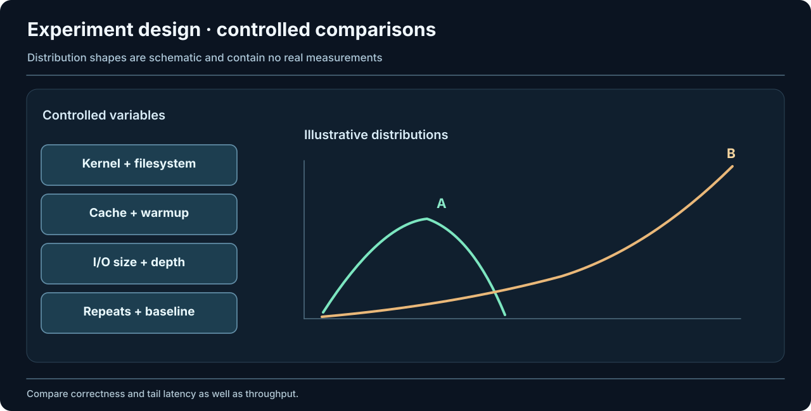

## 1. 벤치마크의 시작은 명령이 아니라 질문이다

`fio` 명령을 실행한 뒤 IOPS 한 줄을 남겨도 다음 주에 그 숫자를 다시 이해하기 어렵다. 실험이 어떤 현상을 구별하려 했는지, 어떤 변수가 통제됐는지 기록하지 않았기 때문이다.

여기서는 **Page cache의 영향, sync/durable write의 비용, queue depth에 따른 throughput/latency**라는 세 질문을 중심으로 안전한 mini-lab을 설계한다.



## 2. 첫 번째 전제: 안전한 실험 대상

Raw block device를 잘못 선택하면 실제 데이터가 손상된다. 처음에는 **별도 디렉터리의 실험용 파일**만 대상으로 한다. 테스트 파일과 결과 로그, 실행 대상 파일시스템을 명확히 확인한다.

- 실제 운영 데이터나 공유 파일시스템에서 benchmark를 실행하지 않는다.
- Dirty cache를 전역으로 떨어뜨리는 동작은 다른 프로세스에 영향을 주므로 공유 호스트에서 하지 않는다.
- Device 상태를 변경하는 destructive preconditioning은 전용 테스트 장치에서만 고려한다.
- 쓰기 실험 결과는 반드시 파일 내용을 검증할 수 있는 기준과 함께 기록한다.

## 3. 실험 A: Cold vs Warm Read

같은 파일을 첫 번째와 두 번째 읽었을 때 시간이 달라진다면 page cache가 원인인지 판단하려 한다.

| 통제 변수 | 기록 내용 |
| --- | --- |
| 파일 크기 | RAM 대비 크기 |
| 파일 생성·사전 준비 | 생성 방식 및 사전 읽기 여부 |
| Page cache 상태 | Warm/Cold 조건을 어떻게 확인했는가 |
| Filesystem | Type 및 mount option |
| Read pattern | Sequential/random, block size |
| Metric | Throughput, latency, 실제 block I/O |

**같은 파일을 다시 읽었기 때문에 빨랐다**는 가설과, 장치 내부 캐시 또는 다른 변수가 원인이라는 가설을 구분할 수 있도록 관측해야 한다.

## 4. 실험 B: Buffered vs Sync Write

일반적인 buffered write의 반환 시간과 `fsync`를 포함한 쓰기의 응답 시간은 다른 계약을 측정한다.

1. 동일한 데이터셋과 쓰기 크기를 사용한다.
2. Buffered mode에서 syscall latency를 기록한다.
3. 동기화 조건을 추가하고 API 완료의 의미를 확인한다.
4. 실제 저장장치 I/O 및 CPU 사용량을 함께 관찰한다.
5. 결과는 “durability 계약 포함 여부”를 명확히 표기한다.

`direct=1`과 동기화 쓰기는 다르며, **direct I/O = durable write**라는 가정은 틀릴 수 있다.

## 5. 실험 C: Queue Depth

Queue depth 1, 4, 16, 32 등으로 outstanding I/O를 바꾸면서 throughput과 p99 latency를 관측한다. **장치와 ioengine이 해당 depth를 실제로 활용하는지**부터 확인해야 한다.

| 증가할 수 있는 것 | 동시에 나빠질 수 있는 것 |
| --- | --- |
| 장치 처리량 | Queueing 지연 |
| 병렬 명령 수 | Tail latency |
| CPU 병렬 이용 | Scheduling overhead |
| SSD 내부 병렬성 활용 | Thermal/GC 경쟁 |

## 6. 예시 실행 설정

```bash
mkdir -p ./storage-mini-lab

# 파일을 테스트 디렉터리에 준비한 뒤 읽기 실험을 실행한다.
fio --name=read-baseline \
    --filename=./storage-mini-lab/data.bin \
    --rw=read --bs=128k --size=1G \
    --ioengine=sync --direct=0 --runtime=30 --time_based=1
```

현재 코드에는 측정 결과가 없다. 파일이 존재하지 않으면 먼저 **분리된 환경에서 실험용 데이터를 준비**해야 한다.

## 7. 빈 결과표

| Case | Kernel / FS | Workload | p50 / p99 | IOPS / BW | Interpretation |
| --- | --- | --- | --- | --- | --- |
| Cache cold | 미측정 | 미측정 | 미측정 | 미측정 | 실험 뒤 기록 |
| Cache warm | 미측정 | 미측정 | 미측정 | 미측정 | 실험 뒤 기록 |
| Buffered write | 미측정 | 미측정 | 미측정 | 미측정 | 동기화 계약 명시 |
| Sync write | 미측정 | 미측정 | 미측정 | 미측정 | 동기화 계약 명시 |
| QD variants | 미측정 | 미측정 | 미측정 | 미측정 | 병렬성·오버헤드 |

**미측정은 0이 아니다.** 실패한 실험이라면 실패 메시지·환경을 그대로 기록한다.

## 8. 해석에서 흔히 실패하는 지점

- 첫 실행의 컴파일·파일 생성 시간을 benchmark에 섞는다.
- 테스트 파일이 RAM보다 작은데 장치 성능이라고 주장한다.
- F2FS/Ext4를 비교하면서 mount option과 초기 free space를 다르게 둔다.
- SSD의 온도와 GC 상태를 기록하지 않는다.
- 단 한 번의 결과에서 p99 차이를 과도하게 해석한다.
- 응용 correctness를 확인하지 않고 throughput만 보고 성공이라고 한다.

## 9. 다음 학습과의 연결

이 lab은 blk-mq 및 NVMe 큐, F2FS GC, ext4 journaling, paper evaluation을 이해하기 위한 기초다. 첫 결과가 나오면 해당 개념 노트의 “예상 메커니즘”과 **실제 trace·benchmark 결과가 일치하는지** 비교한다.

## 참고자료

- [fio](https://fio.readthedocs.io/)
- [Linux block I/O](https://docs.kernel.org/block/)
- [ext4](https://docs.kernel.org/filesystems/ext4/)
- [F2FS](https://docs.kernel.org/filesystems/f2fs.html)
