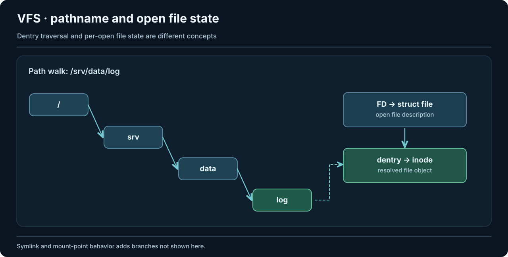

## 1. 경로 문자열이 어떻게 파일 객체가 될까?

사용자 프로그램이 `open("data/log.txt", O_RDONLY)`을 호출하면 커널은 경로를 **현재 작업 디렉터리, mount namespace와 접근 권한**에 따라 해석한다. 파일 경로가 곧 물리 위치를 뜻하는 것은 아니다.

## 2. VFS는 무엇을 공통으로 만드는가

VFS는 ext4·F2FS·tmpfs 등 서로 다른 파일시스템에 공통 파일 연산 인터페이스를 제공한다. 그러나 모든 파일시스템이 같은 저장 전략과 crash consistency를 가지는 것은 아니다.

| 객체 | 역할 | 흔한 혼동 |
| --- | --- | --- |
| `super_block` | mount된 파일시스템 인스턴스의 정보 | 디렉터리 inode와 같지 않음 |
| `inode` | 파일 메타데이터와 관련된 객체 | 파일 이름 그 자체가 아님 |
| `dentry` | 경로 구성요소의 이름과 객체 연결 | 디스크 데이터 블록이 아님 |
| `file` | 열린 파일의 상태·연산 | FD 정수와 다른 커널 객체 |
| `address_space` | 파일 데이터 cache와의 연결 | 단일 프로세스의 VMA와 다름 |

## 3. Path lookup의 단계

경로 탐색을 다음 순서로 나눠 생각할 수 있다.

1. 상대 경로는 cwd, 절대 경로는 root에서 시작.
2. 각 경로 구성요소에 대한 이름 조회.
3. Dentry cache에서 사용할 수 있는 정보 확인.
4. 필요 시 파일시스템 조회 함수 호출.
5. Symbolic link와 mount crossing 처리.
6. 권한·flags 검토 후 열린 파일 생성.
7. 열린 파일 상태를 프로세스의 FD와 연결.

이는 **개념적 단계**다. 실제 함수 호출과 최적화는 커널 버전 및 flags에 따라 달라질 수 있다.

## 4. Dentry와 inode가 다른 이유

파일 하나에 hard link가 여러 개 있을 수 있다. 경로 이름은 서로 다르지만 같은 inode를 가리킬 수 있다. 또한 파일이 존재하지 않는다는 정보도 negative dentry로 캐시할 수 있다.

즉, dentry는 단순한 “inode의 또 다른 이름”이 아니다. **경로 탐색과 파일 메타데이터의 수명**은 구분돼야 한다.

## 5. `open`, `dup`, `fork`로 보는 열린 파일

`open()`을 두 번 하면 일반적으로 각각 다른 open file description을 얻는다. `dup()`는 같은 열린 상태를 가리키는 새 FD를 만들고, `fork()` 후 자식은 부모가 연 FD 참조를 상속할 수 있다.

| 상황 | 파일 오프셋 |
| --- | --- |
| 별도 `open()` 두 번 | 일반적으로 독립 |
| `dup(fd)` | 동일 열린 파일 상태에서 공유 |
| `fork()`로 상속된 FD | 열린 파일 상태를 공유할 수 있음 |

이 구분은 파일의 물리 내용이 같다는 사실과 관계없이 발생한다.

## 6. Symlink, hard link, bind mount

- **Hard link:** 파일시스템 내부에서 같은 inode를 참조하는 별도 이름.
- **Symlink:** 대상 경로 문자열을 담고 있어 dangling이 가능.
- **Bind mount:** 파일시스템 트리 일부를 다른 경로에 노출.
- **Mount namespace:** 프로세스마다 볼 수 있는 mount 구성을 달리할 수 있음.

컨테이너의 `/data`와 호스트 파일 경로가 다를 수 있는 이유는 이런 이름 공간의 추상화에서 출발한다.

## 7. 열려 있는 파일을 삭제하면?

`unlink()`는 이름 연결을 제거한다. 하지만 프로세스가 해당 파일을 열고 있다면 열린 참조가 유효한 동안 접근이 가능한 경우가 있다. 따라서 **디렉터리에서 삭제된 파일이 디스크 공간을 계속 점유**할 수 있다.

실제 공간 회수는 링크 수와 열린 참조, 파일시스템 동작을 검토해야 한다.

## 8. 소스 코드 읽기 가이드

| 경로 | 읽을 주제 |
| --- | --- |
| `fs/open.c` | `open` 계열 system call |
| `fs/namei.c` | 이름·경로 탐색 |
| `fs/read_write.c` | 일반 read/write 경로 |
| `include/linux/fs.h` | VFS 객체와 인터페이스 |
| `mm/filemap.c` | 일반 파일 page cache 관련 기능 |

**먼저 커널 tag를 고정**하고 관련 함수를 찾아야 한다. 현재 버전의 이름을 과거 논문의 구현에 그대로 대입하면 잘못된 호출 경로를 만들 수 있다.

## 9. 실제로 해볼 만한 실험

| 실험 | 관찰 |
| --- | --- |
| 동일 파일을 두 번 `open` | 열린 상태가 분리되는가 |
| `dup` 뒤 `lseek` | 공유 오프셋 |
| `unlink` 후 열린 FD 읽기 | 경로 이름과 참조의 분리 |
| Symlink 대상 교체 | 경로 해석 결과 변화 |
| 별도 mount namespace | 같은 pathname의 다른 의미 |

운영 파일이 아닌 임시 테스트 디렉터리에서 실행하고, 예상과 실제 결과를 분리해 기록한다.

## 10. 핵심 질문

1. Dentry와 inode는 어떤 관계인가?
2. 같은 inode를 가리키는 이름이 여러 개일 수 있는가?
3. FD 정수와 `struct file`을 동일시하면 안 되는 이유는?
4. `unlink()`와 실제 데이터 회수는 왜 즉시 일치하지 않는가?
5. VFS 공통 API와 ext4/F2FS의 내부 구현은 어디에서 갈라지는가?

## 11. Path walk와 열려 있는 파일의 수명을 더 깊게 보기

실제로 VFS 코드를 읽을 때 가장 먼저 구분해야 하는 것은 **이름을 찾아가는 과정과 열린 파일을 사용하는 과정**이다. 사용자 프로그램이 `open()`으로 FD를 얻은 뒤에는 매번 원래 문자열 경로를 다시 탐색해서 `read()`하는 것이 아니다. 열린 파일 상태와 해당 파일 연산을 통해 I/O가 이루어질 수 있다.

따라서 파일의 이름을 바꾸거나 unlink하는 작업과 이미 열려 있는 FD의 동작이 서로 다른 의미를 가진다.

### 11.1 Path lookup의 중요한 경계

| 사건 | 어떤 상태가 바뀌는가 | 무엇까지 자동으로 바뀌지 않는가 |
| --- | --- | --- |
| `rename()` | Namespace의 이름 연결 | 기존 열린 FD의 의미 |
| `unlink()` | 이름 연결과 link count | 이미 열린 파일 참조 |
| `dup()` | FD table에 참조 추가 | 파일의 독립 오프셋 생성 |
| 새 `open()` | 열린 파일 상태 새로 생성 가능 | 기존 FD 상태를 대체하지 않음 |
| Bind mount | 다른 경로에 tree 노출 | 실제 파일의 내용 그 자체 |
| Mount namespace | 프로세스의 경로 해석 환경 | 다른 namespace의 mount를 자동 변경하지 않음 |

### 11.2 Negative dentry는 무엇을 캐시하는가?

파일 조회 실패도 캐시될 수 있다. 예를 들어 존재하지 않는 이름을 반복 조회할 때, 커널은 **그 이름에 해당하는 항목이 없었다는 탐색 결과**를 재사용할 수 있다.

하지만 이 결과가 영원히 유효한 것은 아니다. 디렉터리 항목이 생성·삭제되면 lookup cache의 정합성이 필요하므로 invalidation, sequence 검사 등 다양한 메커니즘이 관여할 수 있다. 이 때문에 dentry를 단순히 “inode를 담은 포인터”라고 외우면 중요한 의미를 놓친다.

### 11.3 `openat2()`와 경로 해석 정책

상대경로를 열 때 현재 작업 디렉터리에 의존하지 않고 **정해진 디렉터리 FD를 기준**으로 경로를 해석할 수 있다. `openat2()`의 resolve flags는 특정 symlink, mount traversal 또는 경로 탈출을 제한하는 데 활용할 수 있다.

이것은 컨테이너·아카이브 추출·특정 디렉터리 아래만 접근해야 하는 서버에서 중요한 보안 문제다. 이름 문자열만 검사하는 방식보다 실제 kernel path resolution 정책을 활용하는 편이 특정 경합을 줄이는 데 도움이 될 수 있다.

## 12. 실습을 실제로 한다면 남겨야 하는 기록

1. 커널 버전과 파일시스템 종류.
2. 프로그램의 cwd와 mount namespace.
3. 각 FD가 가리키는 open file description의 공유 여부.
4. `rename`/`unlink` 이전과 이후의 파일 내용·link count.
5. `strace`로 확인한 system call 및 반환값.
6. 특정 현상이 POSIX 계약인지 Linux 구현 의존적인지에 대한 판단.

**관찰한 사실과 내부 객체에 대한 추론을 분리**해야 한다. `strace`는 시스템 콜을 보여주지만 그 자체가 모든 dentry/inode cache 이동을 보여주는 도구는 아니다.

## 참고자료

- [Linux VFS documentation](https://docs.kernel.org/filesystems/vfs.html)
- [Linux path lookup](https://docs.kernel.org/filesystems/path-lookup.html)
- [open(2)](https://man7.org/linux/man-pages/man2/open.2.html)
