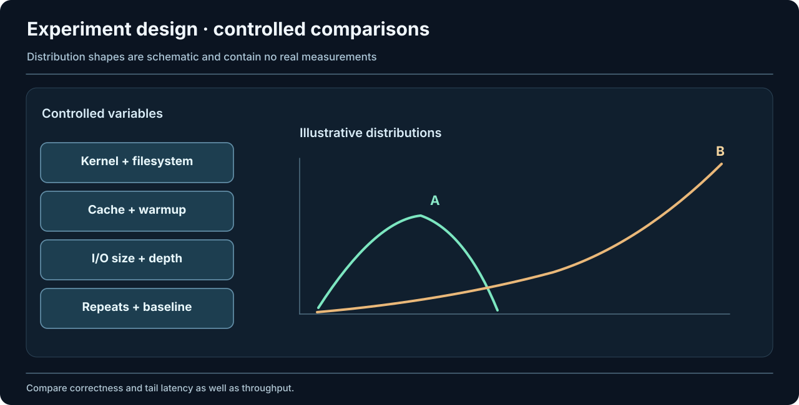

## 1. 이 목차를 사용하는 방법

2027년 봄학기 OSLab 합류를 앞두고 공부할 내용을 단순 목록이 아니라 **언제든 다시 읽고 구현할 수 있는 자료**로 정리한다. 각 글은 시스템 개념, 실제 구현의 위치, 실패 조건, 관측 방법, 다시 확인할 질문을 연결하는 것이 목표다.

기술 노트가 공개됐다는 사실은 해당 실험을 수행했거나 연구를 재현했다는 뜻이 아니다. 새로 작성한 개념 글, 실습 설계, 논문 사전 학습을 별도로 읽어야 한다.

| 문서 유형 | 의미 | 완료의 증거 |
| --- | --- | --- |
| Concept | 메커니즘과 실패 조건 설명 | 올바른 개념과 예시·참고자료 |
| Lab Guide | 실행 방법과 통제 변수 정리 | 실제 실행 전에는 계획 |
| Paper Background | 공개 연구를 이해할 준비 | Full paper 리뷰와 구분 |
| Reproduction | 코드/실험과 원시 결과 | 환경·반복·정확성 검증 |

## 2. Foundations — System Programming과 Operating Systems

1. [프로세스와 FD의 수명](https://petooooo.github.io/notes/study-process-fd-lifecycle/) — fork/exec, FD table, open file description, pipe EOF.
2. [POSIX 시스템 프로그래밍 통합](https://petooooo.github.io/notes/study-kdt-posix/) — thread, IPC, signal, socket, epoll.
3. [동시성·Lock·Memory ordering](https://petooooo.github.io/notes/study-concurrency-locking-memory-order/) — data race, mutex, condition variable, atomics, deadlock.
4. [가상 메모리](https://petooooo.github.io/notes/study-virtual-memory-mmap-fault/) — VMA, page table, TLB, page fault, COW.
5. [CFS·EEVDF 스케줄러](https://petooooo.github.io/notes/study-scheduler-cfs-eevdf/) — runnable, lag, virtual deadline.
6. [NUMA·Reclaim·Cgroups](https://petooooo.github.io/notes/study-numa-reclaim-cgroups/) — memory locality, PSI, OOM.

**완료 기준:** 프로세스가 언제 CPU를 얻고, 파일과 메모리를 어떤 커널 객체로 접근하는지 구분해서 설명한다.

## 3. Kernel Source와 Observability

1. [Linux 커널 소스 읽기](https://petooooo.github.io/notes/study-kernel-source-navigation/) — syscall부터 서브시스템의 실제 호출 경로까지.
2. [ftrace Scheduler Latency](https://petooooo.github.io/notes/study-ftrace-scheduler-latency-lab/) — sched_wakeup/sched_switch와 runnable latency.
3. [perf·eBPF 관측](https://petooooo.github.io/notes/study-perf-ebpf-evidence/) — sampling, kprobe, tracepoint, BPF map.
4. [Kernel Crash Dump](https://petooooo.github.io/notes/study-kdt-crash-dump/) — vmcore, symbols, task state.
5. [Embedded Linux·Driver](https://petooooo.github.io/notes/study-kdt-embedded-linux/) — boot, DT, IRQ, deferred work.
6. [xv6·Pintos](https://petooooo.github.io/notes/study-xv6-pintos-os-lab/) — OS의 작은 구현과 테스트.
7. [Linux Kernel Build·Patch](https://petooooo.github.io/notes/study-linux-kernel-build-debug-patch/) — version pinning, debug symbols, QEMU.

**완료 기준:** 실제 kernel tag와 config, 관측 이벤트를 기록하고 내 설명과 실행 결과를 연결한다. 소스를 읽은 기록과 실제 patch 완료는 구분한다.

## 4. File Systems & Storage — 핵심 연구 관심

1. [VFS Path Lookup](https://petooooo.github.io/notes/study-vfs-pathwalk-inode-file/) — dentry, inode, superblock, open file.
2. [Page Cache·Writeback·fsync](https://petooooo.github.io/notes/study-page-cache-writeback-fsync/) — buffered I/O와 persistence 경계.
3. [Block I/O·blk-mq·NVMe](https://petooooo.github.io/notes/study-block-io-blk-mq-nvme/) — bio, request, SQ/CQ.
4. [fio 실험 설계](https://petooooo.github.io/notes/study-fio-workload-design/) — IOPS, throughput, latency, queue depth.
5. [ext4·JBD2](https://petooooo.github.io/notes/study-ext4-jbd2-crash-consistency/) — journaling과 crash consistency.
6. [F2FS·GC](https://petooooo.github.io/notes/study-f2fs-log-gc-segments/) — segment cleaning과 foreground latency.
7. [NAND·FTL·Write Amplification](https://petooooo.github.io/notes/study-nand-ftl-write-amplification/) — out-of-place update, GC, TRIM.
8. [NVMe·ZNS](https://petooooo.github.io/notes/study-nvme-zns-zone-lifecycle/) — zone write pointer, reset.
9. [Storage Mini-Lab](https://petooooo.github.io/notes/study-storage-mini-lab-method/) — cache, sync, QD 실험의 통제와 검증.

**완료 기준:** write syscall부터 device completion까지 어떤 단계가 있고, 어떤 단계에서 durable storage 보장이 필요한지 설명한다.

## 5. Graduate Research / Paper Study

1. [시스템 논문 읽는 방법](https://petooooo.github.io/notes/study-systems-paper-reading-method/) — Problem·Mechanism·Evaluation.
2. [GAZE의 ZNS GC 배경](https://petooooo.github.io/notes/study-gaze-zns-gc-background/) — CPU-side GC, pipeline, preallocation.
3. [D2FS·OPIMQ·DJFS](https://petooooo.github.io/notes/study-d2fs-opimq-djfs-reading-guide/) — Device-driven GC, I/O ordering, journaling.
4. [f2trace·GPUDirect](https://petooooo.github.io/notes/study-f2trace-gpudirect-io-context/) — Queue tracing, GPU I/O.
5. [실험 재현성과 평가](https://petooooo.github.io/notes/study-experiment-reproducibility/) — fair baseline, 반복, p99, correctness.
6. [연구 주제 선정](https://petooooo.github.io/notes/study-systems-research-question-selection/) — falsifiable hypothesis와 작은 구현.

**완료 기준:** 논문이 주장하는 메커니즘과 실제 논문 결과, 내 가설을 명확히 구분한다. 공개 Abstract를 읽은 단계와 Full Paper를 정독한 단계는 동일하지 않다.

## 6. Coding Test / Algorithms

1. [복잡도·배열·해시·스택·큐](https://petooooo.github.io/notes/study-algorithms-complexity-structures/) — 자료구조 선택의 비용.
2. [Two Pointers·Binary Search](https://petooooo.github.io/notes/study-two-pointers-binary-search/) — 단조성, 경계, 구간 합.
3. [BFS·DFS·Dijkstra·Union-Find](https://petooooo.github.io/notes/study-graph-bfs-dijkstra/) — 그래프 모델과 가중치.
4. [DP·Greedy·Tree](https://petooooo.github.io/notes/study-dp-greedy-trees/) — 상태와 선택의 정당성.

**완료 기준:** 정답 코드 외에 시간·공간 복잡도, 반례, 풀이 불변식을 설명한다. 실제 저지 기록은 별도 labs에 누적한다.

## 7. 기존 학습 기록과 연결

기존의 포괄적인 개념 글은 삭제하지 않는다. 새 세부 노트는 **한 가지 메커니즘을 깊게 파고드는 교차 참조**다.

- [Linux 시스템 전체 개요](https://petooooo.github.io/notes/study-kdt-overview/)
- [Scheduler·VM·VFS 통합](https://petooooo.github.io/notes/study-kdt-kernel-vfs-memory/)
- [POSIX System Programming 통합](https://petooooo.github.io/notes/study-kdt-posix/)
- [eBPF·BCC·Observability 통합](https://petooooo.github.io/notes/study-kdt-ebpf-observability/)

## 8. 이후 진행해야 할 일

지금 작성된 글은 **개념과 실험 설계**다. 실험을 실제로 수행하고 데이터를 수집한 뒤에만 verified 상태로 바꾼다.

| 후속 실습 | 최소 증거 | 추천 기록 경로 |
| --- | --- | --- |
| fork/FD/IPC | 소스·컴파일·출력 | labs/system-programming |
| ftrace 스케줄러 | Kernel version·trace·타임라인 | labs/kernel |
| mmap/COW | 매핑·RSS·fault 횟수 | labs/kernel |
| fio baseline | FS/장치·raw results·반복 | labs/storage |
| ext4/F2FS 비교 | 정합성·동일 workload | labs/storage |
| xv6/Pintos | 빌드·테스트·diff | labs/kernel |
| 논문 reproduction | 논문 설정과 baseline | labs/storage |

**참고:** 완료 기록이 없는 항목을 실제로 끝낸 작업으로 표시하지 않는다. 향후 결과와 실패 로그가 쌓이면 관련 노트에 링크로 연결한다.

자세한 일정은 [학습 로드맵](https://petooooo.github.io/notes/study-roadmap/)에서 관리한다.