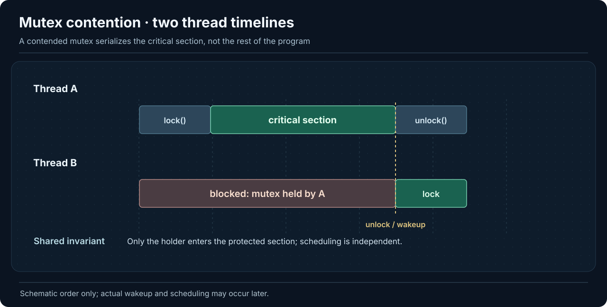

## 동시성의 문제는 실행 순서보다 불변식에 있다

스레드가 동시에 실행된다는 사실만으로 프로그램이 틀리지는 않는다. 문제는 **어떤 순서로 실행되더라도 지켜야 하는 공유 상태의 불변식**이 깨질 때 발생한다는 점이다. `counter++`조차 읽기, 계산, 저장 단계로 분해될 수 있다. 공유 데이터의 일관성을 유지하려면 어떤 작업을 원자적 단위로 취급할지 정의해야 한다.



## Process와 Thread의 공유 상태

| 자원 | 같은 프로세스의 thread | 일반적인 다른 process |
| --- | --- | --- |
| 주소 공간 | 공유 | 분리 |
| Heap·전역 변수 | 공유 | 독립 |
| Stack·register | 스레드별 별도 | 실행 단위별 별도 |
| File descriptor table | 스레드 그룹에서 공유 | 복제·상속 가능 |
| Scheduler task | 개별 스케줄 | 개별 스케줄 |

데이터 복사가 적어진 대신 동기화·캐시 일관성 비용이 생기므로 **thread가 모든 작업에서 process보다 빠른 것은 아니다**.

## Data race와 Race condition

Race condition은 결과가 실행 순서에 영향을 받는 상황을 넓게 가리킨다. Data race는 언어 메모리 모델에서 규정한 동기화 없이 같은 메모리 위치에 충돌하는 접근이 발생하는 상황이다.

두 스레드가 `counter=0`에서 시작한다고 생각해 보자.

1. A가 0을 읽는다.
2. B도 0을 읽는다.
3. A가 1을 저장한다.
4. B가 1을 저장한다.

두 번의 증가가 있었지만 결과는 1이다. 이 문제의 핵심은 **읽고 쓰는 동작이 묶이지 않았다**는 것이다.

## Mutex와 Critical Section

```c
#include <pthread.h>
static pthread_mutex_t lock = PTHREAD_MUTEX_INITIALIZER;
static long total = 0;

void add_one(void) {
    pthread_mutex_lock(&lock);
    total += 1;
    pthread_mutex_unlock(&lock);
}
```

Mutex는 `total`이라는 변수 이름보다 “한 번의 증가가 손실 없이 반영된다”는 **불변식**을 보호한다. 여러 변수가 함께 바뀌어야 한다면 전체 상태 변경이 올바르게 묶여야 한다.

### Mutex 사용 시의 질문

- 공유되는 변수와 구조체는 무엇인가?
- 같은 데이터를 lock 밖에서 접근하는 경로가 있는가?
- Lock을 잡은 채 I/O 등 블로킹 호출을 하는가?
- 여러 lock의 획득 순서가 일관되는가?
- 오류와 조기 반환 뒤에도 lock을 해제하는가?

## Semaphore와 Condition Variable

Semaphore는 자원 수 또는 사건 통지 등에 사용할 수 있고, Mutex와는 소유권 모델이 다르다. Condition variable은 특정 조건을 기다리도록 도와준다.

```c
pthread_mutex_lock(&lock);
while (!ready) {
    pthread_cond_wait(&cond, &lock);
}
consume_item();
pthread_mutex_unlock(&lock);
```

`pthread_cond_wait`는 기다리는 동안 Mutex를 놓고, 다시 깨어나면 Mutex를 획득한다. **깨어났다는 사실이 조건을 만족했다는 뜻은 아니다.** 다른 스레드의 경합과 spurious wakeup이 가능하므로 `while`로 다시 확인한다.

## Deadlock, Starvation, Livelock

| 문제 | 현상 | 중요한 증거 |
| --- | --- | --- |
| Deadlock | 서로의 자원을 기다리는 순환 | Lock 소유·대기 그래프 |
| Starvation | 특정 태스크가 지속적으로 기회를 얻지 못함 | Fairness와 진행 상태 |
| Livelock | 계속 상태가 바뀌지만 유의미한 진행 없음 | 재시도·충돌 패턴 |
| Priority inversion | 높은 우선순위가 낮은 우선순위의 lock에 대기 | Priority·owner |
| Data race | 잘못된 메모리 접근 경쟁 | Memory model, sanitizer |

A가 L1을 잡고 L2를 기다리고, B가 L2를 잡고 L1을 기다리는 경우 순환 대기 문제가 생길 수 있다. 이때는 lock 획득 순서를 통일하거나 전체 설계를 바꾸는 방식을 고려한다.

**스레드가 오래 멈췄다는 사실만으로 deadlock이 입증되는 것은 아니다.** I/O 대기나 일시적 자원 고갈일 수도 있다.

## Atomic과 Memory Ordering

`std::atomic`은 특정 연산의 원자성을 제공하지만 여러 변수를 수정하는 논리적 작업 전체를 자동으로 하나의 transaction으로 만들어 주지 않는다.

| Memory order | 의미 |
| --- | --- |
| Relaxed | 해당 atomic의 원자성을 제공하지만 다른 데이터의 공개 순서를 자동 보장하지 않음 |
| Release | 이전 쓰기가 적절한 acquire와 동기화될 수 있도록 함 |
| Acquire | 매칭된 release 이후 공유 데이터 관측 순서 제약 |
| Seq-cst | 강한 순차 일관성 순서 제약 |

컴파일러와 CPU가 메모리 접근을 재배치할 수 있으므로 **소스 순서가 모든 스레드에 같은 순서로 보일 것이라고 가정하면 안 된다**.

생산자가 일반 데이터를 완성하고 release flag를 게시하며, 소비자가 acquire로 확인하는 방식은 올바른 동기화 관계를 설계하는 예시다. 데이터의 수명, 중복 작성 및 다른 접근 경로도 안전하게 다뤄야 한다.

## False Sharing과 캐시 일관성

두 스레드가 서로 다른 변수만 수정해도 같은 cache line에 배치되어 있으면 cache coherence traffic이 늘어날 수 있다. 이를 false sharing이라고 한다.

False sharing은 data race가 없어도 발생할 수 있다. 따라서 thread 수를 늘렸는데 처리량이 감소했다면 **lock contention만 의심하지 말고 cache line placement와 memory locality**도 검토한다.

## 재현 실험 계획

| 실험 | 변경 변수 | 관측 대상 |
| --- | --- | --- |
| Counter race | Mutex 유무 | Expected/actual count |
| Producer-consumer | Queue size와 consumer 수 | 대기·throughput |
| False sharing | Cache line padding | CPU time |
| Lock contention | Thread 수 | Lock wait latency |
| Deadlock | Lock order | 진행 중단과 순환 관계 |

새 테스트 결과가 생기면 `labs/system-programming`에 실제 소스·컴파일러·CPU·반복 횟수·출력을 기록한다. **실행하지 않은 결과를 가상의 benchmark 표로 채우지 않는다.**

## 확인할 질문

1. Race condition과 data race는 어떤 차이가 있는가?
2. Mutex가 보호하는 것은 변수인가 불변식인가?
3. Condition variable에서 `while`로 확인하는 이유는?
4. Deadlock과 I/O wait를 구별할 증거는?
5. Relaxed atomic과 release/acquire는 어떻게 다른가?
6. False sharing이 없어도 성능이 낮을 수 있는가?

## 참고자료

- [POSIX thread synchronization](https://pubs.opengroup.org/onlinepubs/9799919799/)
- [C++ memory order](https://en.cppreference.com/w/cpp/atomic/memory_order)
- [OSTEP Concurrency](https://pages.cs.wisc.edu/~remzi/OSTEP/)
