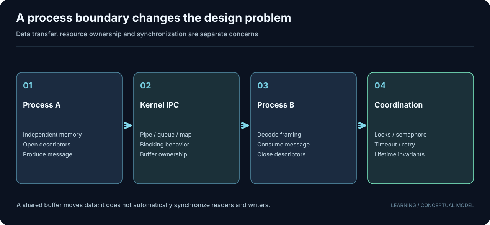

## 1. API 호출 뒤에 남는 상태

C/C++ 코드를 작성하다 보면 함수 호출만 생각하기 쉽다. 그러나 프로세스, 파일 디스크립터, 시스템 콜이 등장하는 순간 **운영체제가 관리하는 자원의 수명과 실행 순서**를 함께 고민해야 한다. 일반적인 함수 호출과 달리 POSIX API에서는 **누가 자원을 소유하고, 언제 블로킹되고, 실패 이후 무엇을 정리해야 하는가**가 중요하다.

프로세스·스레드, signal, pipe/FIFO, message queue, shared memory, mmap, socket, epoll을 **자원의 수명과 오류 처리**라는 관점에서 이어서 살펴본다. 아래 코드는 API의 동작과 실패 지점을 설명하기 위한 예제다.



## 2. User Space와 Kernel Space

C 라이브러리 함수와 system call은 구분해야 한다. 예를 들어 `printf()`는 stdio 버퍼링을 거칠 수 있고, `write()`는 파일 디스크립터를 이용해 커널에 I/O를 요청한다.

| 계층 | 역할 |
|---|---|
| Application | 비즈니스 로직 및 응용 프로토콜 |
| libc / runtime | 표준 API·버퍼링·system call wrapper |
| System-call interface | 사용자 모드에서 커널에 자원 작업 요청 |
| Kernel | 파일·메모리·프로세스·네트워크 관리 |
| Device / filesystem | 실제 I/O 또는 장치 연산 |

### 2.1 오류의 의미를 분리하기

`open()`이 실패했다고 해서 모든 오류를 동일하게 다루면 안 된다.

```c
#include <errno.h>
#include <fcntl.h>
#include <stdio.h>
#include <string.h>
#include <unistd.h>

int main(void) {
    int fd = open("example.txt", O_RDONLY);
    if (fd == -1) {
        fprintf(stderr, "open: %s\n", strerror(errno));
        return 1;
    }
    close(fd);
    return 0;
}
```

| 오류 | 의미 | 판단 |
|---|---|---|
| `ENOENT` | 경로를 찾지 못함 | 경로·생성 여부 확인 |
| `EACCES` | 접근 권한 없음 | 권한 모델 점검 |
| `EMFILE` | 프로세스의 FD 한도에 도달 | FD 누수 여부 확인 |
| `EINTR` | 시그널에 의해 작업이 중단될 수 있음 | 해당 API의 재시도 조건 검토 |

“그냥 재시도”는 권한이나 경로 오류를 해결하지 않는다.

## 3. Process: 프로그램과 실행 단위

실행 파일은 디스크 위의 데이터이고, 프로세스는 커널이 실행 상태·주소 공간·자원을 관리하는 단위다. 일반적인 프로세스에는 text, data, heap, stack, mmap 영역 등이 있다. 실제 배치는 ASLR과 아키텍처·런타임에 따라 달라진다.

### 3.1 `fork()`, `execve()`, `waitpid()`

`fork()`는 새 자식 프로세스를 만든다. `execve()`는 **현재 프로세스의 실행 이미지를 교체**하며 새로운 PID를 만드는 API가 아니다. `waitpid()`는 부모가 자식의 종료 상태를 수거하는 데 사용한다.

```c
#include <stdio.h>
#include <sys/types.h>
#include <sys/wait.h>
#include <unistd.h>

int main(void) {
    pid_t pid = fork();
    if (pid == -1) {
        perror("fork");
        return 1;
    }
    if (pid == 0) {
        execlp("echo", "echo", "child", (char *)NULL);
        perror("execlp");
        _exit(127);
    }
    int status;
    if (waitpid(pid, &status, 0) == -1) {
        perror("waitpid");
        return 1;
    }
    printf("child status=%d\n", status);
    return 0;
}
```

관찰할 점은 부모·자식의 `fork()` 반환값이 다르다는 것과, `exec`가 성공하면 **호출한 기존 프로그램으로 돌아오지 않는다는 것**이다.

프로세스 종료 이후 부모가 자식 상태를 수거하지 않으면 zombie가 남을 수 있다. 또 `fork()`로 물려받은 파일 디스크립터와 `FD_CLOEXEC` 설정은 새 실행 이미지에서도 중요한 문제가 된다.

## 4. File Descriptor: 파일, 파이프, 소켓의 공통 핸들

파일 디스크립터는 프로세스가 커널 자원에 접근하는 데 사용하는 **정수 핸들**이다. 작은 숫자 자체가 파일 객체는 아니다.

| 개념 | 설명 |
|---|---|
| File descriptor | 프로세스 내 FD 테이블의 번호 |
| Open file description | 파일 오프셋·상태 플래그 등이 있는 커널 객체 |
| Inode | 파일시스템의 파일 메타데이터 |
| Pathname | 파일 객체를 찾아가기 위한 경로 |
| `dup()` | 같은 open file description을 참조하는 새 FD |
| `fork()` 후 FD | 상속된 FD가 같은 open file description을 참조할 수 있음 |

따라서 `dup()`를 사용한 두 FD는 **동일한 파일 오프셋을 공유할 수 있다**. 반면 동일한 파일을 독립적으로 두 번 `open()`하면 일반적으로 서로 다른 open file description을 얻는다.

### 4.1 Pipe에서 EOF가 오지 않는 문제

Pipe의 읽는 측은 **모든 쓰기 측 FD가 닫혀야** EOF를 관찰할 수 있다. 부모가 사용하지 않는 쓰기 FD를 열어 두면 자식이 데이터를 다 보낸 후에도 읽기 측이 계속 대기할 수 있다.

이 문제는 코드를 잘못 작성한 스레드가 아니라 **FD 소유권과 수명**의 문제다.

## 5. Thread와 Synchronization

스레드는 같은 프로세스의 가상주소 공간을 공유한다. 그렇기 때문에 heap 등의 데이터 접근이 편하지만 race condition도 쉽게 발생한다. 스레드별 stack과 register context는 별도다.

### 5.1 Mutex는 무엇을 보호하는가

```c
#include <pthread.h>

static pthread_mutex_t mu = PTHREAD_MUTEX_INITIALIZER;
static long total = 0;

void increment(void) {
    pthread_mutex_lock(&mu);
    total += 1;
    pthread_mutex_unlock(&mu);
}
```

이 예제에서 보호하는 것은 “`total`을 안전하게 한 번 증가시킨다”라는 **불변식**이다. 락이 없다면 여러 스레드가 같은 이전 값을 읽고 서로의 변경을 덮어써서 갱신이 손실될 수 있다.

| 문제 | 원인 | 대응 질문 |
|---|---|---|
| Data race | 같은 메모리에 충돌 접근 | 무엇을 동기화해야 하는가 |
| Deadlock | 순환 대기 관계 | 락 순서가 일정한가 |
| Starvation | 실행·획득 기회 부족 | 공정성 보장이 필요한가 |
| Livelock | 동작은 하지만 진전 없음 | 재시도 패턴이 충돌하는가 |
| Priority inversion | 낮은 우선순위 소유자가 높은 우선순위를 지연 | 실시간 정책과 락의 상호작용은? |

동기화를 많이 하는 것보다 **공유 상태와 보호 범위를 정확히 정하는 것**이 먼저다.

## 6. Signal, Timer와 비동기 사건

Signal은 프로세스/스레드에 비동기 이벤트를 통지한다. signal handler는 일반 함수와 동일한 실행 제약을 갖지 않는다. 예를 들어 handler 내부에서 임의의 libc 함수를 호출해도 안전한 것은 아니므로 **async-signal-safe** 함수와 동기화·재진입 문제를 고려해야 한다.

블로킹 system call은 시그널에 의해 `EINTR`를 반환할 수 있다. 어떤 API가 자동 재시작되는지, 재시도 때 이미 진행된 부분이 있는지는 별도로 판단해야 한다.

Timer가 만료되는 시점과 사용자 콜백이 실제로 실행되는 시점도 같지 않을 수 있다. 커널 타이머와 scheduler의 역할이 다르기 때문이다.

## 7. IPC: Pipe, FIFO, Message Queue, Shared Memory

| 방식 | 데이터 모델 | 특징 | 주의점 |
|---|---|---|---|
| Pipe | 바이트 스트림 | 관련 프로세스 간 단순 연결 | FD 상속·EOF |
| FIFO | 바이트 스트림 | 파일시스템 이름이 있음 | open blocking |
| POSIX Message Queue | 메시지 단위 | 우선순위·큐 한도 | 송신과 처리 완료를 혼동 |
| System V IPC | 메시지/세마포어/공유 메모리 | 시스템 관리형 객체 | 권한 및 자원 정리 |
| Shared Memory | 공유 주소 공간 | 데이터 복사 절감 가능 | 동기화 필수 |
| Unix Domain Socket | 로컬 전송 | FD 전달 등의 기능 | 연결 및 권한 정책 |

**공유 메모리로 데이터를 전달하는 것**과 상대방이 **완성된 데이터만 읽게 하는 것**은 서로 다른 설계 문제다. lock, semaphore, condition variable 등을 어떻게 쓸지 정해야 한다.

### 7.1 `mmap()`의 의미

```c
#include <sys/mman.h>

void *ptr = mmap(NULL, 4096,
                 PROT_READ | PROT_WRITE,
                 MAP_PRIVATE | MAP_ANONYMOUS,
                 -1, 0);
if (ptr != MAP_FAILED) {
    // 실제 코드에서는 매핑된 영역 사용 및 오류 처리
    munmap(ptr, 4096);
}
```

`mmap()`은 가상주소 영역을 매핑한다. **즉시 모든 물리 페이지를 할당한다는 의미는 아니다.** 위의 `MAP_PRIVATE | MAP_ANONYMOUS`도 그 자체로 독립 프로세스 사이의 공유 메모리를 설정하는 예제는 아니다.

## 8. Socket: TCP와 UDP가 보장하는 것

### 8.1 TCP는 메시지가 아니라 바이트 스트림

한 번 `send()`한 100바이트가 수신 측의 `recv()` 호출 한 번에서 정확히 100바이트로 반환된다는 보장은 없다. TCP는 **순서 있는 바이트 스트림**을 제공하므로 애플리케이션이 프레이밍을 결정해야 한다.

예를 들어 헤더에 길이를 기록하는 프로토콜은 다음처럼 동작할 수 있다.

```text
[4-byte length][N-byte body]
```

서버는 헤더 전체가 도착할 때까지 모은 뒤, 명시된 길이만큼 body를 수신한다. 이때 `recv()`는 적은 바이트만 돌려줄 수 있으므로 반환값에 맞춰 누적해야 한다.

### 8.2 UDP는 데이터그램 단위

UDP는 데이터그램의 경계를 유지하지만, 손실·순서·재전송·중복 제거 등을 애플리케이션이 고려해야 할 수 있다. 따라서 신뢰성 있는 파일 전송을 만든다면 UDP 위에 직접 그 메커니즘을 설계하거나 목적에 맞는 상위 프로토콜을 선택해야 한다.

### 8.3 연결 종료와 오류

| 상황 | 잘못된 가정 | 확인할 점 |
|---|---|---|
| `recv()`가 0 반환 | “데이터가 잠깐 없음” | 상대의 orderly shutdown |
| `send()`가 양수 반환 | “전체 메시지 전송 완료” | 실제 반환된 바이트 수 |
| `EAGAIN` | “연결이 끊어짐” | nonblocking I/O의 준비 상태 |
| `EINTR` | “항상 치명적 오류” | 중단된 시스템 콜과 재시도 조건 |
| 클라이언트가 느림 | “언젠가는 처리됨” | 큐·버퍼 용량과 back-pressure |

## 9. `select`, `poll`, `epoll`: 여러 FD를 처리하는 방법

동시 연결이 많아지면 **연결마다 스레드 한 개**라는 설계의 비용이 커질 수 있다. I/O multiplexing은 여러 FD의 상태를 감시해 준비된 대상을 처리한다.

| 방법 | 방식 | 주의점 |
|---|---|---|
| Blocking I/O | 호출한 스레드가 대기 | 요청 수 증가 시 스레드 비용 |
| `select()` | FD 집합 검사 | FD 한도·집합 재설정 |
| `poll()` | FD 배열 검사 | 검사 비용 |
| `epoll()` | 등록된 FD의 준비 이벤트 확인 | ET/LT 의미 및 버퍼 소비 |

`epoll`이 있다고 모든 작업이 자동으로 nonblocking이 되는 것은 아니다. 특히 **Edge-triggered(ET)** 모델에서는 일반적으로 FD를 nonblocking으로 두고 읽을 수 있는 데이터를 `EAGAIN`까지 모두 처리하는 설계가 필요하다.

## 10. 코드로 다시 확인할 것

| 실험 | 검증할 내용 | 예상 실패 조건 |
|---|---|---|
| Parent-child pipe | FD close 후 EOF | 쓰기 FD를 닫지 않음 |
| pthread counter | race와 mutex 효과 | lock 누락 |
| shared-memory queue | 생산자/소비자 일관성 | 완료 상태 경쟁 |
| TCP echo server | partial read/write | 길이 처리 누락 |
| epoll server | LT·ET 차이 | 버퍼를 끝까지 읽지 않음 |
| signal + I/O | `EINTR` | 실패 코드 무시 |

실행한 결과와 오류 로그가 쌓이면 `labs/system-programming/`에 코드와 함께 남긴다.

## 11. 헷갈리기 쉬운 개념

| 혼동하기 쉬운 두 가지 | 구분 |
|---|---|
| `fork` / `execve` | 프로세스 생성 / 실행 이미지 교체 |
| FD / inode | 프로세스의 핸들 / 파일시스템 메타데이터 |
| Process / thread | 주소공간을 가진 자원 단위 / 실행 흐름 |
| Pipe / message queue | 바이트 스트림 / 메시지 단위 |
| Shared memory / synchronization | 공동 데이터 접근 / 접근 순서 조정 |
| TCP / UDP | 바이트 스트림 / 데이터그램 |
| Nonblocking / asynchronous completion | 바로 대기하지 않는 I/O / 완료 통지 모델 |
| Retry / idempotency | 작업을 반복함 / 반복해도 의도된 효과 유지 |

## 12. 남는 질문

시스템 프로그래밍에서는 API의 정상 경로만큼 **실패했을 때 무엇을 남기고 무엇을 회수해야 하는지**가 중요하다. 특히 FD, 메모리, 소켓처럼 다른 실행 흐름과 참조를 공유할 수 있는 자원은 닫는 시점까지 따져야 한다.

이 개념들은 나중에 컨테이너·비동기 워커·DB connection pool 같은 시스템의 장애를 이해하는 데도 이어졌다.

## 참고자료

- Linux System & Kernel Expert Course: POSIX and networking study
- [Linux man-pages](https://man7.org/linux/man-pages/)
- [POSIX.1-2024](https://pubs.opengroup.org/onlinepubs/9799919799/)
- [OSTEP: Concurrency](https://pages.cs.wisc.edu/~remzi/OSTEP/)
- [Linux 시스템 전체 학습 흐름](https://petooooo.github.io/notes/study-kdt-overview/)
