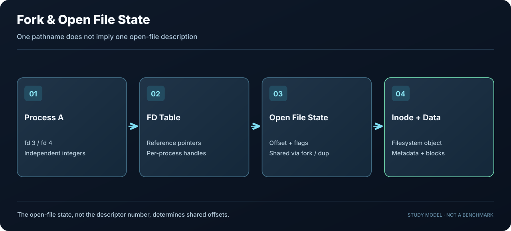

## 왜 프로세스 문제를 파일 디스크립터로 설명해야 할까?

프로세스를 **실행 중인 프로그램**이라고만 이해하면 `fork()` 이후 부모·자식이 파일의 읽기 위치를 공유하는 현상이 낯설다. 프로세스마다 FD 번호는 별개지만 그 번호가 가리키는 커널의 **open file description**을 공유할 수 있기 때문이다. 프로세스 생성, 표준 입출력 리다이렉션, pipe, socket, 종료 후 자원 정리도 이 관계로 설명할 수 있다.



## 실행 파일·프로세스·스레드

디스크의 ELF는 실행 이미지다. 프로세스는 주소 공간과 리소스, 자격증명 및 실행 상태를 가지는 커널 관리 단위다. Thread는 같은 프로세스 주소 공간에서 실행되는 흐름이며 스레드별 stack과 register 상태는 독립적이다.

| 작업 | PID 및 실행 이미지 | 공유되는 자원 |
| --- | --- | --- |
| `fork()` | 자식의 PID 새로 생성 | FD의 열린 파일 상태를 상속할 수 있음 |
| `execve()` | 같은 프로세스의 이미지 교체 | `FD_CLOEXEC`가 아닌 FD를 보존할 수 있음 |
| `waitpid()` | 자식의 종료 상태 회수 | 부모 주소 공간은 유지 |
| `_exit()` | 프로세스 종료 | 열려 있던 FD 참조 등 커널 자원 정리 |
| `pthread_create()` | 같은 프로세스의 thread 추가 | 주소 공간과 FD table 공유 |

**`execve()`는 새 프로세스를 생성하는 API가 아니다.** 성공한 경우 호출한 기존 코드의 다음 줄로 돌아오지 않는다.

## FD table, open file description, inode

파일 관련 구조를 다음과 같이 구분하면 이름 때문에 생기는 혼동이 줄어든다.

1. **FD table:** 프로세스 내부의 작은 정수 번호를 커널 파일 참조에 매핑한다.
2. **Open file description:** 현재 파일 오프셋·상태 플래그 등을 관리한다.
3. **Inode:** 파일시스템이 저장하는 파일의 메타데이터와 관련된다.
4. **Dentry:** 경로의 이름을 탐색·캐시하는 객체다.

`dup(fd)`는 대개 같은 open file description을 참조하는 새로운 FD를 만든다. 별개의 두 번의 `open()`은 같은 파일을 가리키더라도 다른 open file description을 만든다. 따라서 `lseek()`의 오프셋 공유 여부를 확인하면 이 차이가 명확해진다.

## C 코드로 확인하기: `fork()`와 오프셋 공유

아래는 학습용 코드다. 실제 실행 출력이라고 주장하는 값은 없다.

```c
#include <fcntl.h>
#include <stdio.h>
#include <sys/wait.h>
#include <unistd.h>

int main(void) {
    int fd = open("sample.txt", O_CREAT | O_TRUNC | O_RDWR, 0600);
    if (fd == -1) { perror("open"); return 1; }
    if (write(fd, "abcdef", 6) != 6) { perror("write"); return 1; }
    lseek(fd, 0, SEEK_SET);
    pid_t child = fork();
    if (child == -1) { perror("fork"); return 1; }
    if (child == 0) {
        char c;
        if (read(fd, &c, 1) != 1) _exit(2);
        _exit(0);
    }
    int status;
    if (waitpid(child, &status, 0) == -1) { perror("waitpid"); return 1; }
    printf("offset: %lld\n", (long long)lseek(fd, 0, SEEK_CUR));
    close(fd);
}
```

부모가 기다린 후 확인하는 오프셋은 자식이 사용한 열린 파일 상태의 영향을 받을 수 있다. `fork()` 이후 자식만 같은 경로를 다시 `open()`하도록 바꿔 비교하면 **경로와 open file description은 다른 개념**임을 관찰할 수 있다.

## Pipe에서 EOF가 오지 않는 이유

Pipe는 바이트 스트림이다. 읽는 쪽에 EOF가 전달되려면 **쓰기 끝을 참조하는 FD가 전부 닫혀야 한다.** 자식이 더 이상 기록하지 않아도 부모가 쓰기 FD를 남겨뒀다면 reader는 EOF를 볼 수 없다.

| 증상 | 의심할 원인 | 확인할 증거 |
| --- | --- | --- |
| `read()`가 끝나지 않음 | 아직 쓰기 FD가 열려 있음 | `/proc/PID/fd` |
| 데이터가 뒤섞임 | 여러 작성자의 write 경합 | `PIPE_BUF`, 기록 단위 |
| `EPIPE` / `SIGPIPE` | 읽는 끝이 전부 닫힘 | reader 종료·FD 수명 |
| 종료된 자식이 zombie | 부모가 종료 상태를 회수하지 않음 | `waitpid()` 여부 |

`pipe`를 만들면 부모·자식이 어떤 끝을 사용할지 먼저 정하고, **사용하지 않는 끝은 양쪽 모두에서 닫는 것**이 중요하다.

## 파일 디스크립터 상속은 보안 문제이기도 하다

외부 명령 실행 전 `dup2()`로 표준 출력을 바꾸는 경우가 있다. 하지만 원래 실행 프로그램이 열어 둔 비밀 파일·소켓·로그 FD가 의도치 않게 새 이미지로 전달되면 위험하다. `O_CLOEXEC` 또는 `FD_CLOEXEC`는 이런 자원 누출을 줄이는 데 도움이 된다.

파일 디스크립터의 수명은 참조가 모두 사라질 때까지 이어질 수 있다. 그래서 unlink한 파일이 여전히 디스크 공간을 점유하는 현상도 열린 파일 참조와 연결해 설명할 수 있다.

## 관측할 도구와 학습 과제

- `/proc/PID/fd`: 실제 FD 목록 확인
- `/proc/PID/fdinfo/N`: 열린 파일 상태 일부 확인
- `strace -f`: `fork`·`execve`·`close`와 read/write 호출 관찰
- `ps`: 자식 상태, 종료 및 zombie 확인
- `lsof`: 허용된 테스트 시스템에서 FD 참조 확인

| 실험 | 통제할 조건 | 성공 기준 |
| --- | --- | --- |
| `fork` 오프셋 공유 | 같은 열린 FD 상속 | 부모·자식의 위치 관계 설명 |
| 독립 `open` | 각 프로세스에서 별도 open | 오프셋 차이 확인 |
| Pipe EOF | 쓰기 FD 하나 남김 | EOF 지연 원인 파악 |
| `FD_CLOEXEC` | exec 전 FD flag 변경 | 자원 상속 여부 확인 |

## 핵심 정리와 복습 질문

**프로세스의 FD 번호와 커널의 파일 참조 상태는 같은 객체가 아니다.** 이 구분이 `fork`, `execve`, `dup`, pipe, unlink를 이해하는 출발점이다.

1. 두 프로세스가 모두 `fd=3`이라면 반드시 같은 파일인가?
2. `dup()`와 다시 `open()`하는 것은 파일 오프셋에서 어떤 차이가 있는가?
3. `execve()` 후 PID는 어떻게 되는가?
4. 자식이 종료됐는데 pipe reader에 EOF가 도착하지 않는 이유는?
5. FD를 닫으면 inode가 즉시 삭제된다고 말할 수 있는가?

## 참고자료

- [fork(2)](https://man7.org/linux/man-pages/man2/fork.2.html)
- [execve(2)](https://man7.org/linux/man-pages/man2/execve.2.html)
- [open(2)](https://man7.org/linux/man-pages/man2/open.2.html)
- [pipe(7)](https://man7.org/linux/man-pages/man7/pipe.7.html)
